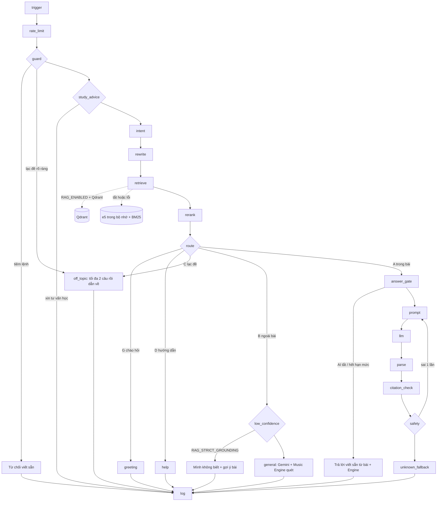

# Pipeline chatbot (G4, góp ý thầy T3)

Chatbot AI Tutor chạy như một quy trình kiểu n8n, viết thẳng trong code backend: mỗi bước là một **Node** (`backend/app/services/ai_pipeline.py`), khung chạy ở `backend/app/ai/pipeline/core.py`. Bộ chạy ghi thời gian từng bước vào `tool_calls.pipeline` của tin nhắn (không ghi nội dung câu hỏi). Giao diện chat và định dạng trả về không đổi.

## Các bước

| Node | Việc làm | Ghi chú |
|---|---|---|
| `trigger` | Chuẩn hóa khoảng trắng, đặt câu hỏi vào ngữ cảnh | |
| `rate_limit` | Cửa sổ trượt 60 giây theo người dùng, quá `CHAT_RATE_LIMIT_PER_MIN` (mặc định 20) thì 429 `AI_RATE_LIMITED` + `Retry-After`; tin bị chặn không lưu | Đếm trong bộ nhớ từng tiến trình; hạn mức ngày vẫn ở cơ sở dữ liệu |
| `guard` | Chặn tiêm lệnh (`injection.py`); nhận lạc đề rõ ràng sớm (nhãn ngoài phạm vi chắc chắn, không dữ kiện Engine, không từ khóa âm nhạc) | Lạc đề rõ ràng đi thẳng tới `off_topic`, không tốn truy xuất |
| `study_advice` | "Mình nên học bài nào tiếp?" trả lời bằng hệ gợi ý | RS-27 |
| `intent` | Ý định cục bộ (`intent.py`), ghi vào nhật ký | |
| `rewrite` | Câu hỏi nối tiếp ngắn ("còn Dm7 thì sao?") được nối với câu người học hỏi trước, **chỉ để truy xuất** | Bộ định tuyến vẫn xét câu gốc |
| `retrieve` | `RAG_ENABLED=1`: hỏi Qdrant (top `RAG_RERANK_POOL`=12, lọc theo `RAG_SOURCES`, mặc định `lessons`). Qdrant chưa nạp, sai chiều hoặc lỗi: lùi về đường cũ và ghi lý do | Điểm là cosine e5 như đường cũ nên ngưỡng định tuyến giữ nguyên |
| `rerank` | Xếp lại theo điểm vector + `RAG_RERANK_WEIGHT`=0,15 × độ trùng từ, bỏ trùng đoạn, cắt còn `RAG_TOP_K` | Giữ nguyên điểm vector của từng đoạn; chỉ chạy khi nguồn là Qdrant |
| `route` | Bộ luật A/B/C/D/G của ADR-017/020 (nhãn tầng 1 + điểm truy xuất + Music Engine) | Không đổi |
| `greeting`, `help` | Câu viết sẵn / mục hướng dẫn | Không gọi AI |
| `off_topic` | Lạc đề: Gemini trả lời **tối đa 2 câu** (máy chủ tự cắt, tối đa 280 ký tự) rồi nối câu dẫn về nhạc lý. AI tắt, hết hạn mức, lỗi, nhóm cấm (bản quyền, tải lậu, mua bán, tấn công) hoặc `OFFTOPIC_MODE=refuse`: dùng câu từ chối cũ | Khác ADR-020 trước đây (chỉ từ chối) theo chốt của Phúc 14/11 |
| `low_confidence` | `RAG_STRICT_GROUNDING=1`: câu nhạc lý mà kho không đủ tin cậy thì "mình không biết" + gợi ý bài, không gọi Gemini | Mặc định tắt để giữ ADR-020 |
| `general` | Luồng B: Gemini trả lời kiến thức chung có nhãn, Music Engine quét mọi nốt/hợp âm | |
| `answer_gate` | Luồng A: AI tắt hoặc hết ngân sách thì trả lời viết sẵn; hết hạn mức ngày thì 429 | |
| `prompt` → `llm` → `parse` | Dựng prompt (lệnh tách khỏi dữ liệu), gọi Gemini/FakeProvider, đọc JSON | |
| `citation_check` | Máy chủ đối chiếu từng trích dẫn với các đoạn đã truy xuất; trích dẫn lạ bị loại | |
| `safety` | Music Engine kiểm khẳng định nhạc lý, chuỗi canh gác kiểm lộ lệnh; sai thì quay lại `prompt` đúng 1 lần, vẫn sai thì dùng câu dự phòng | |
| `unknown_fallback` | AI tự nói "không biết" mà không trích được đoạn nào: hỏi lại theo kiến thức chung (trừ khi bật strict) | |
| `log` | Ghi vết các bước, tổng độ trễ, token, chi phí ước tính (`AI_PRICE_IN_PER_M`, `AI_PRICE_OUT_PER_M`) | Luôn chạy, kể cả khi kết thúc sớm; không ghi nội dung câu hỏi |

## Cờ cấu hình (đều ghi đè bằng biến môi trường, xem `.env.example`)

`RAG_ENABLED`, `RAG_SOURCES`, `RAG_RERANK_WEIGHT`, `RAG_RERANK_POOL`, `CHAT_RATE_LIMIT_PER_MIN`, `OFFTOPIC_MODE` (`brief`|`refuse`), `OFFTOPIC_MAX_SENTENCES`, `RAG_STRICT_GROUNDING`, `AI_PRICE_IN_PER_M`, `AI_PRICE_OUT_PER_M`; Qdrant: `QDRANT_URL`, `QDRANT_COLLECTION`. Định nghĩa tập trung ở `backend/app/core/ai_config.py`.

Gemini chỉ dùng qua `.env` (`GEMINI_API_KEY`, `AI_ENABLED=1`). Không có khóa thì `FakeProvider` (test) hoặc câu trả lời viết sẵn.
