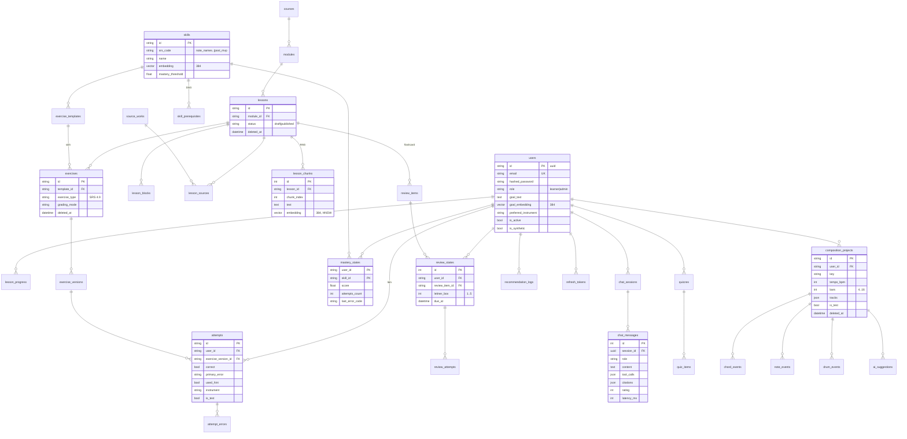

# Giai đoạn A · Ổn định nền và kế hoạch

Ngày 18/10/2026. Nền: code `v0.4.0-dev` + tài liệu CP1 (commit `8269753`). Giai đoạn này **không viết tính năng mới**; nó chốt hiện trạng, các mâu thuẫn và lịch cho Giai đoạn B–F.

Phân công đã chốt: **Thắng** Backend/Engine · **Phúc** Frontend/Audio · **Đạt** AI/NLP/DevOps.

## 0. Hiện trạng đã chạy thật

| Kiểm tra | Lệnh | Kết quả |
|---|---|---|
| Backend test | `cd backend && pip install -r requirements.txt && pytest -q` | **167 passed** (có `music21`; gồm 9 test CP1 mới) |
| Frontend build | `cd frontend && npm ci && npm run build` | **Đạt** (Node 22, Vite 6, 36 module, JS 173 kB). Lần đầu tiên bản v0.4.0 được xác nhận build được |
| Docker | — | **Chưa chạy**: compose hiện chỉ có `postgres:16`, chưa có api/web/redis |

Bảng truy vết đầy đủ 192 FR: [`PHASE_A_TRUY_VET_FR.md`](PHASE_A_TRUY_VET_FR.md). Tóm tắt:

| Ưu tiên | Có | Một phần | Lệch | Thiếu |
|---|---|---|---|---|
| P0 (103 FR) | 13 | 11 | 1 | 78 |
| P1 (68 FR) | 1 | 9 | 1 | 57 |

Đọc bảng này như sau: phần **Music Engine + chấm bài + học L01–L04** đã chắc (gần hết các dòng "Có" nằm ở FR-EX, FR-ERR, FR-LRN-04/05). Gần như mọi thứ khác (đăng nhập, gợi ý, AI, âm thanh, sáng tác, admin) chưa bắt đầu.

## 1. Mâu thuẫn và cách giải

### Đã chốt (nhóm xác nhận 18/10)

| Mã | Mâu thuẫn | Cách giải | Giai đoạn |
|---|---|---|---|
| N1 | 26 kỹ năng / 8 bài (có jazz) ≠ 10 kỹ năng SRS 4.3 | Ánh xạ ở mục 1.1; kỹ năng ngoài MVP gắn `post_mvp`, L05–L08 giữ dạng đặc tả, không vào gợi ý | C |
| N2 | Lịch ôn 1–3–7–14–30 ngày (nhảy 2 hộp khi đúng) | Leitner 5 hộp 1–2–4–8–16, đúng lên 1 hộp, sai về hộp 1, hàng đợi ≤ 20 thẻ. [ADR-002](decisions/ADR-002-leitner.md) | C |
| N3 | API nhận `user_id` từ client (mặc định `demo-user`) | Bỏ khỏi body/query, lấy từ JWT; tài nguyên người khác → 404 | B |
| N4 | 15 bảng ≠ SRS 8.2 | Giữ bảng hiện có, thêm migration cộng thêm. [ADR-001](decisions/ADR-001-anh-xa-csdl.md) | B, C |
| N5 | Nội dung là Python (`curriculum_specs.py`) | Chuyển nguồn sự thật sang `content/*.yaml` + `*.md`, importer idempotent, giữ provenance | C |
| N6 | "Không tạo mastery giả" ≠ SRS 4.6 | Làm EMA đúng SRS (α 0.3; 1.0 / 0.5 / 0.0; yếu < 0.60 với ≥ 5 lượt; thành thạo ≥ 0.80) | C |
| N7 | Tài liệu cũ dự kiến VexFlow, Web MIDI | Không thêm trong MVP; chỉ Tone.js | C |
| N8 | Thư mục `api/ services/ …` ≠ SRS 10.4 | Module mới theo SRS 10.4; code cũ chuyển dần khi chạm vào | B–F |
| N9 | Đóng gói: build chưa xác nhận, thiếu `.env.example` gốc | Build đã xác nhận ở Giai đoạn A; `.env.example` đủ biến SRS 10.3 làm ở B | A, B |

### Mâu thuẫn mới phát hiện ở Giai đoạn A (đề xuất, chờ nhóm duyệt)

| Mã | Phát hiện | Đề xuất | Ai quyết |
|---|---|---|---|
| N10 | **Khối lượng nội dung.** SRS 4.3 yêu cầu tới **03/11**: 1 khóa, 4 module, ≥ 12 bài, ≥ 8 mẫu bài tập, ≥ 60 flashcard. Hiện có 4 bài chạy thật, 0 mẫu bài tập, 32 thẻ ôn đang chạy | Đây là rủi ro số 1 (xem mục 6). Bắt đầu soạn nội dung ngay tuần này, song song với code | Cả nhóm |
| N11 | Loại bài (`kind`: mcq/build/…) ≠ 8 loại SRS 4.9; `grading_service` không truyền `grading_mode`, `root_position_only` (phát hiện ở CP1) | Thêm cột `exercise_type` theo SRS 4.9 và truyền cấu hình chấm xuống Engine | Thắng (C) |
| N12 | CP1 G1/G3/G5: hợp âm gạch chéo chưa kiểm bass; bí danh mặc định "extended"; bài quãng nhận đáp án thiếu quãng tám | Trình bày ở CP1 như "hạn chế đã biết". Sau CP1: sửa G1 (mã `WRONG_BASS`, ADR); giữ G3, G5 và ghi vào SRS | Thắng |
| N13 | Khóa chính đang là chuỗi (`"L01"`, `"demo-user"`); SRS 8.2 ghi `id (PK)` | Giữ chuỗi; người dùng mới dùng UUID. Ghi trong ADR-001 | Thắng |
| N14 | Chuỗi phiên bản lệch nhau: Engine `0.2.0-dev`, `backend/.env.example` `0.3.1-dev`, app `0.4.0-dev` | Giữ Engine 0.2.0 (Engine không đổi); sửa `.env.example` khi làm B | Đạt (B) |
| N15 | SRS 10.2: database `harmony`, web cổng `5173:80`; compose hiện tại `harmonymentor`, chỉ có db | Theo SRS 10.2 khi viết compose mới | Đạt (B) |

### 1.1 Ánh xạ kỹ năng (N1)

| # | Kỹ năng SRS 4.3 | Kỹ năng trong code | Bài hiện có | Cần soạn thêm |
|---|---|---|---|---|
| 1 | note_names | (chưa có riêng) | — | 1 bài mới |
| 2 | accidentals | `pitch.spelling` | L01 | Tách thành bài riêng |
| 3 | intervals | `interval.naming` | L01 | Tách thành bài riêng |
| 4 | major_scales | `scale.major` | L02 | — |
| 5 | minor_scales | (`scale.parallel_minor` ở L06, chưa chạy) | — | 1 bài mới |
| 6 | triads | `chord.triad_formula`, `chord.triad_build` | L01 | Tách thành bài riêng |
| 7 | seventh_chords | `chord.seventh_quality`, `chord.seventh_build` | L02 | — |
| 8 | diatonic_chords | `roman.major_seventh` | L02 | 1 bài hợp âm ba theo bậc |
| 9 | progressions | `function.*`, `progression.ii_v_i` | L03, L04 | — |
| 10 | rhythm_basics | (chưa có) | — | 1–2 bài mới |
| — | post_mvp | `voicing.*`, `harmony.secondary_dominant.*`, `harmony.modal_interchange.*`, `tension.naming`, `mode.basic`, `chord_scale.*` | L05–L08 (đặc tả) | Không làm trong MVP |

Đề xuất khung 12 bài trong 4 module: **M1 Cao độ** (note_names, accidentals, intervals) · **M2 Âm giai** (major_scales, minor_scales) · **M3 Hợp âm** (triads, seventh_chords, diatonic_chords ×2) · **M4 Vòng hợp âm và tiết tấu** (chức năng T–PD–D, ii–V–I, rhythm_basics). L01–L04 hiện có được tách và chuyển vào các bài này, giữ nguyên câu hỏi đã audit và nguồn.

## 2. ERD vật lý (đích sau Giai đoạn F)

Bảng **in đậm tên** là đã có trong code (giữ tên); các bảng khác thêm mới. Chi tiết ánh xạ ở [ADR-001](decisions/ADR-001-anh-xa-csdl.md).



Redis (không phải bảng): `chat:{session_id}` (6 tin, TTL 24 h), `rl:ai:{user_id}:{date}`, `rl:login:{ip}`.

## 3. Sơ đồ route frontend

| Route | Màn hình | Đăng nhập | FR | Giai đoạn |
|---|---|---|---|---|
| `/` | Trang chủ công khai, giới thiệu, chương trình học | Không | VIS-01..04 | B |
| `/dang-ky`, `/dang-nhap` | Đăng ký, đăng nhập | Không | VIS-05/06, AUTH-01/02 | B |
| `/app` | Dashboard người học | Có | LRN-11, MAS-05 | B (khung), C |
| `/app/hoc` | Lộ trình: khóa → module → bài | Có | LRN-01..03 | C |
| `/app/hoc/:lessonId` | Bài học (LessonRunner) | Có | LRN-04/05 | C |
| `/app/luyen-tap` và `/app/luyen-tap/:templateId` | Luyện tập theo mẫu bài | Có | EX-01..15 | C |
| `/app/on-tap` | Flashcard Leitner | Có | FL-01..07 | C |
| `/app/tien-do` | Mastery theo kỹ năng, lịch sử | Có | MAS, LRN-08, ERR-02 | C |
| `/app/muc-tieu` | Nhập mục tiêu, xem bài gợi ý | Có | AUTH-08, REC-01..03 | D |
| `/app/tutor` và `/app/tutor/:sessionId` | AI Tutor | Có | AI-01..21 | E |
| `/app/composition` và `/app/composition/:projectId` | Composition Lab | Có (desktop) | COM, COM-AI | F |
| `/app/ho-so` | Hồ sơ, nhạc cụ ưa thích | Có | AUTH-06/07/10 | B |
| `/admin/*` | Người dùng, nội dung, nhập YAML, cấu hình AI | Admin | ADM | F |

Mọi route `/app/*` qua `RequireAuth` (chưa đăng nhập → `/dang-nhap?next=…`, FR-VIS-07); `/admin/*` qua `RequireAdmin`. Tách bundle theo route; Tone.js chỉ tải ở bài học, luyện tập, Composition Lab.

## 4. Hệ thống thiết kế đề xuất

**Nguyên tắc.** Học sinh mới học nhạc lý, nên giao diện bình tĩnh, ít chữ, đúng/sai rõ ràng, nhạc cụ là trung tâm. Không truyền thông tin chỉ bằng màu (luôn có biểu tượng hoặc chữ).

| Token | Sáng | Tối | Dùng cho |
|---|---|---|---|
| `bg` | `#FAFAF7` | `#14161A` | Nền trang |
| `surface` | `#FFFFFF` | `#1C1F25` | Thẻ, panel |
| `ink` | `#1F2328` | `#E8E6E1` | Chữ chính |
| `muted` | `#5B616B` | `#A3A8B0` | Chữ phụ |
| `primary` | `#3B5BDB` | `#748FFC` | Nút chính, link, phím đang chọn |
| `success` | `#2B8A3E` | `#69DB7C` | Đúng (kèm ✓) |
| `danger` | `#C92A2A` | `#FF8787` | Sai (kèm ✗) |
| `warning` | `#E67700` | `#FFC078` | Cảnh báo vòng hợp âm, sắp hết hạn mức |
| `accent` | `#7048E8` | `#B197FC` | AI Tutor, gợi ý |

- **Chữ:** Be Vietnam Pro (giao diện, hỗ trợ tiếng Việt tốt), JetBrains Mono (ký hiệu hợp âm, tên nốt). Cỡ: 14 / 16 (thân) / 20 / 24 / 32. Tên nốt luôn dùng ký hiệu chuẩn (`E♭4`, hiển thị ♭ ♯ thay cho b #).
- **Khoảng cách:** thang 4 px (4, 8, 12, 16, 24, 32, 48). Bo góc 8 px (thẻ), 999 px (chip hợp âm).
- **Component cơ bản:** Button (primary/secondary/ghost), Card, Chip hợp âm (bấm để xem ChordInspector), FeedbackPanel (đúng/sai + mã lỗi + đáp án + Thử lại/Gợi ý/Hỏi Tutor + mastery cũ → mới), Piano, Guitar, DrumGrid, Skeleton, EmptyState, ErrorState (có nút Thử lại), ProgressRing (mastery).
- **Tương phản:** mọi cặp chữ/nền ở trên đạt WCAG AA; focus ring 2 px màu `primary`.

### Wireframe 6 màn hình

**1. Trang chủ (`/`)**
```
+------------------------------------------------------------+
| HarmonyMentor            Chương trình  Tính năng  [Đăng nhập]|
+------------------------------------------------------------+
|  Hiểu nhạc lý bằng cách chơi nó.                            |
|  Học → Luyện tập → Chẩn đoán → Sáng tác, có AI Tutor.       |
|  [ Bắt đầu miễn phí ]   [ Xem chương trình ]                |
|  [ piano mini: bấm thử C E G ♪ ]                            |
+------------------------------------------------------------+
| M1 Cao độ | M2 Âm giai | M3 Hợp âm | M4 Vòng hợp âm & nhịp  |
+------------------------------------------------------------+
| Luyện tập có chẩn đoán | AI Tutor có trích dẫn | Comp. Lab  |
+------------------------------------------------------------+
```

**2. Dashboard (`/app`)**
```
+-----------+------------------------------------------------+
| Tổng quan | Chào Phúc · Mục tiêu: "đệm hát pop bằng guitar"|
| Học       +------------------------+-----------------------+
| Luyện tập | Gợi ý cho bạn (3–5)    | Thẻ đến hạn: 7        |
| Ôn tập    | 1. Hợp âm thuận giọng  |   [ Ôn ngay ]         |
| Tiến độ   |    vì: khớp mục tiêu…  +-----------------------+
| Tutor     | 2. Hợp âm bảy          | Kỹ năng yếu           |
| Comp. Lab |    vì: tiên quyết đủ…  |  seventh_chords 0.42  |
| Hồ sơ     +------------------------+  intervals      0.55  |
|           | Học tiếp: Bài 7 (60%)  [ Tiếp tục ]            |
|           | Sáng tác gần đây: "Pop loop 1" (4 ô nhịp)      |
+-----------+------------------------------------------------+
```

**3. Bài học (`/app/hoc/:id`)**
```
+------------------------------------------------------------+
| ← M3 Hợp âm · Bài 7: Hợp âm bảy           ███████░░░ 70%   |
+------------------------------------------------------------+
| Mục tiêu: dựng Maj7, 7, m7, m7b5                           |
| [Lý thuyết] Hợp âm bảy = hợp âm ba + quãng 7 …             |
| [Ví dụ] (Cmaj7) (C7) (Cm7)  ← chip bấm được, nghe ♪        |
| [Piano] tô sáng C E G B                                    |
| [Checkpoint] Dựng G7: [________] [Nộp]                     |
| … [ Làm quiz cuối bài ]  [ Hoàn thành ] (khóa đến khi đủ)  |
| Nguồn tham khảo ▸                                          |
+------------------------------------------------------------+
```

**4. Bài tập + phản hồi (`/app/luyen-tap/:id`)**
```
+------------------------------------------------------------+
| Dựng hợp âm  G7            chế độ: đúng tên nốt (strict)   |
|  [ piano: bấm phím ]  hoặc gõ: [G B D F#___] [Nộp]         |
+------------------------------------------------------------+
| ✗ Chưa đúng                                                 |
| Chẩn đoán: Bạn dùng quãng 7 trưởng thay vì quãng 7 thứ.    |
| Đáp án: G B D F     (phím F# tô đỏ, F tô xanh)             |
| Mastery seventh_chords: 0.65 → 0.455                       |
| [ Thử lại ]  [ Gợi ý ]  [ Hỏi Tutor về lỗi này ]  [ Tiếp ]  |
+------------------------------------------------------------+
```

**5. AI Tutor (`/app/tutor/:id`)**
```
+--------------+---------------------------------------------+
| Phiên chat   | Bạn: Ebm7b5 gồm những nốt nào?              |
| + Phiên mới  | Tutor: Eb · Gb · Bbb · Db  (từ Music Engine)|
| Hợp âm bảy…  |   Quãng 5 giảm từ Eb là Bbb, không phải A.  |
| Lỗi G7…      |   [Lesson: Seventh Chords]   ☆☆☆☆☆          |
|              | ------------------------------------------- |
| Còn 24/30    | [ Hỏi về nhạc lý…                ] [Gửi]   |
| câu hôm nay  | AI tắt? → "Tutor tạm nghỉ, xem giải thích…" |
+--------------+---------------------------------------------+
```

**6. Composition Lab (`/app/composition/:id`, desktop)**
```
+------------------------------------------------------------+
| "Pop loop 1"  Giọng C  ♩=90  4/4  8 ô nhịp   [Lưu] [▶][■][⟲]|
+------------------------------------------------------------+
| Hợp âm | C      | G      | Am     | F      | + |  ⚠ gợi ý  |
| Giai   | ▪ ▪  ▪ | ▪   ▪  |  ▪ ▪   | ▪      |   lưới móc |
| điệu   | (2 quãng tám, lưới móc đơn)                      |
| Trống  | K . . . S . . . K . K . S . . .  (16 bước)       |
+------------------------------------------------------------+
| [Tắt giai điệu] [Tắt hòa âm] [Metronome] [Đếm vào]         |
| AI gợi ý hợp âm tiếp: [ Em ] ▶ nghe thử  [Chấp nhận][Từ chối]|
+------------------------------------------------------------+
```

## 5. Kế hoạch Giai đoạn B–F

Hôm nay Chủ nhật 18/10. CP1 thứ Ba 20/10, CP2 thứ Ba 03/11, CP3 thứ Ba 10/11, nộp thứ Sáu 04/12. Mỗi ô là việc chính của người đó trong khoảng ngày; mỗi giai đoạn kết thúc bằng báo cáo và nhóm duyệt trước khi gộp vào `main`.

| Giai đoạn | Ngày | Thắng (Backend/Engine) | Phúc (Frontend/Audio) | Đạt (AI/NLP/DevOps) | Mốc |
|---|---|---|---|---|---|
| **A** kế hoạch | 18–19/10 | Đọc kế hoạch, chốt N10–N15 | Đọc thiết kế, wireframe | Đọc kế hoạch | Gộp PR Giai đoạn A |
| CP1 | 19–20/10 | Trình bày Engine | Slide | Chạy demo | **CP1 20/10** |
| **B** nền tảng | 21–26/10 | Auth JWT + bcrypt + vai trò, migration bảng users/refresh, bỏ `user_id` từ client (N3), test 403/404 | Tailwind, React Router, TanStack Query, trang chủ, đăng ký/đăng nhập, layout, đổi tên Composition Lab | Docker Compose 4 service, `.env.example`, Redis + khóa đăng nhập 5 lần/15 phút, middleware `X-Response-Time` + log + lỗi chuẩn 7.4 | Đăng nhập chạy trong Docker |
| **C** học/luyện tập | 24/10–07/11 | Leitner (N2), mastery EMA (N6), `exercise_templates` + `exercise_type` (N11), hint, importer YAML (N5) | LessonRunner theo module, Tone.js + piano bấm được (M4), FeedbackPanel, Ôn tập, Tiến độ | Soạn nội dung cùng cả nhóm (N10) | **12 bài, 8 mẫu, 60 thẻ vào 02/11** |
| **D** gợi ý (song song C) | 21/10–02/11 | Bảng `mastery_states`, `recommendation_logs` | Trang mục tiêu + thẻ gợi ý | Embedding local, `simulate_learners.py` (2.000, 4 persona), 3 tầng gợi ý, `evaluate_recommender.py` | **CP2 03/11: bảng HitRate@5/Precision@5** |
| **E** AI Tutor | 03–10/11 | API chat, Redis 6 tin, hạn mức 30/ngày, rating | Giao diện chat, nút "Hỏi Tutor về lỗi này" | Provider Gemini + Fake, function calling, RAG (chunk 300 từ, top-4, ngưỡng 0.35, trích dẫn), red-team 10 câu, bộ đánh giá 50 câu | **CP3 10/11: trả lời có `[Lesson: …]`** |
| **F1** nhạc cụ + sáng tác | 11–17/11 | CRUD dự án, kiểm vòng hợp âm, gợi ý hợp âm theo luật | Composition Lab, guitar, lưới trống 16 bước | AI gợi ý hợp âm + kiểm chứng | Sáng tác lưu/tải, đổi BPM giữ phách |
| **F2** admin + kiểm thử | 18–24/11 | Admin CRUD, nhập YAML từ admin, test SRS 6.14 | Playwright E2E, hoàn thiện UI | Sinh quiz (Engine + LLM), bảng p95 | Mọi dòng SRS 6.14 có test |
| **F3** dự phòng + nộp | 25/11–04/12 | Sửa lỗi, đóng băng code 01/12 | Kiểm thử với người học thật | README máy sạch, kịch bản demo 10 phút, video dự phòng, báo cáo | **Nộp 04/12** |

Vì sao C và D chạy song song: CP2 chấm hệ gợi ý, không chấm giao diện học. Đạt dùng dữ liệu mô phỏng nên không phải chờ mastery thật; khi Thắng xong mastery (khoảng 30/10) thì nối vào.

## 6. Rủi ro lớn nhất và phương án cắt giảm

| # | Rủi ro | Dấu hiệu sớm | Phòng ngừa | Cắt giảm nếu trễ |
|---|---|---|---|---|
| R1 | **Thiếu nội dung** (N10): 12 bài / 60 thẻ vào 02/11 trong khi đang có 4 bài | 28/10 chưa có 8 bài YAML | Mỗi người soạn 1 bài/2 ngày từ 21/10; Claude sinh nháp, người kiểm nhạc lý bằng Engine | Giảm còn 10 bài (1 bài/kỹ năng) |
| R2 | Giai đoạn B trễ làm tắc C, D, E (mọi API cần đăng nhập) | 24/10 chưa có JWT | Thắng làm auth trước tiên; tạm có dependency `get_current_user` trả user demo khi `AUTH_DISABLED=1` chỉ trong test | Bỏ refresh token xoay vòng, giữ access 30 phút |
| R3 | CP2 chỉ số gợi ý không vượt baseline | 31/10 chạy thử thua baseline | Persona khác biệt rõ; chỉnh trọng số trong file cấu hình | Báo cáo trung thực + phân tích vì sao |
| R4 | Gemini hết hạn mức/mạng yếu khi demo CP3 | Lỗi 429 khi thử | `FakeProvider`, `AI_ENABLED=false`, quay video dự phòng | Demo bằng chế độ tắt AI + video |
| R5 | Image Docker nặng do model embedding (~1–2 GB) | Build > 10 phút | Tải model một lần vào layer riêng | Cho phép tải model lần đầu chạy |
| R6 | Claude viết code nhóm không giải thích được | Không trả lời được câu hỏi ở buổi kiểm tra | Mỗi giai đoạn có mục "Giải thích cho nhóm"; người phụ trách đọc lại diff trước khi gộp | — |

Danh sách cắt (theo thứ tự cắt trước): FR-COM-AI-02..09 (P2) → guitar làm cách trả lời bài tập (giữ hiển thị) → FR-COM-31 đếm vào → quiz bằng LLM (giữ quiz bằng Engine) → admin quản lý module/khóa (giữ nhập YAML) → FR-AI-17 đánh giá câu trả lời.

## 7. Việc nhóm cần quyết trước khi sang Giai đoạn B

1. Duyệt N10–N15 (đặc biệt N10: ai soạn bài nào).
2. Duyệt khung 12 bài ở mục 1.1.
3. Duyệt bảng màu và wireframe (Phúc).
4. Xác nhận lịch mục 5; nếu ai bận ngày nào thì đổi ô tương ứng.
