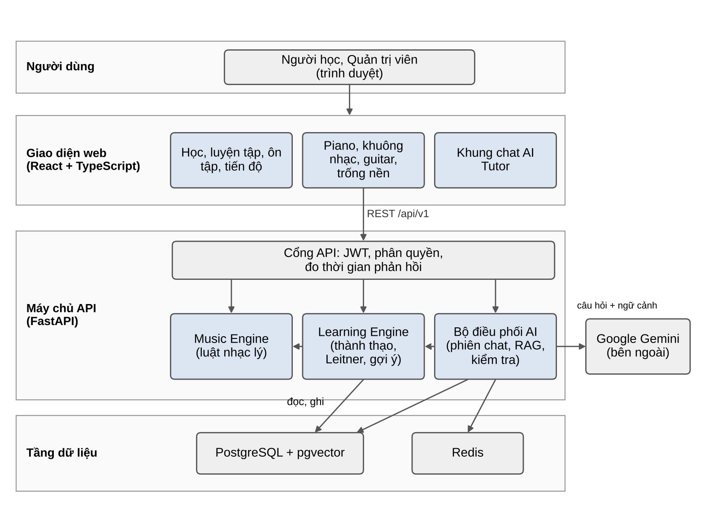

**ĐỒ ÁN CUỐI KHÓA (CAPSTONE PROJECT)**

*Nhóm HarmonyMentor • Bộ tài liệu dự án*

━━━━━━━━━━━━━━━━━━━━━━━━━━━━━━━━━━━━━━━━

**ĐẶC TẢ YÊU CẦU PHẦN MỀM**  
**(SOFTWARE REQUIREMENTS SPECIFICATION – SRS)**

Tài liệu SRS của đồ án cuối khóa • Phiên bản 2.1

<table>
<colgroup>
<col style="width: 100%" />
</colgroup>
<tbody>
<tr class="odd">
<td>
<strong>HARMONYMENTOR AI</strong> 
<strong>NỀN TẢNG HỌC NHẠC LÝ THÍCH ỨNG CÓ TRỢ LÝ AI</strong>

<em>(Adaptive Music Theory Learning, Hybrid Lesson Recommender &amp; Stateful AI Tutor)</em>

Hệ thống web giúp người mới học nhạc lý luyện tập có chẩn đoán lỗi, nhận gợi ý bài học theo mục tiêu và hỏi đáp với trợ lý AI có trích dẫn bài học.
</td>
</tr>
</tbody>
</table>

|                          |                                                                                               |
|--------------------------|-----------------------------------------------------------------------------------------------|
| **Chuyên mục:**          | Hệ thống gợi ý (Recommender System) • Trợ lý hội thoại (Chatbot) • Backend API                |
| **Môn học tích hợp:**    | Python • AI Fundamental • NLP • FastAPI • Docker                                              |
| **Đề tài gốc:**          | Đề tài 03 – Trợ lý học tập thông minh và hệ thống gợi ý cá nhân hóa, áp dụng cho môn nhạc lý  |
| **Nhóm thực hiện:**      | Thắng (trưởng nhóm kỹ thuật) • Phúc (giao diện, âm thanh) • Đạt (nội dung, kiểm thử, báo cáo) |
| **Thời gian thực hiện:** | 14/10/2026 – 04/12/2026                                                                       |
| **Phiên bản:**           | 2.1 – tháng 10/2026                                                                           |

# MỤC LỤC

|         |                                                   |           |
|---------|---------------------------------------------------|-----------|
| **Mục** | **Nội dung**                                      | **Trang** |
| 1       | **Bối cảnh thực tế và sự cần thiết của ứng dụng** | 3         |
| 1.1     | Bối cảnh: biết lý thuyết nhưng chưa dùng được     | 3         |
| 1.2     | Mục tiêu hệ thống HarmonyMentor AI                | 3         |
| 2       | **Giải pháp đề xuất và kiến trúc hệ thống**       | 4         |
| 2.1     | Kiến trúc phân tầng                               | 4         |
| 2.2     | Phạm vi dự án                                     | 5         |
| 2.3     | Tác nhân                                          | 6         |
| 3       | **Ma trận ánh xạ 5 môn học trong đồ án**          | 6         |
| 4       | **Bộ dữ liệu nội dung và thuật toán**             | 6         |
| 4.1     | Nội dung học                                      | 6         |
| 4.2     | Music Engine và chấm bài                          | 7         |
| 4.3     | Mức thành thạo và lịch ôn tập                     | 7         |
| 4.4     | Thuật toán gợi ý lai 3 tầng                       | 8         |
| 4.5     | AI Tutor có căn cứ                                | 8         |
| 5       | **Yêu cầu chức năng chi tiết**                    | 9         |
| 5.1     | Chức năng chính                                   | 9         |
| 5.2     | Yêu cầu phi chức năng chính                       | 10        |
| 6       | **Đặc tả các endpoint RESTful API chính**         | 11        |
| 6.1     | JSON mẫu: nộp đáp án sai                          | 11        |
| 7       | **Thiết kế cơ sở dữ liệu và Docker**              | 12        |
| 8       | **Kế hoạch thực hiện và tiêu chí đánh giá**       | 13        |
| 8.1     | Mốc kiểm tra và phân công                         | 13        |
| 8.2     | Tiêu chí đánh giá đồ án (Rubric 10/10)            | 13        |

***Bảng 1. Lịch sử phiên bản***

| **Phiên bản** | **Ngày**   | **Thay đổi**                                                                                                          | **Người viết** | **Người kiểm** |
|---------------|------------|-----------------------------------------------------------------------------------------------------------------------|----------------|----------------|
| 1.3           | 14/10/2026 | Bản SRS đầu tiên của đồ án.                                                                                           | Cả nhóm        | ……Phúc, Thắng… |
| 1.4           | 20/10/2026 | Bổ sung lộ trình 12 bài, Harmony Lab, chatbot kèm cặp.                                                                | Cả nhóm        | …Phúc, Thắng…… |
| 2.0           | 20/10/2026 | Tách thành 4 tài liệu theo góp ý của giảng viên, viết lại cho dễ đọc.                                                 | Cả nhóm        | ……Phúc, Thắng… |
| 2.1           | 22/10/2026 | Sửa sau rà soát nội bộ: ngưỡng học tiếp 0,60, cách tính điểm gợi ý theo bài, dữ liệu gửi cho AI, thu gọn Giai đoạn 2. | Cả nhóm        | …Phúc, Thắng…… |

***Bảng 2. Bộ tài liệu của đồ án***

| **Tài liệu**                       | **Nội dung**                                                                                                  |
|------------------------------------|---------------------------------------------------------------------------------------------------------------|
| 01\. Đặc tả yêu cầu phần mềm (SRS) | Tài liệu này. Tóm tắt bài toán, giải pháp, chức năng chính, API, dữ liệu và tiêu chí đánh giá.                |
| 02\. Đặc tả chức năng và nghiệp vụ | Phân hệ, danh sách chức năng chi tiết, use case, luồng nghiệp vụ, yêu cầu phi chức năng, tiêu chí nghiệm thu. |
| 03\. Thiết kế tổng quan            | Kiến trúc hệ thống, phân rã module, công nghệ, triển khai, bảo mật, nguyên tắc dùng AI.                       |
| 04\. Thiết kế chi tiết             | Cơ sở dữ liệu, API đầy đủ, thành phần, sơ đồ tuần tự, thuật toán, giao diện, kiểm thử.                        |

# 1. BỐI CẢNH THỰC TẾ VÀ SỰ CẦN THIẾT CỦA ỨNG DỤNG

## 1.1 Bối cảnh: biết lý thuyết nhưng chưa dùng được

Nhiều học sinh, sinh viên thích chơi nhạc nhưng chưa vững nhạc lý. Các bạn thường tự học qua video, bài viết hoặc ứng dụng trắc nghiệm. Những nguồn này giải thích khái niệm khá tốt, nhưng còn ba hạn chế.

> • **Không chỉ ra chỗ sai.** Người học dựng hợp âm G7 thành G B D F# chỉ biết mình sai. Không ai nói cho họ biết lỗi nằm ở quãng 7.
>
> • **Lý thuyết tách rời thực hành.** Làm đúng bài trắc nghiệm chưa có nghĩa là biết dùng kiến thức đó để đệm một vòng hợp âm.
>
> • **Chatbot thông dụng có thể nói sai nhạc lý.** Ví dụ, chatbot liệt kê sai các nốt của một hợp âm. Người mới học khó nhận ra lỗi này.

## 1.2 Mục tiêu hệ thống HarmonyMentor AI

HarmonyMentor AI là nền tảng web giúp người mới học nhạc lý và hòa âm theo vòng: **Học → Luyện tập → Chẩn đoán lỗi → Ôn tập → Vận dụng**. Hệ thống giải quyết ba bài toán:

> 1\. **Luyện tập có chẩn đoán lỗi.** Bài tập được chấm bằng luật nhạc lý cố định. Khi sai, hệ thống nói rõ sai ở đâu và đưa kỹ năng đó vào lịch ôn tập.
>
> 2\. **Gợi ý lộ trình cá nhân (hệ gợi ý lai).** Người học viết mục tiêu bằng lời của mình, ví dụ "Mình muốn đệm hát nhạc pop bằng guitar". Hệ thống đề xuất 3–5 bài học tiếp theo, mỗi bài kèm lý do.
>
> 3\. **Trợ lý AI có bộ nhớ phiên (AI Tutor).** Trợ lý trả lời câu hỏi nhiều lượt và trích dẫn đúng bài học. Thông tin về nốt, quãng, hợp âm đều lấy từ bộ máy nhạc lý (Music Engine), không để AI tự đoán.

|                                                                                                                                           |
|-------------------------------------------------------------------------------------------------------------------------------------------|
| **Nguyên tắc cốt lõi.** AI chỉ giải thích và gợi ý. Đúng hay sai do Music Engine quyết định. Người học tự làm phần việc âm nhạc của mình. |

# 2. GIẢI PHÁP ĐỀ XUẤT VÀ KIẾN TRÚC HỆ THỐNG

## 2.1 Kiến trúc phân tầng

Hệ thống gồm một ứng dụng web React và một backend FastAPI. Backend là một ứng dụng duy nhất nhưng chia thành các module có ranh giới rõ (Modular Monolith). Cách này hợp với nhóm 3 người: chạy được bằng một lệnh Docker, sau này vẫn tách module ra được.

***Bảng 3. Các tầng kiến trúc và trách nhiệm***

| **Tầng kiến trúc**                 | **Trách nhiệm và chức năng**                                                                                                                                |
|------------------------------------|-------------------------------------------------------------------------------------------------------------------------------------------------------------|
| Giao diện web (React + TypeScript) | Trang học, luyện tập, ôn tập, tiến độ và khung chat. Piano ảo, khuông nhạc, cần đàn guitar. Âm thanh phát ngay trên trình duyệt bằng Tone.js.               |
| Cổng API (FastAPI)                 | Nhận yêu cầu REST tại /api/v1. Xác thực bằng JWT, phân quyền Người học và Quản trị viên. Trả lỗi theo một định dạng chung và đo thời gian phản hồi.         |
| Music Engine                       | Lõi nhạc lý viết bằng Python thuần: nốt, quãng, âm giai, hợp âm, giọng, số La Mã, tiết tấu. Chấm bài và sinh mã lỗi. Không gọi cơ sở dữ liệu, không gọi AI. |
| Learning Engine                    | Theo dõi tiến độ và mức thành thạo theo kỹ năng. Xếp lịch ôn tập Leitner. Chạy hệ gợi ý lai 3 tầng.                                                         |
| Bộ điều phối AI (AI Orchestrator)  | Quản lý phiên chat, bộ nhớ 6 tin nhắn gần nhất, truy xuất bài học (RAG), gọi công cụ của Music Engine và kiểm tra câu trả lời trước khi hiển thị.           |
| Tầng dữ liệu                       | PostgreSQL kèm pgvector lưu người dùng, bài học, lượt làm, thẻ ôn, lịch sử chat và vector embedding. Redis lưu bộ nhớ phiên và bộ đếm giới hạn tần suất.    |

Module nội dung và module quản trị cũng nằm trong backend. Thiết kế tổng quan mô tả đủ 8 module.

***Hình 1. Kiến trúc tổng quát của HarmonyMentor AI***

## 2.2 Phạm vi dự án

***Bảng 4. Phạm vi theo giai đoạn***

| **Giai đoạn**                    | **Nội dung**                                                                                                                                                                                                                                                                        |
|----------------------------------|-------------------------------------------------------------------------------------------------------------------------------------------------------------------------------------------------------------------------------------------------------------------------------------|
| Giai đoạn 1 (đến 10/11/2026)     | Tài khoản và hồ sơ. Lộ trình 12 bài học. Piano tương tác, khuông nhạc, âm thanh. Guitar và trống nền ở mức nên có. Bài tập chấm tự động và chẩn đoán lỗi. Ôn tập Leitner. Mức thành thạo. Gợi ý lộ trình lai. AI Tutor có trích dẫn, sinh quiz. Quản trị nội dung. Đóng gói Docker. |
| Giai đoạn 2 (11/11 – 04/12/2026) | Harmony Lab bản rút gọn: tạo dự án, dựng vòng hợp âm 4–8 ô nhịp, chọn trống nền, phát lại, lặp và đổi tốc độ để chơi theo. Chatbot kèm cặp chủ động: nhắc ôn, gợi ý bài, chúc mừng tiến bộ.                                                                                         |
| Hướng phát triển                 | Giai điệu trong Harmony Lab, Composition Engine (biến đổi và gợi ý hợp âm theo luật), chế độ trợ lý hòa âm, xuất MIDI và âm thanh, chia sẻ bản sáng tác. Đã có thiết kế sơ bộ, chưa cam kết trong đồ án.                                                                            |
| Ngoài phạm vi                    | Chấm điểm qua micro, luyện tai, phần mềm thu âm đầy đủ, AI sáng tác trọn bài, ứng dụng di động, thanh toán, triển khai công khai, tinh chỉnh (fine-tune) mô hình ngôn ngữ.                                                                                                          |

## 2.3 Tác nhân

***Bảng 5. Tác nhân của hệ thống***

| **Tác nhân**  | **Mô tả**                            | **Quyền chính**                                                                                                              |
|---------------|--------------------------------------|------------------------------------------------------------------------------------------------------------------------------|
| Khách         | Người chưa đăng nhập.                | Xem trang chủ, chương trình học, đăng ký, đăng nhập.                                                                         |
| Người học     | Học sinh, sinh viên đã có tài khoản. | Học bài, làm bài tập, ôn tập, xem tiến độ, nhận gợi ý, hỏi AI Tutor. Dùng Harmony Lab ở Giai đoạn 2.                         |
| Quản trị viên | Người quản lý nội dung và tài khoản. | Quản lý người dùng, bài học, kỹ năng, bài tập, flashcard, cấu hình AI. Có thể làm thử, lượt làm thử không tính vào thống kê. |
| Google Gemini | Dịch vụ AI bên ngoài.                | Chỉ được Bộ điều phối AI gọi. Không truy cập cơ sở dữ liệu. Chỉ nhận phần dữ liệu cần cho câu trả lời (xem mục 4.5).         |

# 3. MA TRẬN ÁNH XẠ 5 MÔN HỌC TRONG ĐỒ ÁN

***Bảng 6. Ứng dụng 5 môn học trong đề tài***

| **Môn học**    | **Ứng dụng cụ thể trong HarmonyMentor AI**                                                                                                                                                                                                                      |
|----------------|-----------------------------------------------------------------------------------------------------------------------------------------------------------------------------------------------------------------------------------------------------------------|
| Python         | Music Engine viết bằng Python thuần: tên nốt có dấu hóa, quãng, hợp âm, âm giai, số La Mã, tiết tấu. Đồ thị kỹ năng tiên quyết dạng DAG, có kiểm tra chu trình. Bộ nhớ phiên dạng cửa sổ trượt. Kiểm thử bằng Pytest.                                           |
| AI Fundamental | Hệ gợi ý lai: lọc theo luật, so khớp nội dung và lọc cộng tác KNN trên vector mức thành thạo. Mức thành thạo tính bằng trung bình trượt hàm mũ (EMA). Ôn tập ngắt quãng theo hệ Leitner. Đánh giá offline bằng HitRate@5 và Precision@5.                        |
| NLP            | Mục tiêu viết tự do và mô tả kỹ năng được chuyển thành embedding bằng mô hình đa ngôn ngữ, so khớp bằng cosine. RAG trên nội dung bài học, câu trả lời có trích dẫn. Prompt engineering, gọi hàm (function calling) tới Music Engine, phân loại ý định câu hỏi. |
| API (FastAPI)  | REST /api/v1 có tài liệu OpenAPI: xác thực, bài học, lượt làm, ôn tập, gợi ý, chat, quiz, quản trị. Pydantic kiểm tra dữ liệu vào. Middleware ghi thời gian phản hồi vào header X-Response-Time.                                                                |
| Docker         | docker-compose gồm 4 dịch vụ: web (nginx), api (FastAPI), db (PostgreSQL + pgvector), redis. Mỗi dịch vụ có healthcheck. Một lệnh khởi động toàn bộ hệ thống.                                                                                                   |

# 4. BỘ DỮ LIỆU NỘI DUNG VÀ THUẬT TOÁN

## 4.1 Nội dung học

Chương trình có 1 khóa học, 5 module và 12 bài học. Người học đi từ phần nền tảng, rẽ vào một trong ba nhánh (hòa âm chức năng, Pop, Jazz), rồi gặp lại nhau ở bài thực hành tích hợp.

***Bảng 7. Chương trình 12 bài học***

| **Module**             | **Bài học**                                                                                                                              |
|------------------------|------------------------------------------------------------------------------------------------------------------------------------------|
| M1. Nền tảng           | L01 Từ bàn phím đến hợp âm ba nốt • L02 Âm giai trưởng và hợp âm bảy • L09 Âm giai thứ và giọng thứ • L10 Nhịp, phách và tiết tấu cơ bản |
| M2. Hòa âm chức năng   | L03 Chức năng hòa âm T – PD – D • L05 Hợp âm át phụ (secondary dominant)                                                                 |
| M3. Pop                | L11 Vòng hợp âm Pop và phối hợp âm cho giai điệu • L06 Hợp âm mượn (modal interchange)                                                   |
| M4. Jazz               | L04 ii–V–I và guide tone • L07 Tension, mode và chord-scale • L08 Shell voicing trên piano                                               |
| M5. Thực hành tích hợp | L12 Phân tích và phối lại một ca khúc                                                                                                    |

Mã bài (L01–L12) được giữ từ phiên bản trước để không phải đổi dữ liệu đã có. Thứ tự học là thứ tự trong bảng, không phải thứ tự mã bài.

Mỗi bài có mục tiêu đo được, bài tập và flashcard. Nội dung tham chiếu bốn nguồn: Open Music Theory v2, Fankhauser (Working in Harmony), Terefenko (Jazz Theory Workbook) và Trần Khải Hoàn (Hòa âm Jazz). Nhóm cam kết ít nhất 12 bài, 72 câu bài tập, 8 mẫu bài tập sinh tự động và 60 flashcard.

## 4.2 Music Engine và chấm bài

Mỗi nốt được lưu dưới dạng (chữ cái, dấu hóa, quãng tám), ví dụ Ab4. Lý do: G#4 và Ab4 là cùng một phím đàn nhưng là hai tên nốt khác nhau. Nếu chỉ so phím, đáp án G# C D# cho câu "dựng hợp âm Ab trưởng" sẽ bị chấm nhầm là đúng.

Bài tập gõ tên nốt dùng chế độ chấm **strict_spelling** (đúng cả tên nốt). Bài trả lời bằng phím piano dùng chế độ **pitch_class_only** (chỉ cần đúng phím). Khi sai, Engine trả về mã lỗi, ví dụ SEVENTH_QUALITY (sai quãng 7), ENHARMONIC_SPELLING (đúng phím, sai tên nốt), MISSING_TONE (thiếu nốt).

## 4.3 Mức thành thạo và lịch ôn tập

Mỗi kỹ năng có điểm thành thạo từ 0 đến 1, cập nhật sau mỗi lượt làm bài:

<table>
<colgroup>
<col style="width: 100%" />
</colgroup>
<tbody>
<tr class="odd">
<td>mastery_mới = mastery_cũ + 0,3 × (kết_quả − mastery_cũ) 
kết_quả = 1 nếu đúng ngay lần đầu; 0,5 nếu đúng sau gợi ý hoặc sau khi làm lại; 0 nếu sai 
Ví dụ: 0,50 → làm đúng → 0,65 → làm sai → 0,455</td>
</tr>
</tbody>
</table>

Hệ thống dùng ba ngưỡng:

> • **Yếu:** điểm dưới 0,60 sau ít nhất 5 lượt làm.
>
> • **Đủ để học tiếp:** điểm từ 0,60. Hệ gợi ý dùng ngưỡng này để mở bài sau.
>
> • **Thành thạo:** điểm từ 0,80.

Cần hai ngưỡng khác nhau vì mỗi bài chỉ có khoảng 6 câu. Bắt đầu từ 0 và làm đúng ngay liên tiếp, điểm tăng 0,30 → 0,51 → 0,66 → 0,76 → 0,83. Như vậy chỉ cần 3 câu đúng là đủ học tiếp, nhưng phải 5 câu đúng liên tiếp mới thành thạo. Vì vậy mỗi kỹ năng cần ít nhất 3 câu bài tập trong bài dạy nó. Nếu dùng 0,80 để mở bài sau, người học làm đúng hết bài 1 vẫn chưa được gợi ý bài 2.

Flashcard được ôn theo hệ Leitner 5 hộp, cách nhau 1, 2, 4, 8 và 16 ngày. Trả lời đúng thì thẻ lên một hộp, trả lời sai thì về hộp 1. Thẻ của bài vừa hoàn thành đến hạn ngay, nên người học ôn được trong cùng buổi. Mỗi phiên ôn tối đa 20 thẻ.

## 4.4 Thuật toán gợi ý lai 3 tầng

Hệ thống tính điểm cho từng kỹ năng, rồi gộp thành điểm của bài học: điểm của một bài là trung bình điểm các kỹ năng chưa thành thạo mà bài đó dạy.

> • **Tầng 1: Lọc theo luật.** Chỉ giữ bài có ít nhất một kỹ năng chưa thành thạo, và mọi kỹ năng tiên quyết của bài đã đạt ngưỡng đủ để học tiếp (0,60).
>
> • **Tầng 2: So khớp nội dung.** Tính cosine giữa embedding mục tiêu của người học và embedding mô tả kỹ năng.
>
> • **Tầng 3: Lọc cộng tác.** Mỗi người học được biểu diễn bằng vector 14 chiều, mỗi chiều là mức thành thạo trung bình của một trong 14 nhóm kỹ năng. Tìm 10 người gần nhất (KNN), xem họ học tốt kỹ năng nào tiếp theo.

|                                                                                     |
|-------------------------------------------------------------------------------------|
| điểm = 0,35 × nội_dung + 0,25 × (1 − mastery) + 0,20 × đến_hạn_ôn + 0,20 × cộng_tác |

Hệ thống trả về 3–5 bài có điểm cao nhất, mỗi bài kèm một câu lý do. Người học mới chưa có dữ liệu thì bỏ tầng 3 và cộng trọng số 0,20 của tầng 3 vào tầng 2 (nội dung thành 0,55).

Vì chưa có dữ liệu người học thật, nhóm sinh 2.000 người học mô phỏng từ 4 chân dung (đệm hát pop, đệm guitar, thích jazz, người mới hoàn toàn). Dữ liệu này được đánh dấu là mô phỏng và chỉ dùng để huấn luyện KNN và đánh giá offline. Cách đánh giá: giữ lại 20% lịch sử cuối, đo HitRate@5 và Precision@5, so sánh ba phương án: chỉ luật, luật + nội dung, đủ 3 tầng.

**Giới hạn cần nói rõ.** Dữ liệu mô phỏng do nhóm tự sinh, nên kết quả chỉ cho thấy thuật toán chạy đúng như thiết kế, chưa chứng minh chất lượng với người học thật. Để phép so sánh công bằng, bộ sinh dữ liệu có sở thích riêng của từng chân dung, có nhiễu ngẫu nhiên và có người học không đi theo thứ tự tiên quyết. Cách sinh được mô tả ở Thiết kế chi tiết mục 6.5.

## 4.5 AI Tutor có căn cứ

> • **Bộ nhớ phiên:** mỗi phiên có mã UUIDv4. Redis giữ 6 tin nhắn gần nhất, mọi tin nhắn đều được lưu lại vào PostgreSQL.
>
> • **RAG:** bài học được chia thành đoạn khoảng 80–100 từ, vừa với giới hạn 128 token của mô hình embedding. Hệ thống lấy 4 đoạn gần nhất với câu hỏi. Nếu không đoạn nào đạt ngưỡng tương đồng (ban đầu 0,35, hiệu chỉnh trên bộ 30 câu hỏi chuẩn), trợ lý nói rằng mình không chắc.
>
> • **Kiểm tra đầu ra:** câu trả lời phải đúng định dạng JSON. Máy chủ tự tìm mọi tên nốt, hợp âm trong câu trả lời và đối chiếu với Music Engine trước khi hiển thị. AI không tự đánh dấu câu trả lời là đã kiểm.
>
> • **Dữ liệu gửi cho Gemini:** câu hỏi, 6 tin nhắn gần nhất, đoạn bài học, mục tiêu học tập, tên kỹ năng yếu và mã lỗi của lượt làm cần giải thích. Không bao giờ gửi email, tên, mật khẩu hay mã người dùng.
>
> • **Một trợ lý duy nhất:** AI Tutor là một chatbot có hai chế độ: kèm học (Giai đoạn 1) và trợ lý hòa âm (hướng phát triển).
>
> • **Giới hạn:** 30 câu hỏi mỗi người mỗi ngày, chờ tối đa 20 giây. Khi AI lỗi hoặc bị tắt, hệ thống trả lời bằng câu mẫu theo mã lỗi.

# 5. YÊU CẦU CHỨC NĂNG CHI TIẾT

## 5.1 Chức năng chính

Bảng dưới liệt kê 19 chức năng chính. Cột cuối cho biết mỗi chức năng gồm những chức năng chi tiết nào trong tài liệu Đặc tả chức năng và nghiệp vụ.

***Bảng 8. Danh sách chức năng chính***

| **Mã và tên chức năng**                                            | **Mô tả nghiệp vụ**                                                                                                                | **Gồm chức năng chi tiết**                                  |
|--------------------------------------------------------------------|------------------------------------------------------------------------------------------------------------------------------------|-------------------------------------------------------------|
| **FR-01** Truy cập và xác thực                                     | Khách xem trang công khai, đăng ký, đăng nhập. Hệ thống cấp JWT và phân quyền theo vai trò.                                        | FR-VIS-01–07; FR-AUTH-01–05, 09                             |
| **FR-02** Hồ sơ, mục tiêu và kiểm tra đầu vào                      | Người học cập nhật hồ sơ, viết mục tiêu bằng lời của mình và làm bài kiểm tra đầu vào 12 câu.                                      | FR-AUTH-06–08, 10; FR-REC-01; FR-LRN-12                     |
| **FR-03** Lộ trình và bài học                                      | Xem 12 bài theo 5 module, học từng bước, ghi nhận hoàn thành khi mọi câu đã đúng.                                                  | FR-LRN-01–06, 08–10, 13, 14                                 |
| **FR-04** Bảng điều khiển và tiến độ                               | Hiển thị mục tiêu, bài gợi ý, kỹ năng yếu, thẻ ôn đến hạn và tiến độ.                                                              | FR-LRN-11; FR-MAS-05                                        |
| **FR-05** Học nhạc tương tác và âm thanh                           | Piano, khuông nhạc, Chord Inspector, âm thanh, máy đếm nhịp. Guitar và trống nền ở mức nên có.                                     | FR-MUS-01–18; FR-AUD-01–06                                  |
| **FR-06** Làm bài tập và chấm điểm                                 | Nộp đáp án bằng chữ, nút chọn hoặc phím đàn. Chấm theo luật, giải thích sau 2 lần sai, cho làm lại.                                | FR-EX-01–15                                                 |
| **FR-07** Bộ máy nhạc lý (Music Engine)                            | Chấm theo cấu hình câu hỏi, chức năng hòa âm, át phụ, hợp âm mượn, phân tích vòng hợp âm.                                          | FR-ENG-01–08                                                |
| **FR-08** Chẩn đoán lỗi                                            | Xác định loại lỗi, lưu lỗi lặp lại, chỉ ra điểm khác so với đáp án.                                                                | FR-ERR-01–05                                                |
| **FR-09** Ôn tập flashcard Leitner                                 | Hàng đợi thẻ đến hạn, 5 hộp 1-2-4-8-16 ngày, thẻ ý mở tự đánh giá.                                                                 | FR-FL-01–07                                                 |
| **FR-10** Mức thành thạo theo kỹ năng                              | Lưu và cập nhật điểm EMA, phát hiện kỹ năng yếu, cung cấp cho hệ gợi ý.                                                            | FR-MAS-01–04                                                |
| **FR-11** Gợi ý lộ trình cá nhân hóa                               | Nhận mục tiêu tự do, trả về 3–5 bài kèm lý do bằng gợi ý lai 3 tầng. Đánh giá offline.                                             | FR-LRN-07; FR-REC-02–06                                     |
| **FR-12** Khởi tạo phiên và hỏi đáp với AI Tutor                   | Tạo session_id, nhớ 6 tin nhắn, trả lời có trích dẫn, gọi công cụ Engine, giới hạn phạm vi.                                        | FR-AI-01–04, 10–16, 19–21; FR-CMP-01–04, 07, 13, 15, 17, 18 |
| **FR-13** Giải thích câu trả lời sai                               | Người học bấm "Giải thích lỗi này". Trợ lý giải thích theo 3 mức gợi mở từ mã lỗi của Engine.                                      | FR-AI-05, 06; FR-CMP-05, 06                                 |
| **FR-14** Sinh quiz tự động                                        | Sinh quiz 10 câu theo kỹ năng hoặc 3 câu sau một chủ đề. Đáp án do Engine sinh và kiểm.                                            | FR-AI-18; FR-CMP-12                                         |
| **FR-15** Lịch sử và đánh giá cuộc trò chuyện                      | Xem lại phiên chat cũ và chấm 1–5 sao từng câu trả lời.                                                                            | FR-AI-08, 09, 17; FR-CMP-14                                 |
| **FR-16** Kèm cặp chủ động (Giai đoạn 2)                           | Trợ lý nhắc thẻ ôn đến hạn, đề xuất bài tiếp theo, chúc mừng khi thành thạo. Tối đa 3 lời nhắc mỗi phiên.                          | FR-CMP-08–11                                                |
| **FR-17** Harmony Lab (bản rút gọn) (Giai đoạn 2)                  | Dự án gồm vòng hợp âm 4–8 ô nhịp và trống nền. Phát lại, lặp, đổi tốc độ để chơi theo. Giai điệu và xuất file là hướng phát triển. | FR-COM-01–31; FR-COM-ADV-01–07                              |
| **FR-18** Trợ lý sáng tác và Composition Engine (Hướng phát triển) | Engine sinh ứng viên hợp âm theo luật, AI xếp hạng và giải thích. Người học nghe thử, chấp nhận hoặc từ chối.                      | FR-COM-AI-01–10; FR-CE-01–06; FR-AI-07; FR-CMP-16           |
| **FR-19** Quản trị hệ thống                                        | Quản lý người dùng, khóa học, bài học, kỹ năng, bài tập, flashcard, nhập nội dung, cấu hình AI.                                    | FR-ADM-01–40; FR-ADM-AI-01–04                               |

## 5.2 Yêu cầu phi chức năng chính

***Bảng 9. Yêu cầu phi chức năng chính***

| **Nhóm**      | **Yêu cầu**                                                                                                                                                     |
|---------------|-----------------------------------------------------------------------------------------------------------------------------------------------------------------|
| Hiệu năng     | 95% yêu cầu không gọi AI phản hồi dưới 2 giây. Câu trả lời đầy đủ của AI Tutor dưới 6 giây (p95).                                                               |
| Độ chính xác  | AI Tutor trả lời đúng ít nhất 90% bộ 30 câu hỏi chuẩn. 100% tên nốt, hợp âm xuất hiện trong câu trả lời được máy chủ đối chiếu với Music Engine.                |
| Bảo mật       | Mật khẩu băm bằng bcrypt. Token truy cập hết hạn sau 30 phút. Khóa đăng nhập sau 5 lần sai trong 15 phút (theo email và địa chỉ IP). API key chỉ nằm ở backend. |
| Riêng tư      | Chỉ thu email và tên hiển thị. Không gửi thông tin định danh cho dịch vụ AI.                                                                                    |
| Quyền dữ liệu | Người học chỉ xem được dữ liệu của mình. Truy cập dữ liệu người khác trả về 404.                                                                                |
| Độ tin cậy    | Khi tắt AI, toàn bộ luồng học vẫn chạy. Lời giải thích mẫu hiện ra dưới 2 giây.                                                                                 |
| Triển khai    | Một lệnh docker compose up chạy toàn bộ hệ thống trên máy mới.                                                                                                  |
| Khả năng dùng | Giao diện tiếng Việt. Chạy tốt trên Chrome, Edge desktop. Trang học hiển thị đúng ở độ rộng 390 px.                                                             |
| Kiểm thử      | Music Engine có độ phủ kiểm thử từ 80%. Luồng chính có kiểm thử tự động bằng Playwright.                                                                        |

# 6. ĐẶC TẢ CÁC ENDPOINT RESTFUL API CHÍNH

***Bảng 10. Các endpoint chính (tiền tố /api/v1)***

| **Method** | **Endpoint**                  | **Quyền hạn** | **Mô tả**                                       |
|------------|-------------------------------|---------------|-------------------------------------------------|
| POST       | /auth/register                | Công khai     | Tạo tài khoản, cấp token truy cập               |
| POST       | /auth/login                   | Công khai     | Đăng nhập, cấp token truy cập và cookie làm mới |
| GET        | /courses                      | Công khai     | Khóa học, module và danh sách bài               |
| GET        | /lessons                      | Người học     | Danh sách bài kèm tiến độ của người học         |
| GET        | /lessons/{lesson_id}          | Người học     | Nội dung bài, bài tập và flashcard              |
| POST       | /attempts                     | Người học     | Nộp đáp án, nhận kết quả chấm                   |
| POST       | /lessons/{lesson_id}/complete | Người học     | Hoàn thành bài, kích hoạt thẻ ôn                |
| GET        | /review/due                   | Người học     | Danh sách thẻ ôn đến hạn                        |
| POST       | /review/{item_id}/answer      | Người học     | Ghi kết quả ôn, xếp lịch ôn kế tiếp             |
| PUT        | /me/goal                      | Người học     | Lưu mục tiêu học tập dạng văn bản tự do         |
| GET        | /recommend                    | Người học     | 3–5 bài học gợi ý kèm lý do                     |
| POST       | /chat/sessions                | Người học     | Tạo phiên chat mới (session_id)                 |
| POST       | /chat/message                 | Người học     | Gửi tin nhắn cho AI Tutor kèm ngữ cảnh          |
| GET        | /chat/history/{session_id}    | Người học     | Lịch sử một phiên chat                          |
| POST       | /quiz/generate                | Người học     | Sinh quiz theo kỹ năng                          |
| POST       | /admin/content/import         | Quản trị viên | Nhập nội dung bài học từ file                   |

## 6.1 JSON mẫu: nộp đáp án sai

Người học dựng G7 thành G B D F#. Hệ thống trả về:

<table>
<colgroup>
<col style="width: 100%" />
</colgroup>
<tbody>
<tr class="odd">
<td>POST /api/v1/attempts 
{ "exercise_version_id": "L02-Q06-v1", "answer": "G B D F#", "input_method": "text" } 
 
200 OK 
{ 
"attempt_id": "9b1e0c4a-...", 
"correct": false, 
"score": 0.0, 
"primary_error": "SEVENTH_QUALITY", 
"feedback": "Bạn đang dùng quãng 7 trưởng thay vì quãng 7 thứ (F# → F).", 
"errors": [ { "code": "SEVENTH_QUALITY", 
"detail": { "answered": "F#", "expected_note": "F" } } ], 
"explanation": null, 
"wrong_attempts": 1 
}</td>
</tr>
</tbody>
</table>

Lời giải thích đầy đủ (explanation) hiện ra khi người học trả lời đúng hoặc đã sai từ 2 lần.

# 7. THIẾT KẾ CƠ SỞ DỮ LIỆU VÀ DOCKER

***Bảng 11. Các bảng dữ liệu chính***

| **Bảng**                     | **Thuộc tính chính**                                                                                                                                                    |
|------------------------------|-------------------------------------------------------------------------------------------------------------------------------------------------------------------------|
| users                        | id (PK), email (unique), hashed_password, role, display_name, preferred_instrument, goal_text, goal_embedding, is_synthetic, is_active                                  |
| courses, modules             | courses: id (PK), title, description. modules: id (PK), course_id (FK), branch, title, order_index                                                                      |
| lessons, lesson_blocks       | lessons: id (PK), module_id (FK), title, objectives, status. lesson_blocks: id (PK), lesson_id (FK), position, block_type, payload                                      |
| skills, skill_prerequisites  | skills: id (PK), name, group_code, description, embedding. skill_prerequisites: skill_id (FK), prerequisite_skill_id (FK)                                               |
| exercises, exercise_versions | exercises: id (PK), lesson_id (FK), skill_id (FK), kind, prompt, options. exercise_versions: id (PK), exercise_id (FK), version, answer_key, grader_config, explanation |
| attempts                     | id (PK), user_id (FK), exercise_version_id (FK), answer, correct, score, primary_error, input_method, created_at                                                        |
| mastery_states               | (user_id, skill_id) (PK), score, attempts_count, last_error_code, updated_at                                                                                            |
| review_items, review_states  | review_items: id (PK), lesson_id (FK), skill_id (FK), front, back. review_states: id (PK), user_id (FK), review_item_id (FK), leitner_box, due_at                       |
| recommendation_logs          | id (PK), user_id (FK), lesson_ids, scores, explanation, clicked_lesson_id, created_at                                                                                   |
| chat_sessions, chat_messages | chat_sessions: id (UUID, PK), user_id (FK), mode, summary. chat_messages: id (PK), session_id (FK), role, content, citations, tool_calls, rating, latency_ms            |
| lesson_chunks                | id (PK), lesson_id (FK), block_id, text (80–100 từ), embedding vector(384)                                                                                              |

***Bảng 12. Dịch vụ trong docker-compose***

| **Dịch vụ** | **Image**              | **Vai trò**                                                      |
|-------------|------------------------|------------------------------------------------------------------|
| web         | nginx (bản build Vite) | Phục vụ giao diện React tại cổng 5173                            |
| api         | Python 3.11 + FastAPI  | Backend, chạy migration và nạp nội dung khi khởi động, cổng 8000 |
| db          | pgvector/pgvector:pg16 | PostgreSQL 16 có extension pgvector                              |
| redis       | redis:7-alpine         | Bộ nhớ phiên chat, giới hạn tần suất đăng nhập và câu hỏi AI     |

# 8. KẾ HOẠCH THỰC HIỆN VÀ TIÊU CHÍ ĐÁNH GIÁ

## 8.1 Mốc kiểm tra và phân công

***Bảng 13. Các mốc kiểm tra***

| **Mốc** | **Ngày**   | **Sản phẩm trình bày**                                    |
|---------|------------|-----------------------------------------------------------|
| CP1     | 20/10/2026 | Đặc tả Music Engine, phân loại bài tập, kiểm thử chạy đạt |
| CP2     | 03/11/2026 | Hệ gợi ý chạy được, có bảng HitRate@5 và Precision@5      |
| CP3     | 10/11/2026 | AI Tutor trả lời có trích dẫn bài học                     |
| Nộp bài | 04/12/2026 | Mã nguồn, Docker, bộ tài liệu, báo cáo, video demo        |

***Bảng 14. Phân công nhóm***

| **Thành viên** | **Trách nhiệm**                                                                                               |
|----------------|---------------------------------------------------------------------------------------------------------------|
| Thắng          | Trưởng nhóm kỹ thuật. Backend, Music Engine, hệ gợi ý, tích hợp AI, cơ sở dữ liệu, hợp nhất mã nguồn.         |
| Phúc           | Giao diện học tập, piano ảo, khuông nhạc, âm thanh Tone.js, khung chat, Harmony Lab bản rút gọn.              |
| Đạt            | Biên soạn 12 bài học và nguồn tham chiếu, bộ câu hỏi kiểm thử nhạc lý, kiểm thử chất lượng, biên tập báo cáo. |

## 8.2 Tiêu chí đánh giá đồ án (Rubric 10/10)

***Bảng 15. Tiêu chí chấm điểm***

| **Tiêu chí chấm điểm**                            | **Yêu cầu nghiệm thu**                                                                   |
|---------------------------------------------------|------------------------------------------------------------------------------------------|
| 1\. Kiến trúc backend và quản lý phiên (2,0 điểm) | FastAPI chia module rõ ràng. Phiên chat có session_id, bộ nhớ 6 tin nhắn hoạt động đúng. |
| 2\. Mô hình AI và hệ gợi ý lai (2,5 điểm)         | Gợi ý lộ trình hợp lý, có bảng so sánh 3 phương án. AI Tutor trả lời đúng, có trích dẫn. |
| 3\. Cơ sở dữ liệu và lịch sử học tập (1,5 điểm)   | Quan hệ Người học, Bài học, Lượt làm, Thẻ ôn và Lịch sử chat toàn vẹn.                   |
| 4\. Đóng gói Docker và triển khai (1,5 điểm)      | docker-compose chạy cùng lúc giao diện, FastAPI, PostgreSQL và Redis.                    |
| 5\. Kiểm thử tự động Pytest (1,5 điểm)            | Kiểm thử Music Engine, chấm bài, phân quyền, phiên chat, khi AI lỗi.                     |
| 6\. Báo cáo và demo (1,0 điểm)                    | Demo trực tiếp vòng Học → Luyện tập → Sai → AI giải thích → Gợi ý bài → Ôn tập.          |
