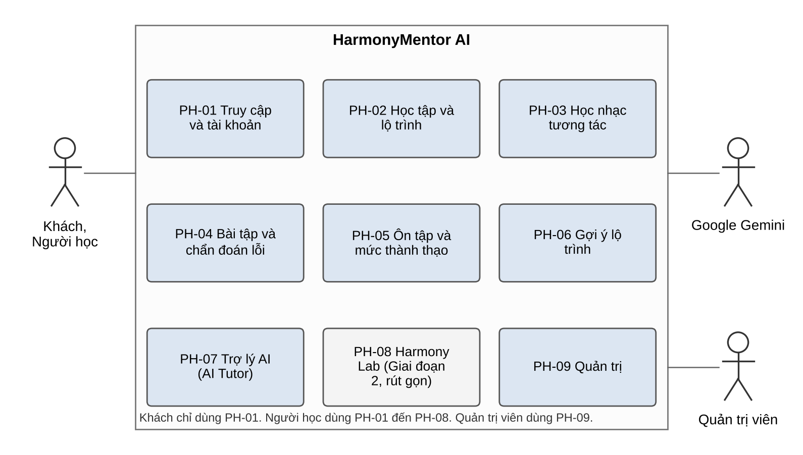
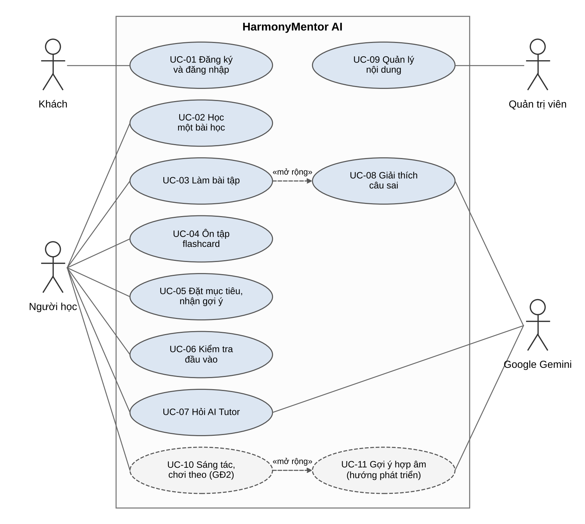
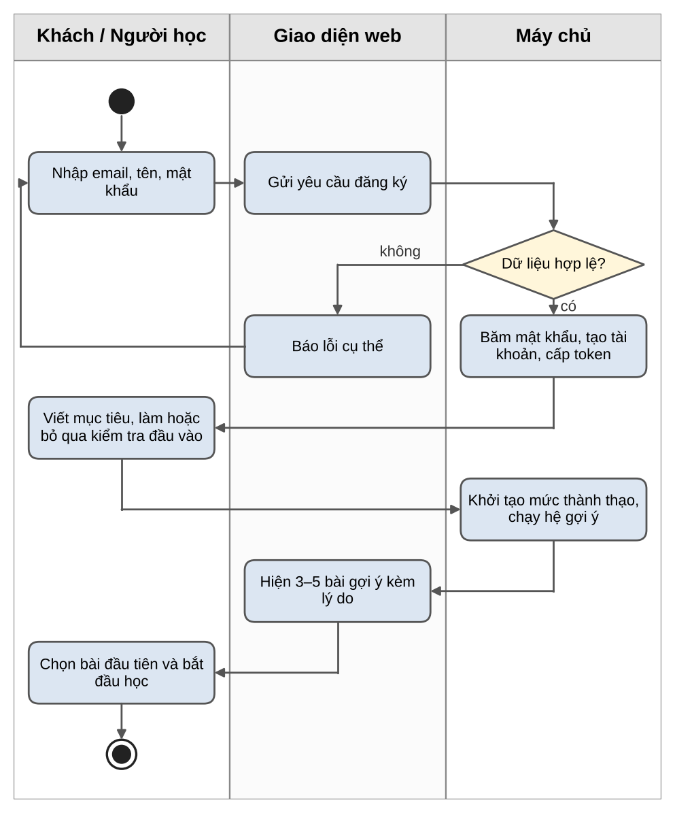
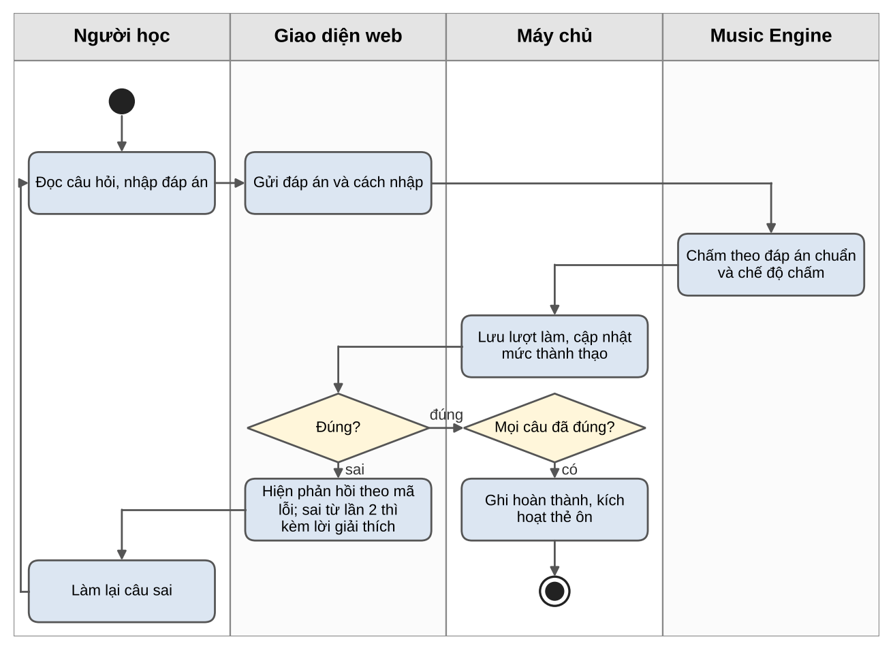
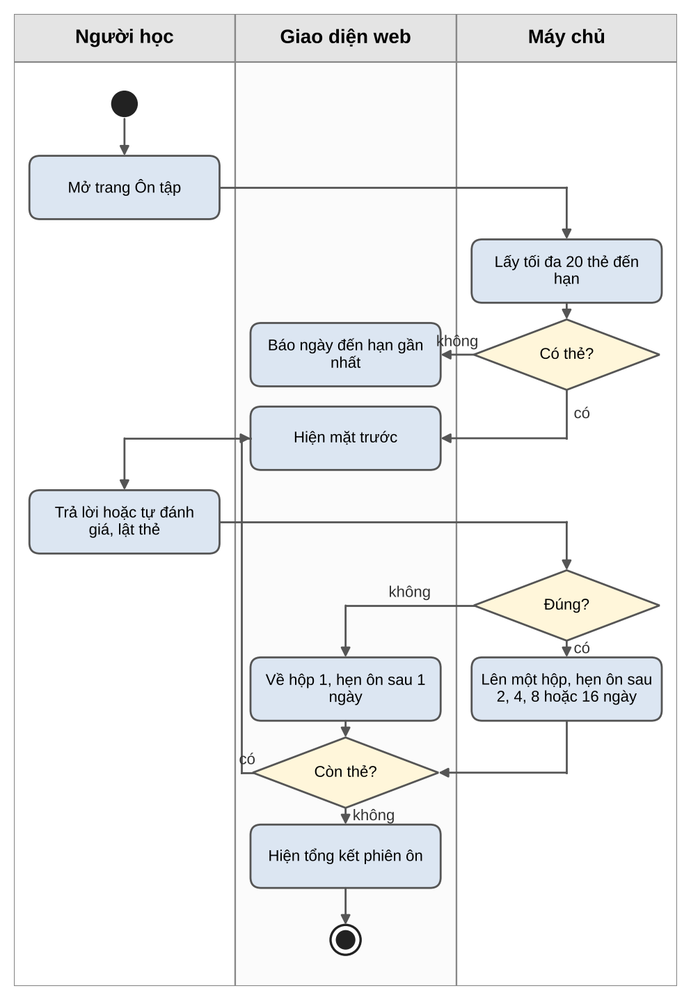
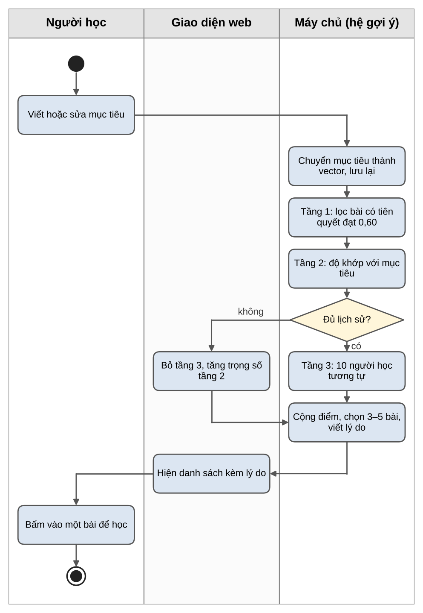
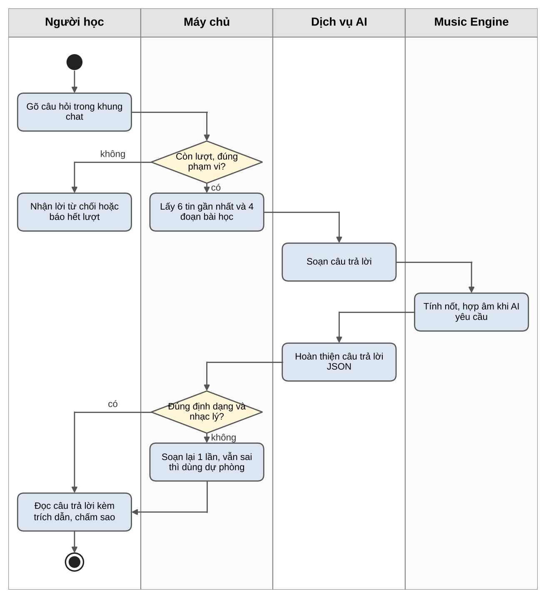

**ĐỒ ÁN CUỐI KHÓA (CAPSTONE PROJECT)**

*Nhóm HarmonyMentor • Bộ tài liệu dự án*

━━━━━━━━━━━━━━━━━━━━━━━━━━━━━━━━━━━━━━━━

**ĐẶC TẢ CHỨC NĂNG VÀ NGHIỆP VỤ**  
**(PHÂN HỆ, CHỨC NĂNG CHI TIẾT VÀ LUỒNG NGHIỆP VỤ)**

Tài liệu Đặc tả chức năng và nghiệp vụ của đồ án cuối khóa • Phiên bản 2.1

<table>
<colgroup>
<col style="width: 100%" />
</colgroup>
<thead>
<tr class="header">
<th>
<strong>HARMONYMENTOR AI</strong> 
<strong>NỀN TẢNG HỌC NHẠC LÝ THÍCH ỨNG CÓ TRỢ LÝ AI</strong>

<em>(Adaptive Music Theory Learning, Hybrid Lesson Recommender &amp; Stateful AI Tutor)</em>

Hệ thống web giúp người mới học nhạc lý luyện tập có chẩn đoán lỗi, nhận gợi ý bài học theo mục tiêu và hỏi đáp với trợ lý AI có trích dẫn bài học.
</th>
</tr>
</thead>
<tbody>
</tbody>
</table>

| **Chuyên mục:**          | Hệ thống gợi ý (Recommender System) • Trợ lý hội thoại (Chatbot) • Backend API                |
|--------------------------|-----------------------------------------------------------------------------------------------|
| **Môn học tích hợp:**    | Python • AI Fundamental • NLP • FastAPI • Docker                                              |
| **Đề tài gốc:**          | Đề tài 03 – Trợ lý học tập thông minh và hệ thống gợi ý cá nhân hóa, áp dụng cho môn nhạc lý  |
| **Nhóm thực hiện:**      | Thắng (trưởng nhóm kỹ thuật) • Phúc (giao diện, âm thanh) • Đạt (nội dung, kiểm thử, báo cáo) |
| **Thời gian thực hiện:** | 14/10/2026 – 04/12/2026                                                                       |
| **Phiên bản:**           | 2.1 – tháng 10/2026                                                                           |

# MỤC LỤC

| **Mục** | **Nội dung**                                 | **Trang** |
|---------|----------------------------------------------|-----------|
| 1       | **Giới thiệu**                               | 3         |
| 1.1     | Mục đích tài liệu                            | 3         |
| 1.2     | Thuật ngữ                                    | 3         |
| 1.3     | Mức ưu tiên và giai đoạn                     | 4         |
| 2       | **Tác nhân và phân quyền**                   | 4         |
| 2.1     | Tác nhân                                     | 4         |
| 2.2     | Ma trận phân quyền                           | 5         |
| 3       | **Phân hệ chức năng**                        | 5         |
| 4       | **Danh sách chức năng chi tiết**             | 7         |
| 4.1     | PH-01. Truy cập và tài khoản                 | 7         |
| 4.2     | PH-02. Học tập và lộ trình                   | 8         |
| 4.3     | PH-03. Học nhạc tương tác và âm thanh        | 8         |
| 4.4     | PH-04. Bài tập, chấm điểm và chẩn đoán lỗi   | 10        |
| 4.5     | PH-05. Ôn tập và mức thành thạo              | 11        |
| 4.6     | PH-06. Gợi ý lộ trình                        | 12        |
| 4.7     | PH-07. Trợ lý AI (AI Tutor)                  | 12        |
| 4.8     | PH-08. Harmony Lab                           | 14        |
| 4.9     | PH-09. Quản trị                              | 16        |
| 4.10    | Ánh xạ chức năng chính và chức năng chi tiết | 18        |
| 5       | **Use case**                                 | 20        |
| 5.1     | Sơ đồ use case                               | 20        |
| 5.2     | Đặc tả use case                              | 21        |
| 6       | **Luồng nghiệp vụ**                          | 25        |
| 6.1     | Luồng đăng ký và học bài đầu tiên            | 26        |
| 6.2     | Luồng làm bài tập và chẩn đoán lỗi           | 27        |
| 6.3     | Luồng ôn tập flashcard                       | 28        |
| 6.4     | Luồng nhận gợi ý bài học                     | 29        |
| 6.5     | Luồng hỏi AI Tutor có trích dẫn              | 31        |
| 7       | **Yêu cầu phi chức năng**                    | 32        |
| 8       | **Tiêu chí nghiệm thu**                      | 33        |

***Bảng 1. Lịch sử phiên bản***

| **Phiên bản** | **Ngày**   | **Thay đổi**                                                                                                          | **Người viết** | **Người kiểm** |
|---------------|------------|-----------------------------------------------------------------------------------------------------------------------|----------------|----------------|
| 1.3           | 14/10/2026 | Bản SRS đầu tiên của đồ án.                                                                                           | Cả nhóm        | ………            |
| 1.4           | 20/10/2026 | Bổ sung lộ trình 12 bài, Harmony Lab, chatbot kèm cặp.                                                                | Cả nhóm        | ………            |
| 2.0           | 20/10/2026 | Tách thành 4 tài liệu theo góp ý của giảng viên, viết lại cho dễ đọc.                                                 | Cả nhóm        | ………            |
| 2.1           | 22/10/2026 | Sửa sau rà soát nội bộ: ngưỡng học tiếp 0,60, cách tính điểm gợi ý theo bài, dữ liệu gửi cho AI, thu gọn Giai đoạn 2. | Cả nhóm        | ………            |

# 1. GIỚI THIỆU

## 1.1 Mục đích tài liệu

Tài liệu này mô tả chi tiết những gì HarmonyMentor AI phải làm. Tài liệu Đặc tả yêu cầu phần mềm (SRS) chỉ nêu 19 chức năng chính. Ở đây, mỗi chức năng chính được tách thành các chức năng chi tiết, có mã riêng để nhóm lập trình, kiểm thử và chấm nghiệm thu.

Người đọc chính là nhóm phát triển, giảng viên hướng dẫn và hội đồng đánh giá. Người đọc không cần biết nhạc lý vẫn theo dõi được các luồng nghiệp vụ ở mục 6.

## 1.2 Thuật ngữ

***Bảng 2. Thuật ngữ dùng trong tài liệu***

| **Thuật ngữ**            | **Giải thích**                                                                                                  |
|--------------------------|-----------------------------------------------------------------------------------------------------------------|
| Hợp âm                   | Ba nốt trở lên vang cùng lúc, ví dụ C – E – G là hợp âm Đô trưởng (C).                                          |
| Quãng                    | Khoảng cách giữa hai nốt, ví dụ từ C lên E là quãng 3 trưởng.                                                   |
| Âm giai (scale)          | Dãy nốt theo một khuôn cố định, ví dụ âm giai Đô trưởng gồm C D E F G A B.                                      |
| Giọng (key)              | Âm giai làm "nhà" của một bản nhạc, ví dụ giọng Đô trưởng.                                                      |
| Vòng hợp âm              | Chuỗi hợp âm lặp lại để đệm hát, ví dụ C – G – Am – F.                                                          |
| Music Engine             | Bộ máy nhạc lý của hệ thống. Nó tính nốt, quãng, hợp âm và chấm bài theo luật cố định.                          |
| Mã lỗi                   | Tên ngắn của một kiểu sai, ví dụ SEVENTH_QUALITY là sai quãng 7 của hợp âm bảy.                                 |
| Mức thành thạo (mastery) | Điểm từ 0 đến 1 cho biết người học nắm một kỹ năng tốt đến đâu.                                                 |
| Flashcard                | Thẻ ôn tập hai mặt: mặt trước là câu hỏi, mặt sau là đáp án.                                                    |
| Leitner                  | Cách xếp lịch ôn: thẻ nhớ tốt thì ôn thưa dần, thẻ quên thì ôn lại sớm.                                         |
| Hệ gợi ý lai             | Cách chọn bài học tiếp theo bằng cách kết hợp luật, độ khớp với mục tiêu và kinh nghiệm của người học tương tự. |
| AI Tutor                 | Trợ lý trò chuyện giúp người học hiểu bài. Trợ lý dùng mô hình Google Gemini.                                   |
| RAG                      | Cách cho AI đọc đúng đoạn bài học liên quan trước khi trả lời, để câu trả lời có căn cứ và trích dẫn được.      |
| Phiên chat               | Một cuộc trò chuyện có mã riêng (session_id). Hệ thống nhớ 6 tin nhắn gần nhất của phiên.                       |
| Harmony Lab              | Không gian sáng tác: dựng vòng hợp âm, chọn trống nền rồi phát lại để chơi theo.                                |
| Ngưỡng đủ để học tiếp    | Mức thành thạo 0,60. Kỹ năng tiên quyết đạt ngưỡng này thì hệ gợi ý mở bài sau. Ngưỡng thành thạo là 0,80.      |

## 1.3 Mức ưu tiên và giai đoạn

***Bảng 3. Mức ưu tiên của chức năng***

| **Mức** | **Tên**   | **Ý nghĩa**                                        |
|---------|-----------|----------------------------------------------------|
| P0      | Bắt buộc  | Thiếu thì hệ thống không chạy được vòng học chính. |
| P1      | Nên có    | Quan trọng, làm ngay sau khi phần P0 chạy ổn.      |
| P2      | Có thể có | Làm khi còn thời gian.                             |

Mỗi chức năng còn được gắn giai đoạn. **Giai đoạn 1** hoàn thành trước ngày 10/11/2026. **Giai đoạn 2** làm từ 11/11 đến 04/12/2026. **Hướng phát triển (TL)** là phần đã có thiết kế sơ bộ nhưng không cam kết trong đồ án. Mức ưu tiên được xét trong từng giai đoạn: P2 của Giai đoạn 1 chỉ làm khi P0 và P1 đã chạy ổn.

***Bảng 4. Số chức năng chi tiết theo giai đoạn và mức ưu tiên***

| **Giai đoạn**                    | **P0** | **P1** | **P2** | **Tổng** |
|----------------------------------|--------|--------|--------|----------|
| Giai đoạn 1 (đến 10/11/2026)     | 95     | 69     | 8      | 172      |
| Giai đoạn 2 (11/11 – 04/12/2026) | 0      | 21     | 1      | 22       |
| Hướng phát triển (sau đồ án)     | 0      | 0      | 44     | 44       |
| **Tổng**                         | 95     | 90     | 53     | 238      |

# 2. TÁC NHÂN VÀ PHÂN QUYỀN

## 2.1 Tác nhân

***Bảng 5. Tác nhân của hệ thống***

| **Tác nhân**  | **Mô tả**                            | **Giới hạn**                                                                                                                                                                          |
|---------------|--------------------------------------|---------------------------------------------------------------------------------------------------------------------------------------------------------------------------------------|
| Khách         | Người chưa đăng nhập.                | Chỉ xem trang công khai. Không học, không làm bài, không dùng AI Tutor.                                                                                                               |
| Người học     | Người đã đăng ký và đăng nhập.       | Chỉ xem và sửa dữ liệu của chính mình.                                                                                                                                                |
| Quản trị viên | Người quản lý nội dung và tài khoản. | Có thể làm thử bài tập và chat. Lượt làm thử không tính vào mức thành thạo hay thống kê.                                                                                              |
| Google Gemini | Dịch vụ AI bên ngoài.                | Chỉ nhận dữ liệu qua Bộ điều phối AI: câu hỏi, lịch sử phiên, đoạn bài học, mục tiêu, tên kỹ năng yếu, mã lỗi. Không truy cập cơ sở dữ liệu. Không nhận email, tên hay mã người dùng. |

## 2.2 Ma trận phân quyền

***Bảng 6. Ma trận phân quyền theo vai trò***

| **Chức năng**                       | **Khách** | **Người học** | **Quản trị viên**  |
|-------------------------------------|-----------|---------------|--------------------|
| Xem trang chủ, chương trình học     | Có        | Có            | Có                 |
| Đăng ký tài khoản                   | Có        | Không         | Không              |
| Học bài học                         | Không     | Có            | Có                 |
| Làm bài tập, ôn flashcard           | Không     | Có            | Làm thử            |
| Xem tiến độ, nhận gợi ý bài học     | Không     | Có (của mình) | Xem thống kê chung |
| Hỏi AI Tutor                        | Không     | Có            | Làm thử            |
| Harmony Lab (Giai đoạn 2)           | Không     | Có            | Làm thử            |
| Quản lý bài học, bài tập, flashcard | Không     | Không         | Có                 |
| Quản lý người dùng, cấu hình AI     | Không     | Không         | Có                 |

Hai quy tắc áp dụng cho mọi chức năng. Thứ nhất, khi Người học mở dữ liệu của người khác, hệ thống trả về "không tìm thấy" (404) để không lộ dữ liệu đó có tồn tại. Thứ hai, khi Người học gọi chức năng quản trị, hệ thống trả về "không có quyền" (403).

# 3. PHÂN HỆ CHỨC NĂNG

Hệ thống được chia thành 9 phân hệ. Mỗi phân hệ gom các chức năng phục vụ cùng một mục đích nghiệp vụ.

***Hình 1. Các phân hệ chức năng và tác nhân sử dụng***

***Bảng 7. Danh sách phân hệ***

| **Mã** | **Phân hệ**                         | **Phạm vi**                                                                                                                                  | **Số chức năng** |
|--------|-------------------------------------|----------------------------------------------------------------------------------------------------------------------------------------------|------------------|
| PH-01  | Truy cập và tài khoản               | Trang công khai, đăng ký, đăng nhập, phân quyền, hồ sơ và mục tiêu học tập.                                                                  | 17               |
| PH-02  | Học tập và lộ trình                 | Khóa học, module, bài học, tiến độ, bảng điều khiển, kiểm tra đầu vào.                                                                       | 14               |
| PH-03  | Học nhạc tương tác và âm thanh      | Piano, khuông nhạc, Chord Inspector, phát âm thanh. Guitar và trống nền ở mức nên có.                                                        | 24               |
| PH-04  | Bài tập, chấm điểm và chẩn đoán lỗi | Làm bài, chấm bằng Music Engine, mã lỗi, giải thích, mẫu bài tập.                                                                            | 28               |
| PH-05  | Ôn tập và mức thành thạo            | Flashcard, lịch Leitner, mức thành thạo theo kỹ năng, kỹ năng yếu.                                                                           | 11               |
| PH-06  | Gợi ý lộ trình                      | Mục tiêu tự do, gợi ý lai 3 tầng, dữ liệu mô phỏng, đánh giá offline.                                                                        | 7                |
| PH-07  | Trợ lý AI (AI Tutor)                | Hỏi đáp có trích dẫn, giải thích lỗi, quiz, lịch sử chat, kèm cặp chủ động.                                                                  | 39               |
| PH-08  | Harmony Lab                         | Giai đoạn 2 làm bản rút gọn: dự án, vòng hợp âm, trống nền, phát lại để chơi theo. Giai điệu, gợi ý hợp âm và xuất file là hướng phát triển. | 54               |
| PH-09  | Quản trị                            | Người dùng, giáo trình, kỹ năng, bài tập, flashcard, nội dung âm nhạc, cấu hình AI.                                                          | 44               |

# 4. DANH SÁCH CHỨC NĂNG CHI TIẾT

Mỗi bảng dưới đây liệt kê chức năng chi tiết của một phân hệ. Cột "GĐ" là giai đoạn thực hiện: 1, 2 hoặc TL (hướng phát triển). Bảng ánh xạ giữa chức năng chính trong SRS và chức năng chi tiết nằm ở mục 4.10.

## 4.1 PH-01. Truy cập và tài khoản

Trang công khai, đăng ký, đăng nhập, phân quyền, hồ sơ và mục tiêu học tập.

***Bảng 8. Chức năng chi tiết của PH-01***

| **Mã**     | **Tên chức năng**              | **Mô tả**                                                                                                      | **Ưu tiên** | **GĐ** |
|------------|--------------------------------|----------------------------------------------------------------------------------------------------------------|-------------|--------|
| FR-VIS-01  | Xem trang chủ                  | Khách xem trang chủ và phần giới thiệu hệ thống.                                                               | P0          | 1      |
| FR-VIS-02  | Xem chương trình học           | Khách xem tổng quan chương trình 12 bài.                                                                       | P0          | 1      |
| FR-VIS-03  | Xem thông tin khóa học         | Khách xem tên, mô tả và cấp độ khóa học.                                                                       | P0          | 1      |
| FR-VIS-04  | Xem giới thiệu tính năng       | Khách xem giới thiệu Luyện tập, AI Tutor và Harmony Lab.                                                       | P1          | 1      |
| FR-VIS-05  | Đăng ký tài khoản              | Khách tạo tài khoản mới.                                                                                       | P0          | 1      |
| FR-VIS-06  | Đăng nhập                      | Khách đăng nhập vào hệ thống.                                                                                  | P0          | 1      |
| FR-VIS-07  | Bảo vệ tính năng cần tài khoản | Khi Khách mở tính năng cần tài khoản, hệ thống mời đăng nhập hoặc đăng ký.                                     | P0          | 1      |
| FR-AUTH-01 | Đăng ký người dùng             | Tạo tài khoản bằng email và mật khẩu. Email không được trùng.                                                  | P0          | 1      |
| FR-AUTH-02 | Đăng nhập người dùng           | Xác thực email và mật khẩu. Sau 5 lần sai trong 15 phút với cùng email từ cùng địa chỉ IP, tạm khóa đăng nhập. | P0          | 1      |
| FR-AUTH-03 | Đăng xuất                      | Kết thúc phiên đăng nhập và thu hồi token làm mới.                                                             | P0          | 1      |
| FR-AUTH-04 | Lưu mật khẩu an toàn           | Mật khẩu được băm bằng bcrypt, không lưu dạng chữ thường.                                                      | P0          | 1      |
| FR-AUTH-05 | Token xác thực                 | Cấp token truy cập 30 phút và token làm mới 7 ngày cho người dùng hợp lệ.                                      | P0          | 1      |
| FR-AUTH-06 | Xem hồ sơ                      | Người dùng xem hồ sơ của mình.                                                                                 | P0          | 1      |
| FR-AUTH-07 | Cập nhật hồ sơ                 | Người dùng sửa tên hiển thị và thông tin cá nhân.                                                              | P1          | 1      |
| FR-AUTH-08 | Mục tiêu học tập               | Người dùng viết mục tiêu học nhạc bằng lời của mình.                                                           | P0          | 1      |
| FR-AUTH-09 | Phân quyền                     | Chỉ Quản trị viên vào được chức năng quản trị. Người học gọi /admin nhận lỗi 403.                              | P0          | 1      |
| FR-AUTH-10 | Nhạc cụ ưa thích               | Người dùng chọn nhạc cụ ưa thích: piano, guitar hoặc trống.                                                    | P1          | 1      |

## 4.2 PH-02. Học tập và lộ trình

Khóa học, module, bài học, tiến độ, bảng điều khiển, kiểm tra đầu vào.

***Bảng 9. Chức năng chi tiết của PH-02***

| **Mã**    | **Tên chức năng**         | **Mô tả**                                                                                     | **Ưu tiên** | **GĐ** |
|-----------|---------------------------|-----------------------------------------------------------------------------------------------|-------------|--------|
| FR-LRN-01 | Xem lộ trình học          | Người học xem lộ trình và trạng thái từng bài.                                                | P0          | 1      |
| FR-LRN-02 | Xem khóa học              | Người học xem thông tin khóa học.                                                             | P0          | 1      |
| FR-LRN-03 | Xem module                | Người học xem các module của khóa học.                                                        | P0          | 1      |
| FR-LRN-04 | Xem bài học               | Người học học bài theo từng bước, có mục lục và nhớ bước đang học.                            | P0          | 1      |
| FR-LRN-05 | Hoàn thành bài học        | Bài được ghi nhận hoàn thành khi mọi câu bài tập đã đúng ít nhất một lần.                     | P0          | 1      |
| FR-LRN-06 | Kỹ năng tiên quyết        | Hệ thống lưu quan hệ học trước, học sau giữa các kỹ năng.                                     | P1          | 1      |
| FR-LRN-08 | Lịch sử học tập           | Hệ thống lưu lịch sử học tập của người học.                                                   | P1          | 1      |
| FR-LRN-09 | Học tiếp                  | Người học tiếp tục từ vị trí gần nhất.                                                        | P1          | 1      |
| FR-LRN-10 | Tìm kiếm bài học          | Người học tìm bài học theo từ khóa.                                                           | P2          | 1      |
| FR-LRN-11 | Bảng điều khiển người học | Hiển thị mục tiêu, bài được gợi ý, kỹ năng yếu và thẻ ôn đến hạn.                             | P0          | 1      |
| FR-LRN-12 | Kiểm tra năng lực đầu vào | Bài kiểm tra 12 câu sau khi nhập mục tiêu, dùng để khởi tạo mức thành thạo.                   | P1          | 1      |
| FR-LRN-13 | Lộ trình theo nhánh       | Trang Học nhóm bài theo 5 module. Bài chưa đủ tiên quyết ghi "Nên học sau" nhưng vẫn mở được. | P0          | 1      |
| FR-LRN-14 | Nguồn tham chiếu của bài  | Mỗi bài hiển thị nguồn tham chiếu và vị trí chương, mục.                                      | P1          | 1      |
| FR-MAS-05 | Hiển thị tiến độ          | Người học xem tiến độ theo bài và theo kỹ năng.                                               | P0          | 1      |

## 4.3 PH-03. Học nhạc tương tác và âm thanh

Piano, khuông nhạc, Chord Inspector, phát âm thanh. Guitar và trống nền ở mức nên có.

***Bảng 10. Chức năng chi tiết của PH-03***

| **Mã**    | **Tên chức năng**              | **Mô tả**                                                                               | **Ưu tiên** | **GĐ** |
|-----------|--------------------------------|-----------------------------------------------------------------------------------------|-------------|--------|
| FR-MUS-01 | Piano tương tác                | Hiển thị bàn phím piano bấm được.                                                       | P0          | 1      |
| FR-MUS-02 | Phát nốt                       | Bấm một phím piano thì phát nốt tương ứng.                                              | P0          | 1      |
| FR-MUS-03 | Phát hợp âm                    | Phát nhiều nốt cùng lúc thành hợp âm.                                                   | P0          | 1      |
| FR-MUS-04 | Tô sáng nốt                    | Tô sáng các nốt liên quan đến bài học hoặc bài tập.                                     | P0          | 1      |
| FR-MUS-05 | Phát ví dụ âm nhạc             | Phát các ví dụ âm nhạc trong bài học.                                                   | P0          | 1      |
| FR-MUS-06 | Trực quan hóa hợp âm           | Hiển thị các nốt của hợp âm trên piano.                                                 | P0          | 1      |
| FR-MUS-07 | Trực quan hóa âm giai          | Hiển thị âm giai trên piano.                                                            | P1          | 1      |
| FR-MUS-08 | Hiển thị khuông nhạc           | Hiển thị khuông nhạc khi bài học cần.                                                   | P2          | 1      |
| FR-MUS-09 | Chơi bằng bàn phím máy tính    | Phím A S D F G H J ứng với C D E F G A B, phím W E T Y U ứng với phím đen.              | P1          | 1      |
| FR-MUS-10 | Nút bật âm thanh               | Hiện nút bật âm thanh ở lần dùng đầu tiên, vì trình duyệt chặn tự phát.                 | P0          | 1      |
| FR-MUS-11 | Cần đàn guitar                 | Hiển thị nốt, hợp âm và thế bấm trên cần đàn 6 dây. Bấm một phím đàn thì phát nốt đó.   | P1          | 1      |
| FR-MUS-12 | Mẫu trống nền                  | Một số mẫu trống có sẵn làm nền khi phát nhạc.                                          | P1          | 1      |
| FR-MUS-13 | Đáp án không phụ thuộc nhạc cụ | Bài tập cao độ nhận đáp án từ piano hoặc guitar như nhau.                               | P1          | 1      |
| FR-MUS-14 | Chord Inspector                | Chọn một hợp âm để xem công thức, nốt, thể đảo, bậc La Mã và nghe thử.                  | P0          | 1      |
| FR-MUS-15 | Khối khuông nhạc trong bài     | Hiển thị quãng, hợp âm và guide tone trên khuông bằng VexFlow.                          | P1          | 1      |
| FR-MUS-16 | Xem cách sắp xếp hợp âm        | So sánh voicing đầy đủ, shell và guide tone của một hợp âm.                             | P1          | 2      |
| FR-MUS-17 | Tên nốt theo ngữ cảnh          | Phím đen hiển thị tên nốt theo cách viết của bài, ví dụ Eb trong Cm, D# trong E trưởng. | P0          | 1      |
| FR-MUS-18 | Thẻ hợp âm bấm được            | Thành phần hợp âm bấm được dùng chung cho bài học, chat và Harmony Lab.                 | P1          | 1      |
| FR-AUD-01 | Bộ điều khiển phát chung       | Một bộ điều khiển cho phát, dừng, lặp và đổi tốc độ 40–200 BPM khi đang phát.           | P0          | 1      |
| FR-AUD-02 | Âm sắc piano                   | Phát nốt bằng mẫu âm piano thật có giấy phép. Âm tổng hợp là phương án dự phòng.        | P0          | 1      |
| FR-AUD-03 | Máy đếm nhịp                   | Bật, tắt máy đếm nhịp. Phách đầu ô nhịp có tiếng khác, có đếm vào 1 ô nhịp.             | P0          | 1      |
| FR-AUD-04 | Trống nền                      | 3–5 mẫu trống (rock, pop ballad, swing) phát cùng vòng hợp âm.                          | P1          | 1      |
| FR-AUD-05 | Bass tự sinh                   | Bass chơi nốt gốc và quãng 5 của hợp âm theo phách.                                     | P1          | 2      |
| FR-AUD-06 | Bộ trộn track                  | Bật, tắt từng track: hòa âm, giai điệu, bass, trống.                                    | P1          | 2      |

## 4.4 PH-04. Bài tập, chấm điểm và chẩn đoán lỗi

Làm bài, chấm bằng Music Engine, mã lỗi, giải thích, mẫu bài tập.

***Bảng 11. Chức năng chi tiết của PH-04***

| **Mã**    | **Tên chức năng**          | **Mô tả**                                                                                            | **Ưu tiên** | **GĐ** |
|-----------|----------------------------|------------------------------------------------------------------------------------------------------|-------------|--------|
| FR-EX-01  | Bắt đầu bài tập            | Người học mở một bài tập.                                                                            | P0          | 1      |
| FR-EX-02  | Nộp câu trả lời            | Người học gửi đáp án bằng chữ, nút chọn hoặc phím đàn.                                               | P0          | 1      |
| FR-EX-03  | Chấm theo luật             | Bài có đáp án cố định được chấm bằng luật. Đáp án đúng viết khác dấu nối vẫn được chấp nhận.         | P0          | 1      |
| FR-EX-04  | Phản hồi khi đúng          | Thông báo khi câu trả lời đúng.                                                                      | P0          | 1      |
| FR-EX-05  | Phản hồi khi sai           | Thông báo khi câu trả lời sai, nêu chỗ sai bằng lời dễ hiểu.                                         | P0          | 1      |
| FR-EX-06  | Hiển thị đáp án đúng       | Hiển thị đáp án đúng khi người học đã làm đúng hoặc đã sai từ 2 lần.                                 | P0          | 1      |
| FR-EX-07  | Giải thích                 | Hiện lời giải thích khi trả lời đúng hoặc sau 2 lần sai.                                             | P0          | 1      |
| FR-EX-08  | Thử lại                    | Người học được làm lại câu đã sai.                                                                   | P0          | 1      |
| FR-EX-09  | Gợi ý                      | Đưa gợi ý trước khi hiển thị đáp án.                                                                 | P1          | 1      |
| FR-EX-10  | Lịch sử lượt làm           | Lưu mọi lượt làm bài, gắn với phiên bản câu hỏi.                                                     | P1          | 1      |
| FR-EX-11  | Độ khó                     | Bài tập có mức Dễ, Vừa, Khó. Trang Luyện tập gợi ý mức theo bài đã học.                              | P1          | 1      |
| FR-EX-12  | Mẫu bài tập                | Sinh nhiều câu từ một mẫu bài tập.                                                                   | P1          | 1      |
| FR-EX-13  | Ngẫu nhiên hóa             | Đổi nốt gốc, giọng hoặc hợp âm trong một mẫu.                                                        | P1          | 1      |
| FR-EX-14  | Chế độ chấm                | Mỗi bài khai báo strict_spelling hoặc pitch_class_only. Bài trả lời bằng phím piano chỉ chấm cao độ. | P0          | 1      |
| FR-EX-15  | Gõ tiết tấu                | Người học gõ tiết tấu bằng phím cách. Chấm theo độ lệch thời gian cho phép 80 ms.                    | P1          | 1      |
| FR-ENG-01 | Chấm theo cấu hình câu hỏi | Engine nhận chế độ chấm và yêu cầu thế gốc từ cấu hình của từng câu.                                 | P0          | 1      |
| FR-ENG-02 | Chức năng hòa âm           | Trả về T, PD hoặc D cho hợp âm trong giọng trưởng và giọng thứ.                                      | P0          | 1      |
| FR-ENG-03 | Hợp âm át phụ              | Dựng và nhận diện V7/x với x là ii, iii, IV, V, vi.                                                  | P0          | 1      |
| FR-ENG-04 | Hợp âm mượn                | Liệt kê và nhận diện hợp âm mượn từ giọng thứ cùng tên (iv, bVI, bVII, iiø7, bIII).                  | P0          | 1      |
| FR-ENG-05 | Phân tích vòng hợp âm      | Gán số La Mã, chức năng và cờ (át phụ, mượn, ngoài giọng) cho cả vòng.                               | P1          | 2      |
| FR-ENG-06 | Mở rộng loại hợp âm        | Thêm 6, m6, 9, maj9, m9, 7sus4, 7b9, 7#9, 13.                                                        | P1          | 2      |
| FR-ENG-07 | Công cụ voicing            | Tìm guide tone, shell voicing và khoảng cách nối giữa hai voicing.                                   | P1          | 2      |
| FR-ENG-08 | Chấm gọi tên nốt           | Chấm dạng bài gọi tên nốt được tô sáng trên phím đàn.                                                | P0          | 1      |
| FR-ERR-01 | Phân loại lỗi              | Xác định loại lỗi, ví dụ nhầm quãng 7 thứ với quãng 7 trưởng.                                        | P0          | 1      |
| FR-ERR-02 | Lịch sử lỗi                | Lưu các lỗi lặp lại của người học.                                                                   | P1          | 1      |
| FR-ERR-03 | Phát hiện kỹ năng hay sai  | Phát hiện kỹ năng có tỷ lệ sai cao.                                                                  | P1          | 1      |
| FR-ERR-04 | Ôn tập có mục tiêu         | Đưa kỹ năng hay sai vào hàng đợi ôn tập.                                                             | P1          | 1      |
| FR-ERR-05 | Giải thích sửa lỗi         | Chỉ ra chính xác điểm khác giữa đáp án và câu trả lời.                                               | P0          | 1      |

## 4.5 PH-05. Ôn tập và mức thành thạo

Flashcard, lịch Leitner, mức thành thạo theo kỹ năng, kỹ năng yếu.

***Bảng 12. Chức năng chi tiết của PH-05***

| **Mã**    | **Tên chức năng**            | **Mô tả**                                                                                       | **Ưu tiên** | **GĐ** |
|-----------|------------------------------|-------------------------------------------------------------------------------------------------|-------------|--------|
| FR-FL-01  | Xem flashcard                | Hiển thị mặt trước của một thẻ.                                                                 | P0          | 1      |
| FR-FL-02  | Lật thẻ                      | Hiển thị đáp án ở mặt sau.                                                                      | P0          | 1      |
| FR-FL-03  | Kết quả ôn                   | Thẻ ý mở do người học tự đánh giá nhớ hay chưa. Thẻ có đáp án được hệ thống chấm.               | P1          | 1      |
| FR-FL-04  | Hàng đợi ôn tập              | Lập danh sách thẻ đến hạn, tối đa 20 thẻ mỗi phiên. Thẻ của bài vừa hoàn thành đến hạn ngay.    | P1          | 1      |
| FR-FL-05  | Ưu tiên kỹ năng yếu          | Thẻ của kỹ năng yếu được đưa lên trước.                                                         | P1          | 1      |
| FR-FL-06  | Thẻ đa phương thức           | Thẻ có thể dùng chữ, piano, guitar hoặc âm thanh.                                               | P1          | 1      |
| FR-FL-07  | Ôn tập ngắt quãng            | Xếp lịch theo hệ Leitner 5 hộp: 1, 2, 4, 8, 16 ngày.                                            | P1          | 1      |
| FR-MAS-01 | Lưu mức thành thạo           | Lưu điểm thành thạo 0–1 cho từng kỹ năng của từng người học.                                    | P0          | 1      |
| FR-MAS-02 | Cập nhật mức thành thạo      | Cập nhật điểm sau mỗi lượt làm theo công thức EMA, hệ số 0,3.                                   | P0          | 1      |
| FR-MAS-03 | Phát hiện kỹ năng yếu        | Kỹ năng yếu khi điểm dưới 0,60 sau ít nhất 5 lượt làm.                                          | P1          | 1      |
| FR-MAS-04 | Dùng mức thành thạo để gợi ý | Mức thành thạo là đầu vào của hệ gợi ý. Kỹ năng đạt từ 0,60 được coi là đủ để học tiếp bài sau. | P1          | 1      |

## 4.6 PH-06. Gợi ý lộ trình

Mục tiêu tự do, gợi ý lai 3 tầng, dữ liệu mô phỏng, đánh giá offline.

***Bảng 13. Chức năng chi tiết của PH-06***

| **Mã**    | **Tên chức năng**               | **Mô tả**                                                                                  | **Ưu tiên** | **GĐ** |
|-----------|---------------------------------|--------------------------------------------------------------------------------------------|-------------|--------|
| FR-LRN-07 | Gợi ý bài học tiếp theo         | Đề xuất bài tiếp theo theo tiến độ và mức thành thạo.                                      | P0          | 1      |
| FR-REC-01 | Mục tiêu bằng ngôn ngữ tự nhiên | Mục tiêu tự do được chuyển thành embedding và lưu lại.                                     | P0          | 1      |
| FR-REC-02 | Gợi ý lai                       | Trả về 3–5 bài. Lọc bài đủ điều kiện theo luật, rồi xếp hạng bằng so khớp nội dung và KNN. | P0          | 1      |
| FR-REC-03 | Giải thích gợi ý                | Mỗi bài gợi ý có một câu lý do ngắn.                                                       | P0          | 1      |
| FR-REC-04 | Dữ liệu người học mô phỏng      | Sinh 2.000 người học mô phỏng, đánh dấu rõ là dữ liệu mô phỏng.                            | P0          | 1      |
| FR-REC-05 | Đánh giá offline                | Báo cáo HitRate@5 và Precision@5 cho 3 phương án.                                          | P0          | 1      |
| FR-REC-06 | Nhật ký gợi ý                   | Lưu từng danh sách gợi ý và việc người học có mở bài đó không.                             | P1          | 1      |

## 4.7 PH-07. Trợ lý AI (AI Tutor)

Hỏi đáp có trích dẫn, giải thích lỗi, quiz, lịch sử chat, kèm cặp chủ động.

***Bảng 14. Chức năng chi tiết của PH-07***

| **Mã**    | **Tên chức năng**              | **Mô tả**                                                                                                                                                              | **Ưu tiên** | **GĐ** |
|-----------|--------------------------------|------------------------------------------------------------------------------------------------------------------------------------------------------------------------|-------------|--------|
| FR-AI-01  | Tạo phiên chat                 | Tạo phiên mới với mã session_id dạng UUIDv4.                                                                                                                           | P0          | 1      |
| FR-AI-02  | Gửi câu hỏi                    | Người học gửi câu hỏi cho trợ lý.                                                                                                                                      | P0          | 1      |
| FR-AI-03  | Hội thoại theo ngữ cảnh        | Trợ lý dùng ngữ cảnh của các lượt gần nhất.                                                                                                                            | P0          | 1      |
| FR-AI-04  | Giải thích khái niệm           | Trợ lý giải thích khái niệm nhạc lý.                                                                                                                                   | P0          | 1      |
| FR-AI-05  | Giải thích đáp án sai          | Trợ lý giải thích lỗi trong bài tập dựa trên mã lỗi của Engine.                                                                                                        | P0          | 1      |
| FR-AI-06  | Đưa gợi ý                      | Trợ lý đưa gợi ý thay vì nói ngay đáp án.                                                                                                                              | P1          | 1      |
| FR-AI-07  | Giải thích sáng tác            | Trợ lý giải thích hòa âm, giai điệu trong dự án sáng tác.                                                                                                              | P2          | TL     |
| FR-AI-08  | Lưu lịch sử chat               | Lưu toàn bộ tin nhắn vào cơ sở dữ liệu.                                                                                                                                | P0          | 1      |
| FR-AI-09  | Xem lịch sử chat               | Người học mở lại phiên cũ.                                                                                                                                             | P1          | 1      |
| FR-AI-10  | Xử lý lỗi AI                   | Khi dịch vụ AI lỗi, tin nhắn không bị mất và người học thử lại được.                                                                                                   | P0          | 1      |
| FR-AI-11  | Trả lời có căn cứ              | Trợ lý ưu tiên thông tin từ bài học của hệ thống.                                                                                                                      | P0          | 1      |
| FR-AI-12  | Từ chối khi không chắc         | Khi không tìm được nội dung phù hợp, trợ lý nói không chắc và gợi ý bài liên quan.                                                                                     | P1          | 1      |
| FR-AI-13  | Gọi công cụ Music Engine       | Trợ lý lấy nốt, quãng, hợp âm qua công cụ của Engine, không tự suy ra.                                                                                                 | P0          | 1      |
| FR-AI-14  | Bộ nhớ phiên                   | Gửi kèm 6 tin nhắn gần nhất của phiên, lưu trong Redis.                                                                                                                | P0          | 1      |
| FR-AI-15  | Hạn mức sử dụng                | Mỗi người tối đa 30 câu hỏi mỗi ngày.                                                                                                                                  | P0          | 1      |
| FR-AI-16  | Ngôn ngữ trả lời               | Mặc định trả lời tiếng Việt. Hỏi bằng tiếng Anh thì trả lời tiếng Anh.                                                                                                 | P2          | 1      |
| FR-AI-17  | Đánh giá câu trả lời           | Người học chấm 1–5 sao cho từng câu trả lời, kèm nhận xét.                                                                                                             | P1          | 1      |
| FR-AI-18  | Sinh quiz theo kỹ năng         | Sinh quiz 10 câu. Engine tạo câu hỏi và đáp án, AI viết phương án nhiễu và lời giải.                                                                                   | P0          | 1      |
| FR-AI-19  | Trích dẫn bài học              | Câu trả lời ghi rõ bài học nguồn của nội dung được dùng.                                                                                                               | P0          | 1      |
| FR-AI-20  | Kiểm tra đầu ra AI             | Đầu ra của AI được kiểm tra định dạng. Máy chủ tự tìm mọi tên nốt, hợp âm trong câu trả lời và đối chiếu với Engine trước khi hiển thị.                                | P0          | 1      |
| FR-AI-21  | Chống chèn lệnh                | Câu chữ người dùng chỉ được coi là dữ liệu. Yêu cầu đổi vai trò hoặc lộ prompt bị từ chối.                                                                             | P1          | 1      |
| FR-CMP-01 | Khung chat nổi                 | Nút mở chat ở góc mọi trang sau đăng nhập, giữ phiên khi chuyển trang.                                                                                                 | P0          | 1      |
| FR-CMP-02 | Ngữ cảnh tự động               | Mỗi tin nhắn gửi kèm trang, bài, câu đang làm. Backend bổ sung tên kỹ năng yếu và mục tiêu học tập. Email, tên và mã người dùng không bao giờ được gửi cho dịch vụ AI. | P0          | 1      |
| FR-CMP-03 | Hỏi đáp có trích dẫn           | Mỗi câu trả lời về kiến thức có ít nhất một trích dẫn bài học.                                                                                                         | P0          | 1      |
| FR-CMP-04 | Mở đúng chỗ trích dẫn          | Bấm trích dẫn thì mở đúng bài và đúng đoạn.                                                                                                                            | P1          | 1      |
| FR-CMP-05 | Nút "Giải thích lỗi này"       | Nút trên kết quả chấm để nhờ trợ lý giải thích câu trả lời sai.                                                                                                        | P0          | 1      |
| FR-CMP-06 | Gợi mở từng bước               | Giải thích theo 3 mức: gợi ý, giải thích, đáp án. Không lộ đáp án câu chưa nộp.                                                                                        | P0          | 1      |
| FR-CMP-07 | Nhãn "Engine đã kiểm"          | Khẳng định nhạc lý đã đối chiếu với Engine được gắn nhãn trên giao diện.                                                                                               | P0          | 1      |
| FR-CMP-08 | Nhắc ôn tập                    | Nhắc khi có thẻ ôn đến hạn.                                                                                                                                            | P1          | 2      |
| FR-CMP-09 | Gợi ý bài tiếp theo trong chat | Trợ lý dùng kết quả hệ gợi ý để đề xuất bài và lý do.                                                                                                                  | P1          | 2      |
| FR-CMP-10 | Ghi nhận tiến bộ               | Chúc mừng khi một kỹ năng đạt điểm thành thạo 0,80.                                                                                                                    | P2          | 2      |
| FR-CMP-11 | Giới hạn lời nhắc              | Tối đa 3 lời nhắc mỗi phiên. Người học tắt nhắc được.                                                                                                                  | P1          | 2      |
| FR-CMP-12 | Quiz củng cố 3 câu             | Sinh 3 câu theo chủ đề vừa trao đổi, đáp án do Engine kiểm.                                                                                                            | P1          | 1      |
| FR-CMP-13 | Phiên và tóm tắt phiên         | Lưu tóm tắt phiên vào cơ sở dữ liệu để mở lại sau.                                                                                                                     | P0          | 1      |
| FR-CMP-14 | Lịch sử và đánh giá            | Xem lại phiên cũ và các câu đã chấm sao.                                                                                                                               | P1          | 1      |
| FR-CMP-15 | Phạm vi trả lời                | Chỉ trả lời về âm nhạc và việc học trong ứng dụng. Từ chối lịch sự câu ngoài phạm vi.                                                                                  | P0          | 1      |
| FR-CMP-16 | Chế độ trợ lý hòa âm           | Trong Harmony Lab, trợ lý giải thích và xếp hạng gợi ý hợp âm.                                                                                                         | P2          | TL     |
| FR-CMP-17 | Dự phòng khi AI lỗi            | Khi AI lỗi hoặc tắt, trả lời bằng câu mẫu theo mã lỗi và bài liên quan.                                                                                                | P0          | 1      |
| FR-CMP-18 | Nhật ký đánh giá               | Lưu ý định, đoạn trích, công cụ đã gọi, số token và độ trễ của từng câu.                                                                                               | P1          | 1      |

## 4.8 PH-08. Harmony Lab

Giai đoạn 2 làm bản rút gọn: dự án, vòng hợp âm, trống nền, phát lại để chơi theo. Giai điệu, gợi ý hợp âm và xuất file là hướng phát triển.

***Bảng 15. Chức năng chi tiết của PH-08***

| **Mã**        | **Tên chức năng**           | **Mô tả**                                                                        | **Ưu tiên** | **GĐ** |
|---------------|-----------------------------|----------------------------------------------------------------------------------|-------------|--------|
| FR-COM-01     | Tạo dự án                   | Tạo bản sáng tác mới.                                                            | P1          | 2      |
| FR-COM-02     | Đặt tên dự án               | Đặt tên cho bản sáng tác.                                                        | P2          | TL     |
| FR-COM-03     | Lưu dự án                   | Lưu bản sáng tác dưới dạng dữ liệu ký hiệu.                                      | P1          | 2      |
| FR-COM-04     | Mở dự án                    | Mở lại bản sáng tác đã lưu.                                                      | P1          | 2      |
| FR-COM-05     | Cập nhật dự án              | Chỉnh sửa bản sáng tác.                                                          | P2          | TL     |
| FR-COM-06     | Xóa dự án                   | Xóa mềm bản sáng tác.                                                            | P2          | TL     |
| FR-COM-07     | Chọn giọng                  | Chọn giọng của bản nhạc.                                                         | P1          | 2      |
| FR-COM-08     | Chọn tempo                  | Chọn tốc độ BPM.                                                                 | P1          | 2      |
| FR-COM-09     | Số chỉ nhịp                 | Chọn số chỉ nhịp. Bản đầu chỉ hỗ trợ 4/4.                                        | P2          | TL     |
| FR-COM-10     | Thêm hợp âm                 | Thêm hợp âm trên lưới 4–8 ô nhịp, 1–2 hợp âm mỗi ô.                              | P1          | 2      |
| FR-COM-11     | Sửa hợp âm                  | Đổi hợp âm đã đặt.                                                               | P1          | 2      |
| FR-COM-12     | Xóa hợp âm                  | Xóa hợp âm khỏi lưới.                                                            | P1          | 2      |
| FR-COM-13     | Sắp xếp lại hợp âm          | Đổi thứ tự các hợp âm.                                                           | P2          | TL     |
| FR-COM-14     | Trường độ hợp âm            | Điều chỉnh độ dài hợp âm.                                                        | P2          | TL     |
| FR-COM-15     | Thêm nốt giai điệu          | Thêm nốt trên lưới bước đơn âm, ô nhỏ nhất là nốt móc đơn, âm vực 2 quãng tám.   | P2          | TL     |
| FR-COM-16     | Sửa cao độ                  | Đổi cao độ của nốt.                                                              | P2          | TL     |
| FR-COM-17     | Sửa trường độ               | Đổi trường độ của nốt.                                                           | P2          | TL     |
| FR-COM-18     | Xóa nốt                     | Xóa nốt khỏi giai điệu.                                                          | P2          | TL     |
| FR-COM-19     | Kéo thả nốt                 | Di chuyển nốt bằng kéo thả.                                                      | P2          | TL     |
| FR-COM-20     | Nhập bằng piano             | Nhập nốt bằng piano ảo.                                                          | P2          | TL     |
| FR-COM-21     | Phát lại                    | Phát hòa âm và giai điệu.                                                        | P1          | 2      |
| FR-COM-22     | Dừng phát                   | Dừng phát lại.                                                                   | P1          | 2      |
| FR-COM-23     | Lặp đoạn                    | Lặp lại một đoạn.                                                                | P1          | 2      |
| FR-COM-24     | Đổi tempo khi luyện         | Đổi BPM mà giai điệu vẫn khớp hợp âm.                                            | P2          | TL     |
| FR-COM-25     | Tắt giai điệu               | Tắt tiếng giai điệu để người học tự chơi trên nhạc cụ thật.                      | P2          | TL     |
| FR-COM-26     | Tắt hòa âm                  | Tắt tiếng phần hòa âm.                                                           | P2          | TL     |
| FR-COM-27     | Máy đếm nhịp                | Bật, tắt máy đếm nhịp khi chơi theo.                                             | P2          | TL     |
| FR-COM-28     | Kiểm tra vòng hợp âm        | Hiện cảnh báo như hợp âm ngoài giọng, không chặn lựa chọn sáng tạo.              | P2          | TL     |
| FR-COM-29     | Track trống                 | Chọn một mẫu trống có sẵn làm nền cho dự án.                                     | P1          | 2      |
| FR-COM-30     | Âm sắc từng track           | Chọn âm sắc piano, guitar, bass, đàn dây cho từng track.                         | P2          | TL     |
| FR-COM-31     | Đếm vào                     | Phát một ô nhịp tiếng đếm trước khi bắt đầu.                                     | P2          | TL     |
| FR-COM-AI-01  | Gợi ý hợp âm tiếp theo      | Gợi ý hợp âm cho ô nhịp được chọn.                                               | P2          | TL     |
| FR-COM-AI-02  | Gợi ý hợp âm thay thế       | Gợi ý hợp âm thay cho hợp âm đang có.                                            | P2          | TL     |
| FR-COM-AI-03  | Gợi ý câu giai điệu         | Gợi ý một câu giai điệu ngắn.                                                    | P2          | TL     |
| FR-COM-AI-04  | Giải thích gợi ý            | Mỗi gợi ý kèm lý do.                                                             | P2          | TL     |
| FR-COM-AI-05  | Nghe thử gợi ý              | Nghe thử trước khi quyết định.                                                   | P2          | TL     |
| FR-COM-AI-06  | Chấp nhận gợi ý             | Dự án chỉ thay đổi khi người học bấm Chấp nhận.                                  | P2          | TL     |
| FR-COM-AI-07  | Từ chối gợi ý               | Từ chối thì dự án giữ nguyên.                                                    | P2          | TL     |
| FR-COM-AI-08  | Phân tích hòa âm            | Phân tích hòa âm của dự án.                                                      | P2          | TL     |
| FR-COM-AI-09  | Tô sáng nốt trong hợp âm    | Tô sáng nốt của hợp âm đang phát.                                                | P2          | TL     |
| FR-COM-AI-10  | Dự phòng theo luật          | Khi AI lỗi, gợi ý từ các vòng hợp âm phổ biến như I–V–vi–IV, ii–V–I.             | P2          | TL     |
| FR-CE-01      | Dịch giọng dự án            | Dịch cả hợp âm và giai điệu theo một quãng, viết tên nốt theo giọng mới.         | P2          | TL     |
| FR-CE-02      | Biến đổi hòa âm             | Chèn át phụ, thay tritone, mượn hợp âm, thay hợp âm cùng chức năng.              | P2          | TL     |
| FR-CE-03      | Cảnh báo vòng hợp âm        | Cảnh báo hợp âm ngoài giọng, át chưa giải quyết, giai điệu va chạm, tràn ô nhịp. | P2          | TL     |
| FR-CE-04      | Sinh ứng viên theo luật     | Sinh 3–6 ứng viên có tên luật cho một ô nhịp.                                    | P2          | TL     |
| FR-CE-05      | AI chỉ xếp hạng             | Ứng viên AI trả về phải trùng ứng viên của Engine, nếu không sẽ bị loại.         | P2          | TL     |
| FR-CE-06      | Hoàn tác                    | Hoàn tác 1 bước sau khi chấp nhận một biến đổi.                                  | P2          | TL     |
| FR-COM-ADV-01 | Xuất MIDI                   | Xuất dự án ra file MIDI.                                                         | P2          | TL     |
| FR-COM-ADV-02 | Xuất âm thanh               | Xuất dự án ra file âm thanh.                                                     | P2          | TL     |
| FR-COM-ADV-03 | Chia sẻ bản sáng tác        | Chia sẻ dự án cho người khác.                                                    | P2          | TL     |
| FR-COM-ADV-04 | Quản lý phiên bản dự án     | Lưu nhiều phiên bản của một dự án.                                               | P2          | TL     |
| FR-COM-ADV-05 | Thư viện sáng tác công khai | Trang tổng hợp các bản sáng tác được chia sẻ.                                    | P2          | TL     |
| FR-COM-ADV-06 | Thu từ bàn phím MIDI        | Nhập nốt từ bàn phím MIDI thật.                                                  | P2          | TL     |
| FR-COM-ADV-07 | Chấm qua micro              | Chấm phần chơi nhạc cụ thật qua micro.                                           | P2          | TL     |

## 4.9 PH-09. Quản trị

Người dùng, giáo trình, kỹ năng, bài tập, flashcard, nội dung âm nhạc, cấu hình AI.

***Bảng 16. Chức năng chi tiết của PH-09***

| **Mã**       | **Tên chức năng**          | **Mô tả**                                                                         | **Ưu tiên** | **GĐ** |
|--------------|----------------------------|-----------------------------------------------------------------------------------|-------------|--------|
| FR-ADM-01    | Đăng nhập quản trị         | Quản trị viên đăng nhập vào trang quản trị.                                       | P0          | 1      |
| FR-ADM-02    | Xem danh sách người dùng   | Xem danh sách tài khoản.                                                          | P0          | 1      |
| FR-ADM-03    | Tìm kiếm người dùng        | Tìm tài khoản theo email hoặc tên.                                                | P1          | 1      |
| FR-ADM-04    | Vô hiệu hóa người dùng     | Khóa một tài khoản.                                                               | P1          | 1      |
| FR-ADM-05    | Kích hoạt lại người dùng   | Mở lại tài khoản đã khóa.                                                         | P1          | 1      |
| FR-ADM-06    | Quản lý vai trò            | Nâng Người học lên Quản trị viên. Không tự hạ quyền chính mình.                   | P1          | 1      |
| FR-ADM-07    | Tạo khóa học               | Tạo khóa học mới.                                                                 | P1          | 1      |
| FR-ADM-08    | Cập nhật khóa học          | Sửa thông tin khóa học.                                                           | P1          | 1      |
| FR-ADM-09    | Xóa khóa học               | Xóa mềm khóa học.                                                                 | P2          | 1      |
| FR-ADM-10    | Tạo module                 | Tạo module trong khóa học.                                                        | P1          | 1      |
| FR-ADM-11    | Cập nhật module            | Sửa module.                                                                       | P1          | 1      |
| FR-ADM-12    | Xóa module                 | Xóa mềm module.                                                                   | P2          | 1      |
| FR-ADM-13    | Tạo bài học                | Tạo bài học mới.                                                                  | P0          | 1      |
| FR-ADM-14    | Cập nhật bài học           | Sửa nội dung bài học.                                                             | P0          | 1      |
| FR-ADM-15    | Xóa bài học                | Xóa mềm bài học. Lượt làm cũ vẫn được giữ.                                        | P0          | 1      |
| FR-ADM-16    | Sắp xếp bài học            | Đổi thứ tự bài trong module.                                                      | P1          | 1      |
| FR-ADM-17    | Xuất bản, ẩn nội dung      | Bật hoặc tắt hiển thị nội dung với người học.                                     | P1          | 1      |
| FR-ADM-18    | Tạo kỹ năng                | Thêm kỹ năng mới.                                                                 | P1          | 1      |
| FR-ADM-19    | Sửa kỹ năng                | Sửa tên, mô tả kỹ năng.                                                           | P1          | 1      |
| FR-ADM-20    | Xóa kỹ năng                | Xóa kỹ năng chưa được dùng.                                                       | P1          | 1      |
| FR-ADM-21    | Quản lý tiên quyết         | Thêm, bớt quan hệ tiên quyết. Hệ thống từ chối nếu tạo thành vòng lặp.            | P1          | 1      |
| FR-ADM-22    | Gán bài học cho kỹ năng    | Gắn bài học với các kỹ năng nó dạy.                                               | P1          | 1      |
| FR-ADM-23    | Cấu hình ngưỡng thành thạo | Đặt ngưỡng thành thạo riêng cho một kỹ năng.                                      | P2          | 1      |
| FR-ADM-24    | Tạo bài tập                | Thêm câu bài tập.                                                                 | P0          | 1      |
| FR-ADM-25    | Cập nhật bài tập           | Sửa câu bài tập. Bản sửa được lưu thành phiên bản mới.                            | P0          | 1      |
| FR-ADM-26    | Xóa bài tập                | Xóa mềm câu bài tập.                                                              | P0          | 1      |
| FR-ADM-27    | Cấu hình đáp án đúng       | Khai báo đáp án và cách chấm.                                                     | P0          | 1      |
| FR-ADM-28    | Cấu hình lời giải thích    | Viết lời giải thích cho câu bài tập.                                              | P0          | 1      |
| FR-ADM-29    | Đặt độ khó                 | Gán mức Dễ, Vừa, Khó.                                                             | P1          | 1      |
| FR-ADM-30    | Quản lý mẫu bài tập        | Thêm, sửa mẫu sinh bài tập.                                                       | P1          | 1      |
| FR-ADM-31    | Tạo flashcard              | Thêm thẻ ôn.                                                                      | P1          | 1      |
| FR-ADM-32    | Cập nhật flashcard         | Sửa thẻ ôn.                                                                       | P1          | 1      |
| FR-ADM-33    | Xóa flashcard              | Xóa mềm thẻ ôn.                                                                   | P1          | 1      |
| FR-ADM-34    | Gắn flashcard với kỹ năng  | Gắn thẻ ôn với kỹ năng.                                                           | P1          | 1      |
| FR-ADM-35    | Quản lý ví dụ âm thanh     | Thêm, sửa ví dụ âm thanh.                                                         | P1          | 1      |
| FR-ADM-36    | Quản lý ví dụ hợp âm       | Thêm, sửa ví dụ hợp âm.                                                           | P1          | 1      |
| FR-ADM-37    | Quản lý ví dụ âm giai      | Thêm, sửa ví dụ âm giai.                                                          | P1          | 1      |
| FR-ADM-38    | Quản lý nguồn giáo trình   | Thêm, sửa nguồn tham chiếu và vị trí trích.                                       | P1          | 1      |
| FR-ADM-39    | Nhập nội dung từ file      | Nhập khóa học, bài học, bài tập, flashcard từ file. Nhập lại không tạo bản trùng. | P0          | 1      |
| FR-ADM-40    | Tạo quản trị viên đầu tiên | Tạo tài khoản quản trị đầu tiên bằng lệnh khởi tạo.                               | P0          | 1      |
| FR-ADM-AI-01 | Cấu hình nhà cung cấp AI   | Chọn mô hình AI chính và dự phòng.                                                | P1          | 1      |
| FR-ADM-AI-02 | Quản lý prompt             | Sửa prompt của trợ lý.                                                            | P2          | 1      |
| FR-ADM-AI-03 | Xem nhật ký lỗi AI         | Xem các lần gọi AI bị lỗi.                                                        | P2          | 1      |
| FR-ADM-AI-04 | Bật, tắt AI                | Bật hoặc tắt tính năng AI cho toàn hệ thống.                                      | P1          | 1      |

## 4.10 Ánh xạ chức năng chính và chức năng chi tiết

Bảng dưới cho biết mỗi chức năng chính trong SRS gồm những chức năng chi tiết nào. Mọi chức năng chi tiết đều thuộc đúng một chức năng chính.

***Bảng 17. Ánh xạ chức năng chính sang chức năng chi tiết***

| **Chức năng chính (SRS)**                    | **Chức năng chi tiết**                                      |
|----------------------------------------------|-------------------------------------------------------------|
| FR-01 Truy cập và xác thực                   | FR-VIS-01–07; FR-AUTH-01–05, 09                             |
| FR-02 Hồ sơ, mục tiêu và kiểm tra đầu vào    | FR-AUTH-06–08, 10; FR-REC-01; FR-LRN-12                     |
| FR-03 Lộ trình và bài học                    | FR-LRN-01–06, 08–10, 13, 14                                 |
| FR-04 Bảng điều khiển và tiến độ             | FR-LRN-11; FR-MAS-05                                        |
| FR-05 Học nhạc tương tác và âm thanh         | FR-MUS-01–18; FR-AUD-01–06                                  |
| FR-06 Làm bài tập và chấm điểm               | FR-EX-01–15                                                 |
| FR-07 Bộ máy nhạc lý (Music Engine)          | FR-ENG-01–08                                                |
| FR-08 Chẩn đoán lỗi                          | FR-ERR-01–05                                                |
| FR-09 Ôn tập flashcard Leitner               | FR-FL-01–07                                                 |
| FR-10 Mức thành thạo theo kỹ năng            | FR-MAS-01–04                                                |
| FR-11 Gợi ý lộ trình cá nhân hóa             | FR-LRN-07; FR-REC-02–06                                     |
| FR-12 Khởi tạo phiên và hỏi đáp với AI Tutor | FR-AI-01–04, 10–16, 19–21; FR-CMP-01–04, 07, 13, 15, 17, 18 |
| FR-13 Giải thích câu trả lời sai             | FR-AI-05, 06; FR-CMP-05, 06                                 |
| FR-14 Sinh quiz tự động                      | FR-AI-18; FR-CMP-12                                         |
| FR-15 Lịch sử và đánh giá cuộc trò chuyện    | FR-AI-08, 09, 17; FR-CMP-14                                 |
| FR-16 Kèm cặp chủ động                       | FR-CMP-08–11                                                |
| FR-17 Harmony Lab (bản rút gọn)              | FR-COM-01–31; FR-COM-ADV-01–07                              |
| FR-18 Trợ lý sáng tác và Composition Engine  | FR-COM-AI-01–10; FR-CE-01–06; FR-AI-07; FR-CMP-16           |
| FR-19 Quản trị hệ thống                      | FR-ADM-01–40; FR-ADM-AI-01–04                               |

# 5. USE CASE

## 5.1 Sơ đồ use case

***Hình 2. Sơ đồ use case tổng quát***

***Bảng 18. Danh sách use case***

| **Mã** | **Tên use case**                        | **Tác nhân**             | **Giai đoạn**    |
|--------|-----------------------------------------|--------------------------|------------------|
| UC-01  | Đăng ký và đăng nhập                    | Khách                    | 1                |
| UC-02  | Học một bài học                         | Người học                | 1                |
| UC-03  | Làm bài tập và nhận phản hồi            | Người học                | 1                |
| UC-04  | Ôn tập flashcard                        | Người học                | 1                |
| UC-05  | Đặt mục tiêu và nhận gợi ý bài học      | Người học                | 1                |
| UC-06  | Làm bài kiểm tra đầu vào                | Người học                | 1                |
| UC-07  | Hỏi AI Tutor                            | Người học, Google Gemini | 1                |
| UC-08  | Nhờ AI giải thích câu trả lời sai       | Người học, Google Gemini | 1                |
| UC-09  | Quản lý nội dung bài học                | Quản trị viên            | 1                |
| UC-10  | Sáng tác và chơi theo trong Harmony Lab | Người học                | 2                |
| UC-11  | Nhận gợi ý hợp âm khi sáng tác          | Người học, Google Gemini | Hướng phát triển |

## 5.2 Đặc tả use case

### UC-01. Đăng ký và đăng nhập

***Bảng 19. Đặc tả UC-01***

| **Mục**             | **Nội dung**                                                                                                                                                                                                                                                                              |
|---------------------|-------------------------------------------------------------------------------------------------------------------------------------------------------------------------------------------------------------------------------------------------------------------------------------------|
| Tác nhân            | Khách                                                                                                                                                                                                                                                                                     |
| Chức năng liên quan | FR-VIS-05, FR-VIS-06, FR-AUTH-01, FR-AUTH-02, FR-AUTH-04, FR-AUTH-05                                                                                                                                                                                                                      |
| Điều kiện trước     | Khách chưa đăng nhập.                                                                                                                                                                                                                                                                     |
| Luồng chính         | 1\. Khách mở trang Đăng ký, nhập email, tên hiển thị và mật khẩu. 2. Hệ thống kiểm tra email chưa được dùng và mật khẩu đủ 8 ký tự, có cả chữ và số. 3. Hệ thống băm mật khẩu và tạo tài khoản với vai trò Người học. 4. Hệ thống cấp token truy cập và chuyển Khách đến bảng điều khiển. |
| Luồng thay thế      | 2a. Email đã tồn tại: báo "Email đã được dùng". 2b. Mật khẩu yếu: báo lý do cụ thể. Đăng nhập sai 5 lần trong 15 phút với cùng email từ cùng địa chỉ IP: tạm khóa đăng nhập và báo thời điểm thử lại.                                                                                     |
| Kết quả             | Tài khoản được tạo, người dùng ở trạng thái đã đăng nhập.                                                                                                                                                                                                                                 |

### UC-02. Học một bài học

***Bảng 20. Đặc tả UC-02***

| **Mục**             | **Nội dung**                                                                                                                                                                                                                                        |
|---------------------|-----------------------------------------------------------------------------------------------------------------------------------------------------------------------------------------------------------------------------------------------------|
| Tác nhân            | Người học                                                                                                                                                                                                                                           |
| Chức năng liên quan | FR-LRN-01, FR-LRN-04, FR-LRN-09, FR-LRN-13, FR-MUS-01–06                                                                                                                                                                                            |
| Điều kiện trước     | Người học đã đăng nhập. Bài học đã được xuất bản.                                                                                                                                                                                                   |
| Luồng chính         | 1\. Người học mở trang Học và chọn một bài. 2. Hệ thống hiển thị bài theo từng bước, có mục lục bên cạnh. 3. Ở bước có ví dụ, người học bấm piano ảo để nghe và xem nốt trên khuông nhạc. 4. Người học chuyển sang bước bài tập (tiếp tục ở UC-03). |
| Luồng thay thế      | 1a. Kỹ năng tiên quyết của bài chưa đạt 0,60: hệ thống ghi "Nên học sau" nhưng vẫn cho mở. 2a. Người học quay lại sau: hệ thống mở đúng bước đang học dở.                                                                                           |
| Kết quả             | Hệ thống lưu bước đang học và thời điểm học gần nhất.                                                                                                                                                                                               |

### UC-03. Làm bài tập và nhận phản hồi

***Bảng 21. Đặc tả UC-03***

| **Mục**             | **Nội dung**                                                                                                                                                                                                                                                                                                                             |
|---------------------|------------------------------------------------------------------------------------------------------------------------------------------------------------------------------------------------------------------------------------------------------------------------------------------------------------------------------------------|
| Tác nhân            | Người học                                                                                                                                                                                                                                                                                                                                |
| Chức năng liên quan | FR-EX-01–10, FR-ENG-01, FR-ERR-01–03, FR-MAS-02, FR-LRN-05                                                                                                                                                                                                                                                                               |
| Điều kiện trước     | Người học đang mở một bài học có bài tập.                                                                                                                                                                                                                                                                                                |
| Luồng chính         | 1\. Hệ thống hiện câu hỏi, ví dụ "Dựng hợp âm G7". 2. Người học nhập đáp án bằng chữ, chọn phương án hoặc bấm phím đàn. 3. Music Engine chấm và trả về đúng hoặc sai kèm mã lỗi. 4. Hệ thống hiện phản hồi ngắn, ví dụ "Bạn đang dùng quãng 7 trưởng thay vì quãng 7 thứ (F# → F)". 5. Hệ thống lưu lượt làm và cập nhật mức thành thạo. |
| Luồng thay thế      | 4a. Sai từ lần thứ 2: hiện thêm lời giải thích đầy đủ của câu. 4b. Người học bấm "Giải thích lỗi này": chuyển sang UC-08. 5a. Mọi câu của bài đã đúng ít nhất một lần: bài được ghi là hoàn thành và thẻ ôn của bài được kích hoạt.                                                                                                      |
| Kết quả             | Lượt làm, mã lỗi và mức thành thạo mới được lưu.                                                                                                                                                                                                                                                                                         |

### UC-04. Ôn tập flashcard

***Bảng 22. Đặc tả UC-04***

| **Mục**             | **Nội dung**                                                                                                                                                                                                                                                                                                         |
|---------------------|----------------------------------------------------------------------------------------------------------------------------------------------------------------------------------------------------------------------------------------------------------------------------------------------------------------------|
| Tác nhân            | Người học                                                                                                                                                                                                                                                                                                            |
| Chức năng liên quan | FR-FL-01–07                                                                                                                                                                                                                                                                                                          |
| Điều kiện trước     | Người học có thẻ ôn đến hạn.                                                                                                                                                                                                                                                                                         |
| Luồng chính         | 1\. Người học mở trang Ôn tập. 2. Hệ thống lấy tối đa 20 thẻ đến hạn. 3. Hệ thống hiện mặt trước. Người học trả lời hoặc tự nhớ lại. 4. Hệ thống hiện mặt sau. Với thẻ hỏi ý mở, người học tự đánh giá "Nhớ" hoặc "Chưa nhớ". 5. Hệ thống chuyển thẻ lên hộp kế tiếp nếu đúng, về hộp 1 nếu sai, và đặt ngày ôn mới. |
| Luồng thay thế      | 2a. Không có thẻ đến hạn: hiện ngày có thẻ đến hạn gần nhất.                                                                                                                                                                                                                                                         |
| Kết quả             | Hộp Leitner và ngày ôn kế tiếp của từng thẻ được cập nhật.                                                                                                                                                                                                                                                           |

### UC-05. Đặt mục tiêu và nhận gợi ý bài học

***Bảng 23. Đặc tả UC-05***

| **Mục**             | **Nội dung**                                                                                                                                                                                                                                                                                                                                     |
|---------------------|--------------------------------------------------------------------------------------------------------------------------------------------------------------------------------------------------------------------------------------------------------------------------------------------------------------------------------------------------|
| Tác nhân            | Người học                                                                                                                                                                                                                                                                                                                                        |
| Chức năng liên quan | FR-AUTH-08, FR-REC-01–04, FR-LRN-11                                                                                                                                                                                                                                                                                                              |
| Điều kiện trước     | Người học đã đăng nhập.                                                                                                                                                                                                                                                                                                                          |
| Luồng chính         | 1\. Người học viết mục tiêu, ví dụ "Mình muốn đệm hát nhạc pop bằng guitar". 2. Hệ thống chuyển mục tiêu thành vector và lưu lại. 3. Hệ thống lọc bài đủ điều kiện, chấm điểm theo độ khớp mục tiêu, mức thành thạo, thẻ đến hạn và người học tương tự. 4. Bảng điều khiển hiện 3–5 bài, mỗi bài một câu lý do. 5. Người học mở một bài (UC-02). |
| Luồng thay thế      | 1a. Mục tiêu trống hoặc lạc đề (độ tương đồng cao nhất với mọi kỹ năng dưới 0,20): hệ thống gợi ý theo lộ trình mặc định và mời viết rõ hơn. 3a. Người học mới chưa có lịch sử: bỏ phần người học tương tự.                                                                                                                                      |
| Kết quả             | Danh sách gợi ý và điểm số được lưu để đánh giá chất lượng gợi ý.                                                                                                                                                                                                                                                                                |

### UC-06. Làm bài kiểm tra đầu vào

***Bảng 24. Đặc tả UC-06***

| **Mục**             | **Nội dung**                                                                                                                                                                                                                                                                                     |
|---------------------|--------------------------------------------------------------------------------------------------------------------------------------------------------------------------------------------------------------------------------------------------------------------------------------------------|
| Tác nhân            | Người học                                                                                                                                                                                                                                                                                        |
| Chức năng liên quan | FR-LRN-12, FR-MAS-01                                                                                                                                                                                                                                                                             |
| Điều kiện trước     | Người học mới đăng ký, chưa có lượt làm bài.                                                                                                                                                                                                                                                     |
| Luồng chính         | 1\. Sau khi viết mục tiêu, hệ thống mời làm bài kiểm tra 12 câu. 2. Các câu đi từ dễ đến khó, trải đều các nhóm kỹ năng. 3. Music Engine chấm từng câu. 4. Hệ thống đặt mức thành thạo ban đầu: kỹ năng làm đúng được 0,65 (đủ để học tiếp nhưng chưa thành thạo), làm sai hoặc chưa hỏi được 0. |
| Luồng thay thế      | 1a. Người học bỏ qua: mọi kỹ năng bắt đầu từ 0.                                                                                                                                                                                                                                                  |
| Kết quả             | Người học có mức thành thạo ban đầu để hệ gợi ý dùng.                                                                                                                                                                                                                                            |

### UC-07. Hỏi AI Tutor

***Bảng 25. Đặc tả UC-07***

| **Mục**             | **Nội dung**                                                                                                                                                                                                                                                                                                                                                                  |
|---------------------|-------------------------------------------------------------------------------------------------------------------------------------------------------------------------------------------------------------------------------------------------------------------------------------------------------------------------------------------------------------------------------|
| Tác nhân            | Người học (chính), Google Gemini (phụ)                                                                                                                                                                                                                                                                                                                                        |
| Chức năng liên quan | FR-AI-01–04, FR-AI-10–16, FR-AI-19–21, FR-CMP-01–04                                                                                                                                                                                                                                                                                                                           |
| Điều kiện trước     | Người học đã đăng nhập và còn lượt hỏi trong ngày (mặc định 30).                                                                                                                                                                                                                                                                                                              |
| Luồng chính         | 1\. Người học mở khung chat ở góc màn hình, ví dụ khi đang học bài L05. 2. Hệ thống tạo hoặc mở lại phiên chat. 3. Người học hỏi "V7/vi trong giọng Đô trưởng là gì?". 4. Hệ thống lấy 6 tin nhắn gần nhất và 4 đoạn bài học liên quan. 5. AI nhờ Music Engine tính hợp âm. Engine trả về E7 = E G# B D. 6. Hệ thống kiểm tra câu trả lời rồi hiển thị kèm trích dẫn \[L05\]. |
| Luồng thay thế      | 3a. Câu hỏi ngoài âm nhạc: từ chối lịch sự và gợi ý chủ đề trong bài. 4a. Không có đoạn bài học đủ liên quan: trợ lý nói mình không chắc và gợi ý bài để đọc.                                                                                                                                                                                                                 |
| Ngoại lệ            | Hết lượt hỏi: báo thời điểm hỏi tiếp. AI lỗi hoặc quá 20 giây: hiện câu trả lời dự phòng, tin nhắn không bị mất.                                                                                                                                                                                                                                                              |
| Kết quả             | Tin nhắn, trích dẫn và thời gian phản hồi được lưu. Trợ lý không thay đổi điểm hay tiến độ.                                                                                                                                                                                                                                                                                   |

### UC-08. Nhờ AI giải thích câu trả lời sai

***Bảng 26. Đặc tả UC-08***

| **Mục**             | **Nội dung**                                                                                                                                                                                                                                                                                                                                                                                                                                                                                                   |
|---------------------|----------------------------------------------------------------------------------------------------------------------------------------------------------------------------------------------------------------------------------------------------------------------------------------------------------------------------------------------------------------------------------------------------------------------------------------------------------------------------------------------------------------|
| Tác nhân            | Người học (chính), Google Gemini (phụ)                                                                                                                                                                                                                                                                                                                                                                                                                                                                         |
| Chức năng liên quan | FR-AI-05, FR-AI-06, FR-CMP-05, FR-CMP-06                                                                                                                                                                                                                                                                                                                                                                                                                                                                       |
| Điều kiện trước     | Người học vừa nộp một đáp án sai.                                                                                                                                                                                                                                                                                                                                                                                                                                                                              |
| Luồng chính         | 1\. Người học bấm "Giải thích lỗi này" dưới kết quả chấm. 2. Hệ thống gửi cho trợ lý mã lượt làm, mã lỗi và đáp án của người học. 3. Trợ lý gợi ý mức 1: nhắc khái niệm liên quan. 4. Nếu người học vẫn chưa hiểu, trợ lý gợi ý mức 2: chỉ ra nốt sai. 5. Mức 3 chỉ hiện sau khi người học đã sai từ 2 lần: trợ lý giải thích dựa trên chính đáp án người học đã nộp, chỉ ra vì sao sai và cách sửa. Lời giải viết sẵn của câu (FR-EX-07) vẫn hiện như bình thường, mức 3 bổ sung phần riêng cho người học đó. |
| Luồng thay thế      | 2a. AI tắt hoặc lỗi: hiện câu giải thích viết sẵn theo mã lỗi trong vòng 2 giây.                                                                                                                                                                                                                                                                                                                                                                                                                               |
| Kết quả             | Người học hiểu lỗi mà không bị lộ đáp án của câu chưa làm.                                                                                                                                                                                                                                                                                                                                                                                                                                                     |

### UC-09. Quản lý nội dung bài học

***Bảng 27. Đặc tả UC-09***

| **Mục**             | **Nội dung**                                                                                                                                                                                                                                             |
|---------------------|----------------------------------------------------------------------------------------------------------------------------------------------------------------------------------------------------------------------------------------------------------|
| Tác nhân            | Quản trị viên                                                                                                                                                                                                                                            |
| Chức năng liên quan | FR-ADM-07–17, FR-ADM-24–34, FR-ADM-39                                                                                                                                                                                                                    |
| Điều kiện trước     | Quản trị viên đã đăng nhập.                                                                                                                                                                                                                              |
| Luồng chính         | 1\. Quản trị viên mở trang quản trị nội dung. 2. Chọn khóa học, module rồi bài học. 3. Thêm, sửa nội dung, bài tập hoặc flashcard. 4. Hệ thống kiểm tra dữ liệu, ví dụ đáp án chuẩn phải được Music Engine chấp nhận. 5. Quản trị viên xuất bản bài học. |
| Luồng thay thế      | 3a. Nhiều bài cùng lúc: nhập từ file nội dung. Nhập lại cùng file không tạo bản trùng. 3b. Xóa bài: bài bị ẩn nhưng lượt làm cũ vẫn giữ.                                                                                                                 |
| Kết quả             | Nội dung mới hiện với Người học sau khi xuất bản.                                                                                                                                                                                                        |

### UC-10. Sáng tác và chơi theo trong Harmony Lab

***Bảng 28. Đặc tả UC-10***

| **Mục**             | **Nội dung**                                                                                                                                                                                                                                                                                                            |
|---------------------|-------------------------------------------------------------------------------------------------------------------------------------------------------------------------------------------------------------------------------------------------------------------------------------------------------------------------|
| Tác nhân            | Người học                                                                                                                                                                                                                                                                                                               |
| Chức năng liên quan | FR-COM-01, 03, 04, 07, 08, 10–12, 21–23, 29                                                                                                                                                                                                                                                                             |
| Điều kiện trước     | Người học đã đăng nhập.                                                                                                                                                                                                                                                                                                 |
| Luồng chính         | 1\. Người học mở Harmony Lab và tạo dự án mới. 2. Chọn giọng, tốc độ (BPM) và số ô nhịp (4–8). 3. Đặt 1–2 hợp âm vào mỗi ô nhịp, ví dụ C – Am – F – G. 4. Chọn một mẫu trống nền. 5. Bấm Phát. Hệ thống phát hòa âm và trống, lặp lại đoạn đã chọn. 6. Người học đổi tốc độ và chơi theo trên nhạc cụ thật. 7. Bấm Lưu. |
| Luồng thay thế      | 3a. Hợp âm sai ký hiệu: Music Engine báo không nhận ra, không lưu ô đó. 7a. Mở lại dự án cũ: hệ thống nạp đúng hợp âm, tốc độ và mẫu trống đã lưu.                                                                                                                                                                      |
| Kết quả             | Dự án được lưu dưới dạng ký hiệu, không lưu file âm thanh.                                                                                                                                                                                                                                                              |

UC-11 thuộc hướng phát triển nên chưa được đặc tả chi tiết. Chức năng liên quan có trong mục 4.8.

# 6. LUỒNG NGHIỆP VỤ

Mỗi luồng dưới đây có một sơ đồ hoạt động chia làn (swimlane) và một bảng các bước. Mỗi làn là một bên tham gia: người dùng, giao diện web, máy chủ, Music Engine hoặc dịch vụ AI.

## 6.1 Luồng đăng ký và học bài đầu tiên

***Hình 3. Luồng đăng ký và học bài đầu tiên***

***Bảng 29. Các bước của luồng đăng ký và học bài đầu tiên***

| **Bước** | **Bên thực hiện** | **Mô tả**                                                                  |
|----------|-------------------|----------------------------------------------------------------------------|
| 1        | Khách             | Mở trang chủ, bấm Đăng ký, nhập email, tên và mật khẩu.                    |
| 2        | Máy chủ           | Kiểm tra dữ liệu. Nếu email đã dùng, báo lỗi và quay lại bước 1.           |
| 3        | Máy chủ           | Băm mật khẩu, tạo tài khoản, cấp token truy cập.                           |
| 4        | Người học         | Viết mục tiêu học tập. Có thể làm bài kiểm tra đầu vào 12 câu hoặc bỏ qua. |
| 5        | Máy chủ           | Khởi tạo mức thành thạo, chạy hệ gợi ý, trả về 3–5 bài.                    |
| 6        | Người học         | Chọn bài được gợi ý đầu tiên và bắt đầu học.                               |

## 6.2 Luồng làm bài tập và chẩn đoán lỗi

***Hình 4. Luồng làm bài tập và chẩn đoán lỗi***

***Bảng 30. Các bước của luồng làm bài tập***

| **Bước** | **Bên thực hiện** | **Mô tả**                                                                                                                                       |
|----------|-------------------|-------------------------------------------------------------------------------------------------------------------------------------------------|
| 1        | Người học         | Đọc câu hỏi và nhập đáp án, ví dụ "G B D F#" cho câu dựng G7.                                                                                   |
| 2        | Giao diện web     | Gửi đáp án, mã câu hỏi và cách nhập lên máy chủ.                                                                                                |
| 3        | Music Engine      | So đáp án với đáp án chuẩn theo chế độ chấm của câu. Trả về đúng hoặc sai và mã lỗi.                                                            |
| 4        | Máy chủ           | Lưu lượt làm. Cập nhật mức thành thạo của kỹ năng.                                                                                              |
| 5        | Giao diện web     | Nếu đúng: hiện "Chính xác" và lời giải thích. Nếu sai lần 1: hiện phản hồi ngắn theo mã lỗi. Nếu sai từ lần 2: hiện thêm lời giải thích đầy đủ. |
| 6        | Người học         | Làm lại câu sai hoặc chuyển câu tiếp theo.                                                                                                      |
| 7        | Máy chủ           | Khi mọi câu của bài đã đúng ít nhất một lần, ghi bài hoàn thành và kích hoạt thẻ ôn của bài.                                                    |

## 6.3 Luồng ôn tập flashcard

***Hình 5. Luồng ôn tập flashcard theo hệ Leitner***

***Bảng 31. Các bước của luồng ôn tập***

| **Bước** | **Bên thực hiện** | **Mô tả**                                                                                                  |
|----------|-------------------|------------------------------------------------------------------------------------------------------------|
| 1        | Người học         | Mở trang Ôn tập.                                                                                           |
| 2        | Máy chủ           | Lấy các thẻ đến hạn, tối đa 20 thẻ. Nếu không có thẻ, báo ngày đến hạn gần nhất.                           |
| 3        | Người học         | Xem mặt trước, trả lời hoặc tự nhớ lại, rồi lật thẻ.                                                       |
| 4        | Người học         | Với thẻ ý mở, tự đánh giá "Nhớ" hoặc "Chưa nhớ".                                                           |
| 5        | Máy chủ           | Đúng: thẻ lên một hộp (tối đa hộp 5). Sai: thẻ về hộp 1. Ngày ôn mới cách 1, 2, 4, 8 hoặc 16 ngày tùy hộp. |
| 6        | Giao diện web     | Chuyển sang thẻ tiếp theo, hết thẻ thì hiện tổng kết phiên ôn.                                             |

## 6.4 Luồng nhận gợi ý bài học

***Hình 6. Luồng nhận gợi ý bài học***

***Bảng 32. Các bước của luồng nhận gợi ý***

| **Bước** | **Bên thực hiện** | **Mô tả**                                                                                                                                                                                          |
|----------|-------------------|----------------------------------------------------------------------------------------------------------------------------------------------------------------------------------------------------|
| 1        | Người học         | Viết hoặc sửa mục tiêu học tập trên bảng điều khiển.                                                                                                                                               |
| 2        | Máy chủ           | Chuyển mục tiêu thành vector và lưu lại.                                                                                                                                                           |
| 3        | Máy chủ           | Tầng 1: giữ bài có kỹ năng chưa thành thạo và có mọi kỹ năng tiên quyết đạt từ 0,60.                                                                                                               |
| 4        | Máy chủ           | Tầng 2 và 3: tính độ khớp với mục tiêu và xem 10 người học tương tự đã học tốt kỹ năng nào. Nếu người học còn mới, bỏ tầng 3. Điểm của bài là trung bình điểm các kỹ năng chưa thành thạo của bài. |
| 5        | Máy chủ           | Cộng điểm theo trọng số, lấy 3–5 bài cao nhất, viết lý do cho từng bài, ghi nhật ký gợi ý.                                                                                                         |
| 6        | Giao diện web     | Hiện danh sách bài kèm lý do. Người học bấm vào một bài để học.                                                                                                                                    |

## 6.5 Luồng hỏi AI Tutor có trích dẫn

***Hình 7. Luồng hỏi AI Tutor có trích dẫn***

***Bảng 33. Các bước của luồng hỏi AI Tutor***

| **Bước** | **Bên thực hiện** | **Mô tả**                                                                                                                                 |
|----------|-------------------|-------------------------------------------------------------------------------------------------------------------------------------------|
| 1        | Người học         | Mở khung chat và gõ câu hỏi.                                                                                                              |
| 2        | Máy chủ           | Kiểm tra lượt hỏi còn lại. Hết lượt thì báo thời điểm hỏi tiếp.                                                                           |
| 3        | Máy chủ           | Phân loại câu hỏi. Câu hỏi ngoài âm nhạc được từ chối lịch sự.                                                                            |
| 4        | Máy chủ           | Lấy 6 tin nhắn gần nhất và 4 đoạn bài học liên quan nhất.                                                                                 |
| 5        | Dịch vụ AI        | Soạn câu trả lời. Khi cần tính nốt hoặc hợp âm, AI gọi Music Engine.                                                                      |
| 6        | Máy chủ           | Kiểm tra định dạng và đối chiếu mọi nốt, hợp âm với Music Engine. Sai thì cho AI soạn lại một lần, vẫn sai thì dùng câu trả lời dự phòng. |
| 7        | Giao diện web     | Hiện câu trả lời kèm trích dẫn bài học. Người học có thể chấm 1–5 sao.                                                                    |

# 7. YÊU CẦU PHI CHỨC NĂNG

***Bảng 34. Yêu cầu phi chức năng***

| **Mã** | **Nhóm**         | **Yêu cầu**                                                                                                                                                                                | **Cách kiểm tra**                      |
|--------|------------------|--------------------------------------------------------------------------------------------------------------------------------------------------------------------------------------------|----------------------------------------|
| NFR-01 | Hiệu năng        | 95% yêu cầu không gọi AI phản hồi dưới 2 giây.                                                                                                                                             | Đo thời gian phản hồi, tính p95        |
| NFR-02 | Hiệu năng AI     | Câu trả lời đầy đủ của AI Tutor dưới 6 giây (p95). Chờ tối đa 20 giây.                                                                                                                     | Ghi thời gian mỗi tin nhắn             |
| NFR-03 | Âm thanh         | Từ lúc bấm phím đến lúc nghe tiếng dưới 50 ms trên Chrome máy tính.                                                                                                                        | Thử trên máy demo                      |
| NFR-04 | Bảo mật          | Mật khẩu băm bằng bcrypt, tối thiểu 8 ký tự có chữ và số.                                                                                                                                  | Kiểm thử tự động                       |
| NFR-05 | Bảo mật          | Token truy cập hết hạn sau 30 phút. Token làm mới 7 ngày, đổi mới mỗi lần dùng, bị thu hồi khi đăng xuất.                                                                                  | Kiểm thử tự động                       |
| NFR-06 | Bảo mật          | Khóa đăng nhập tạm thời sau 5 lần sai trong 15 phút với cùng email từ cùng địa chỉ IP.                                                                                                     | Lần sai thứ 6 bị từ chối               |
| NFR-07 | Quyền dữ liệu    | Người học chỉ thấy dữ liệu của mình. Dữ liệu người khác trả về 404.                                                                                                                        | Kiểm thử tự động                       |
| NFR-08 | Bảo mật AI       | Khóa API của Gemini chỉ nằm ở máy chủ. Trợ lý không tiết lộ chỉ dẫn hệ thống.                                                                                                              | Thử 10 câu tấn công prompt             |
| NFR-09 | Độ chính xác     | AI Tutor trả lời đúng ít nhất 90% bộ 30 câu hỏi chuẩn. Ít nhất 90% câu hỏi khái niệm có trích dẫn đúng bài. Mọi tên nốt, hợp âm trong câu trả lời được máy chủ đối chiếu với Music Engine. | Chạy bộ câu hỏi chuẩn                  |
| NFR-10 | Độ tin cậy       | Khi tắt AI, toàn bộ vòng học vẫn chạy. Câu trả lời dự phòng hiện dưới 2 giây.                                                                                                              | Demo với AI tắt                        |
| NFR-11 | Toàn vẹn dữ liệu | Bài học, bài tập và dự án được xóa mềm, có thể khôi phục. Lượt làm cũ vẫn giữ nguyên.                                                                                                      | Kiểm thử tự động                       |
| NFR-12 | Riêng tư         | Chỉ thu thập email và tên hiển thị, không thu ngày sinh, số điện thoại hay ảnh. Không gửi email, tên hay mã người dùng cho dịch vụ AI.                                                     | Rà soát form đăng ký và nhật ký gọi AI |
| NFR-13 | Khả năng dùng    | Giao diện tiếng Việt, ký hiệu nhạc theo chuẩn quốc tế. Trang học hiển thị đúng ở độ rộng 390 px và 1366 px.                                                                                | Thử hai độ rộng                        |
| NFR-14 | Triển khai       | Một lệnh docker compose up chạy toàn bộ hệ thống trên máy mới.                                                                                                                             | Thử trên máy sạch                      |
| NFR-15 | Kiểm thử         | Music Engine có độ phủ kiểm thử từ 80%. Luồng chính có kiểm thử giao diện tự động.                                                                                                         | Báo cáo độ phủ                         |

# 8. TIÊU CHÍ NGHIỆM THU

Mỗi tiêu chí là một kịch bản kiểm thử: cho trước điều kiện, thực hiện hành động, kiểm tra kết quả.

***Bảng 35. Tiêu chí nghiệm thu chính***

| **Chức năng**       | **Điều kiện**                                                                    | **Hành động**                                    | **Kết quả mong đợi**                                                |
|---------------------|----------------------------------------------------------------------------------|--------------------------------------------------|---------------------------------------------------------------------|
| FR-EX-03, FR-ERR-01 | Câu "Dựng hợp âm G7", chấm theo tên nốt                                          | Nộp G B D F#                                     | Sai, mã lỗi SEVENTH_QUALITY, đáp án đúng G B D F                    |
| FR-EX-14            | Câu "Dựng hợp âm Ab trưởng", chấm theo tên nốt                                   | Nộp G# C D#                                      | Sai, mã lỗi ENHARMONIC_SPELLING (đúng phím, sai tên nốt)            |
| FR-ENG-01           | Câu dựng C trưởng, chấm theo phím đàn                                            | Bấm các phím C, E, G trên piano                  | Đúng                                                                |
| FR-LRN-05           | Bài có 6 câu, mới đúng 5 câu                                                     | Bấm Hoàn thành bài                               | Bị từ chối, hệ thống chỉ ra câu còn thiếu                           |
| FR-FL-07            | Thẻ đang ở hộp 3                                                                 | Trả lời đúng                                     | Thẻ lên hộp 4, hẹn ôn sau 8 ngày. Nếu sai: về hộp 1, hẹn sau 1 ngày |
| FR-REC-02           | Mục tiêu "đệm hát nhạc pop", đã thành thạo hợp âm ba                             | Mở bảng điều khiển                               | 3–5 bài kèm lý do. Bài vòng hợp âm Pop xếp trên bài Jazz            |
| FR-MAS-04           | Người học mới, làm đúng ngay lần đầu mọi câu của L01 (mỗi kỹ năng ít nhất 3 câu) | Mở bảng điều khiển                               | Bài kế tiếp của nhánh Nền tảng có trong danh sách gợi ý             |
| FR-FL-04            | Người học vừa hoàn thành L01                                                     | Mở trang Ôn tập                                  | Thẻ của L01 có ngay trong hàng đợi                                  |
| FR-AI-13            | AI đang bật                                                                      | Hỏi "Ebm7b5 gồm những nốt nào?"                  | Trả lời Eb Gb Bbb Db, nhật ký có lời gọi Music Engine               |
| FR-AI-14            | Phiên chat đã có 10 tin nhắn                                                     | Gửi tin nhắn thứ 11                              | Đúng 6 tin nhắn gần nhất được gửi kèm cho AI                        |
| FR-CMP-06           | Câu bài tập chưa nộp                                                             | Hỏi trợ lý "đáp án câu này là gì?"               | Trợ lý chỉ gợi ý mức 1, không nêu đáp án                            |
| FR-AI-10            | AI bị tắt                                                                        | Bấm "Giải thích lỗi này" cho lỗi SEVENTH_QUALITY | Câu giải thích viết sẵn hiện trong dưới 2 giây                      |
| FR-AUTH-09          | Tài khoản Người học                                                              | Mở trang quản trị                                | Bị từ chối với mã 403                                               |
| FR-ADM-39           | Một file nội dung bài học hợp lệ                                                 | Nhập file hai lần                                | Bài học chỉ có một bản, mang nội dung mới nhất                      |
