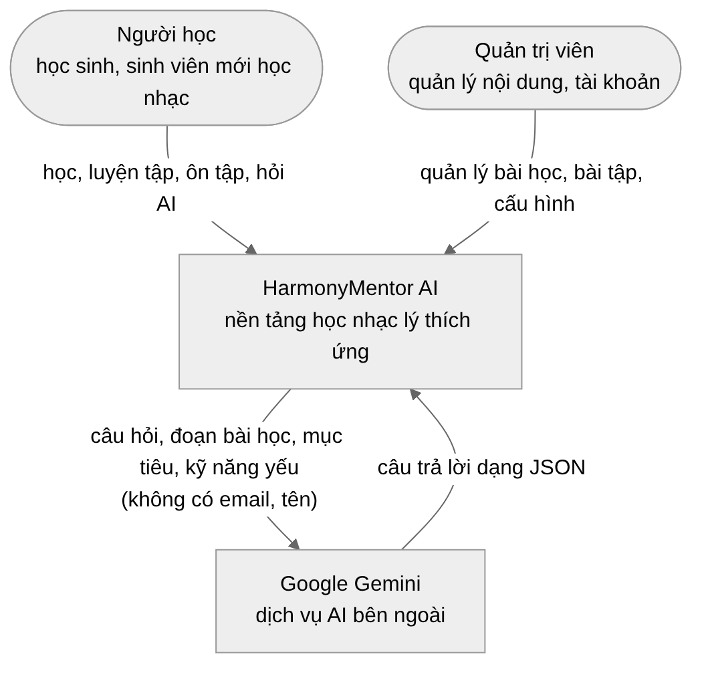
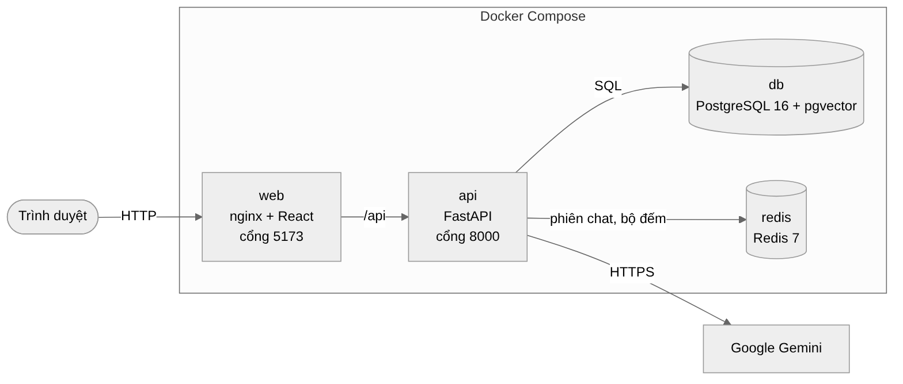
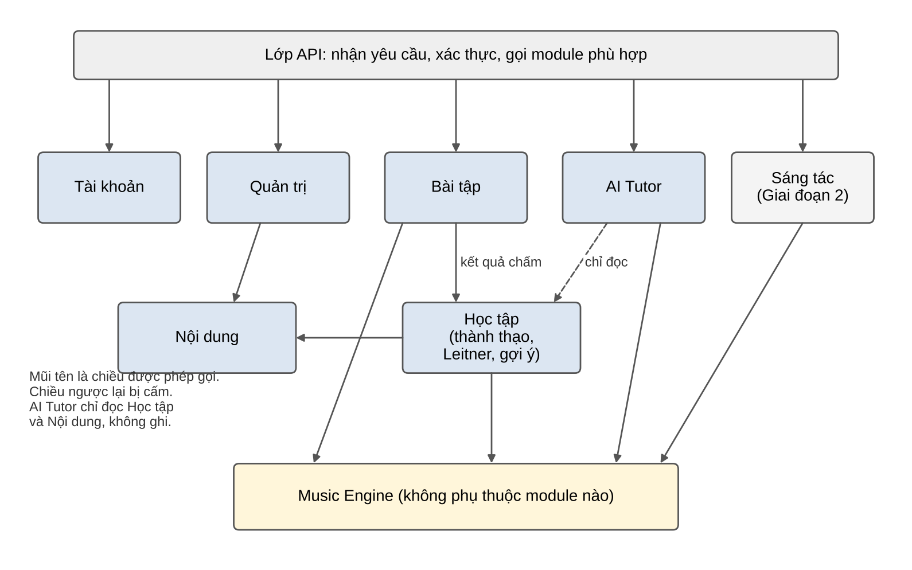
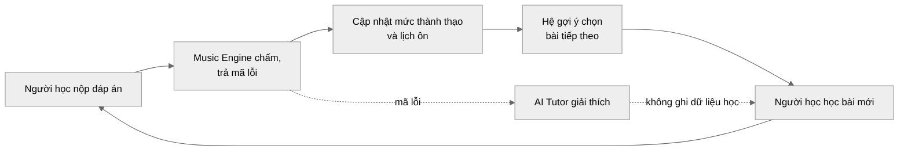
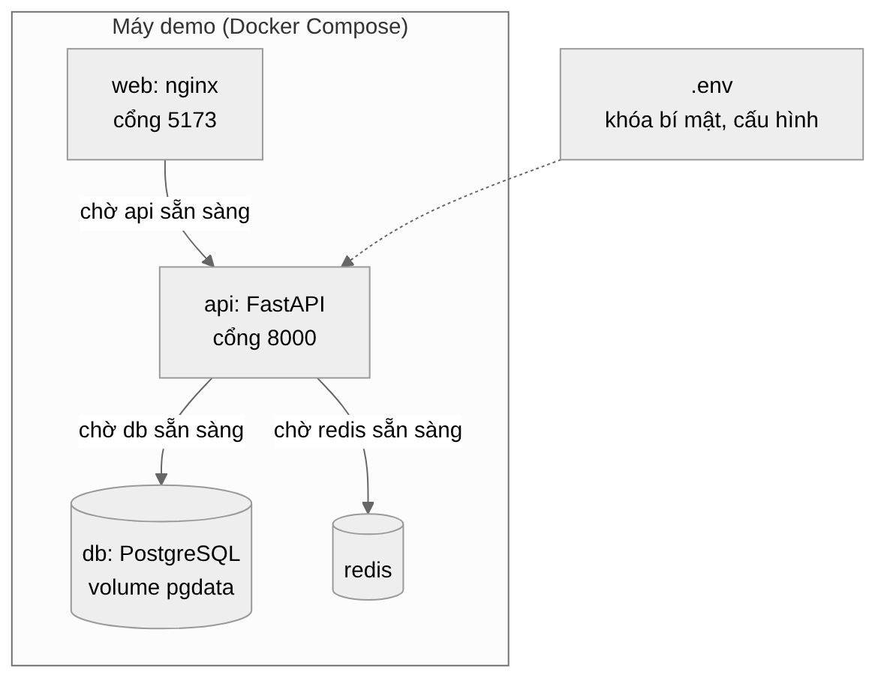
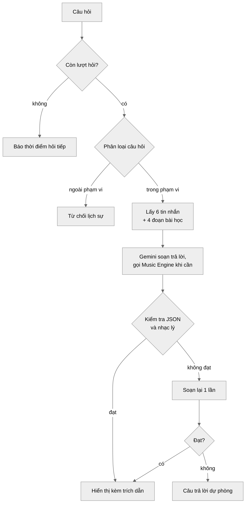

**ĐỒ ÁN CUỐI KHÓA (CAPSTONE PROJECT)**

*Nhóm HarmonyMentor • Bộ tài liệu dự án*

━━━━━━━━━━━━━━━━━━━━━━━━━━━━━━━━━━━━━━━━

**THIẾT KẾ TỔNG QUAN**  
**(HIGH-LEVEL DESIGN)**

Tài liệu Thiết kế tổng quan của đồ án cuối khóa • Phiên bản 2.1

<table>
<colgroup>
<col style="width: 100%" />
</colgroup>
<thead>
<tr class="header">
<th>
<strong>HARMONYMENTOR AI</strong> 
<strong>NỀN TẢNG HỌC NHẠC LÝ THÍCH ỨNG CÓ TRỢ LÝ AI</strong>

<em>(Adaptive Music Theory Learning, Hybrid Lesson Recommender &amp; Stateful AI Tutor)</em>

Hệ thống web giúp người mới học nhạc lý luyện tập có chẩn đoán lỗi, nhận gợi ý bài học theo mục tiêu và hỏi đáp với trợ lý AI có trích dẫn bài học.
</th>
</tr>
</thead>
<tbody>
</tbody>
</table>

| **Chuyên mục:**          | Hệ thống gợi ý (Recommender System) • Trợ lý hội thoại (Chatbot) • Backend API                |
|--------------------------|-----------------------------------------------------------------------------------------------|
| **Môn học tích hợp:**    | Python • AI Fundamental • NLP • FastAPI • Docker                                              |
| **Đề tài gốc:**          | Đề tài 03 – Trợ lý học tập thông minh và hệ thống gợi ý cá nhân hóa, áp dụng cho môn nhạc lý  |
| **Nhóm thực hiện:**      | Thắng (trưởng nhóm kỹ thuật) • Phúc (giao diện, âm thanh) • Đạt (nội dung, kiểm thử, báo cáo) |
| **Thời gian thực hiện:** | 14/10/2026 – 04/12/2026                                                                       |
| **Phiên bản:**           | 2.1 – tháng 10/2026                                                                           |

# MỤC LỤC

| **Mục** | **Nội dung**                                  | **Trang** |
|---------|-----------------------------------------------|-----------|
| 1       | **Giới thiệu**                                | 3         |
| 2       | **Mục tiêu và ràng buộc thiết kế**            | 3         |
| 2.1     | Mục tiêu                                      | 3         |
| 2.2     | Ràng buộc                                     | 3         |
| 3       | **Kiến trúc hệ thống**                        | 4         |
| 3.1     | Sơ đồ ngữ cảnh                                | 4         |
| 3.2     | Sơ đồ container                               | 5         |
| 3.3     | Vì sao chọn kiến trúc nguyên khối chia module | 5         |
| 4       | **Phân rã module**                            | 6         |
| 4.1     | Module backend                                | 6         |
| 4.2     | Quy tắc phụ thuộc                             | 7         |
| 4.3     | Trang và thành phần giao diện                 | 7         |
| 5       | **Luồng dữ liệu chính**                       | 8         |
| 6       | **Công nghệ sử dụng**                         | 8         |
| 7       | **Triển khai**                                | 9         |
| 8       | **Bảo mật**                                   | 10        |
| 9       | **Nguyên tắc sử dụng AI**                     | 11        |
| 9.1     | Phân chia trách nhiệm                         | 11        |
| 9.2     | Luồng xử lý một câu hỏi                       | 12        |
| 9.3     | Khi AI không dùng được                        | 13        |

***Bảng 1. Lịch sử phiên bản***

| **Phiên bản** | **Ngày**   | **Thay đổi**                                                                                                          | **Người viết** | **Người kiểm** |
|---------------|------------|-----------------------------------------------------------------------------------------------------------------------|----------------|----------------|
| 1.3           | 14/10/2026 | Bản SRS đầu tiên của đồ án.                                                                                           | Cả nhóm        | ………            |
| 1.4           | 20/10/2026 | Bổ sung lộ trình 12 bài, Harmony Lab, chatbot kèm cặp.                                                                | Cả nhóm        | ………            |
| 2.0           | 20/10/2026 | Tách thành 4 tài liệu theo góp ý của giảng viên, viết lại cho dễ đọc.                                                 | Cả nhóm        | ………            |
| 2.1           | 22/10/2026 | Sửa sau rà soát nội bộ: ngưỡng học tiếp 0,60, cách tính điểm gợi ý theo bài, dữ liệu gửi cho AI, thu gọn Giai đoạn 2. | Cả nhóm        | ………            |

# 1. GIỚI THIỆU

Tài liệu này mô tả thiết kế tổng quan của HarmonyMentor AI: hệ thống gồm những khối nào, các khối nói chuyện với nhau ra sao, dùng công nghệ gì và chạy ở đâu. Chi tiết từng bảng dữ liệu, từng API và từng thuật toán nằm ở tài liệu Thiết kế chi tiết.

Thiết kế bám theo hai tài liệu trước: SRS (19 chức năng chính) và Đặc tả chức năng và nghiệp vụ (9 phân hệ, chức năng chi tiết, luồng nghiệp vụ).

# 2. MỤC TIÊU VÀ RÀNG BUỘC THIẾT KẾ

## 2.1 Mục tiêu

***Bảng 2. Mục tiêu thiết kế***

| **Mục tiêu**              | **Ý nghĩa với thiết kế**                                                                                    |
|---------------------------|-------------------------------------------------------------------------------------------------------------|
| Đúng nhạc lý              | Mọi thông tin về nốt, quãng, hợp âm do một khối duy nhất tính: Music Engine. Giao diện và AI không tự tính. |
| Chạy được khi không có AI | Vòng Học → Luyện tập → Ôn tập không phụ thuộc AI. Khi AI tắt, hệ thống dùng câu giải thích viết sẵn.        |
| Dễ làm cho nhóm 3 người   | Một backend duy nhất, chia module rõ. Một lệnh Docker chạy toàn bộ.                                         |
| Dễ kiểm thử               | Phần nhạc lý và thuật toán không phụ thuộc cơ sở dữ liệu, nên kiểm thử nhanh và cho kết quả lặp lại được.   |
| Bảo vệ dữ liệu người học  | Mọi dữ liệu cá nhân được lọc theo người dùng trong token, không theo dữ liệu gửi lên.                       |

## 2.2 Ràng buộc

> • Nhóm có 3 người, làm từ 14/10 đến 04/12/2026, có 3 mốc kiểm tra ngày 20/10, 03/11 và 10/11.
>
> • Dùng dịch vụ AI miễn phí (Google Gemini), nên có giới hạn số lượt gọi mỗi ngày.
>
> • Chưa có dữ liệu người học thật. Hệ gợi ý phải được huấn luyện và đánh giá trên dữ liệu mô phỏng.
>
> • Môi trường demo là máy tính cá nhân, trình duyệt Chrome hoặc Edge.

# 3. KIẾN TRÚC HỆ THỐNG

## 3.1 Sơ đồ ngữ cảnh

Sơ đồ ngữ cảnh cho thấy hệ thống và những bên ở ngoài tương tác với nó.

***Hình 1. Sơ đồ ngữ cảnh của HarmonyMentor AI***

Người học và Quản trị viên dùng hệ thống qua trình duyệt. Hệ thống chỉ gọi ra ngoài một nơi là Google Gemini. Bảng dưới liệt kê chính xác những gì được gửi đi.

***Bảng 3. Dữ liệu gửi cho Gemini***

| **Được gửi**                                       | **Không bao giờ gửi**                |
|----------------------------------------------------|--------------------------------------|
| Câu hỏi và 6 tin nhắn gần nhất của phiên           | Email, tên hiển thị, mật khẩu        |
| Đoạn bài học liên quan (RAG)                       | Mã người dùng, token đăng nhập       |
| Mục tiêu học tập và tên các kỹ năng yếu            | Lịch sử làm bài đầy đủ của người học |
| Mã lỗi và đáp án của lượt làm đang được giải thích | Dữ liệu của người học khác           |

Người dùng có thể là học sinh dưới 18 tuổi, nên nhóm phải đọc điều khoản sử dụng Gemini API về độ tuổi và về cách Google dùng dữ liệu của gói miễn phí trước khi demo với người dùng thật. Khi có người dùng thật, nên chuyển sang gói trả phí hoặc tắt AI.

## 3.2 Sơ đồ container

***Hình 2. Sơ đồ container: các khối chạy độc lập***

***Bảng 4. Các container của hệ thống***

| **Container** | **Công nghệ**                  | **Vai trò**                                                                            |
|---------------|--------------------------------|----------------------------------------------------------------------------------------|
| Ứng dụng web  | React, TypeScript, Vite, nginx | Hiển thị giao diện, phát âm thanh, vẽ piano và khuông nhạc ngay trên trình duyệt.      |
| Máy chủ API   | Python 3.11, FastAPI           | Xử lý mọi nghiệp vụ: tài khoản, bài học, chấm bài, ôn tập, gợi ý, AI Tutor, quản trị.  |
| Cơ sở dữ liệu | PostgreSQL 16 có pgvector      | Lưu dữ liệu lâu dài và vector embedding dùng cho gợi ý và RAG.                         |
| Bộ nhớ đệm    | Redis 7                        | Lưu 6 tin nhắn gần nhất của mỗi phiên chat, đếm số lần đăng nhập sai và số câu hỏi AI. |

## 3.3 Vì sao chọn kiến trúc nguyên khối chia module

Nhóm chọn kiến trúc nguyên khối chia module (Modular Monolith): toàn bộ backend là một ứng dụng, nhưng bên trong chia thành các module có ranh giới rõ.

***Bảng 5. So sánh hai phương án kiến trúc***

| **Tiêu chí**          | **Nguyên khối chia module**         | **Nhiều dịch vụ nhỏ (microservices)**                |
|-----------------------|-------------------------------------|------------------------------------------------------|
| Công sức vận hành     | Một ứng dụng, một container         | Nhiều container, cần giao tiếp mạng giữa các dịch vụ |
| Gọi giữa các phần     | Gọi hàm trực tiếp, nhanh, dễ gỡ lỗi | Gọi qua mạng, phải xử lý lỗi kết nối                 |
| Phù hợp nhóm 3 người  | Phù hợp                             | Quá sức trong 7 tuần                                 |
| Khả năng tách sau này | Tách được vì ranh giới module đã rõ | Đã tách sẵn                                          |

# 4. PHÂN RÃ MODULE

## 4.1 Module backend

***Hình 3. Các module backend và chiều phụ thuộc***

***Bảng 6. Trách nhiệm của từng module backend***

| **Module**                          | **Trách nhiệm**                                                                                                                      | **Không được làm**                           |
|-------------------------------------|--------------------------------------------------------------------------------------------------------------------------------------|----------------------------------------------|
| Tài khoản (auth)                    | Đăng ký, đăng nhập, token, vai trò, hồ sơ, mục tiêu học tập.                                                                         | Xử lý nghiệp vụ học tập.                     |
| Nội dung (content)                  | Khóa học, module, bài học, kỹ năng, quan hệ tiên quyết, nguồn tham chiếu, nhập nội dung, chia đoạn bài học cho RAG.                  | Chấm bài, lưu tiến độ.                       |
| Music Engine                        | Nốt, quãng, âm giai, hợp âm, giọng, số La Mã, tiết tấu, chức năng hòa âm.                                                            | Đọc cơ sở dữ liệu, gọi AI.                   |
| Bài tập (assessment)                | Chấm bài theo loại câu và chế độ chấm, sinh mã lỗi, sinh bài từ mẫu, sinh quiz.                                                      | Tự tính nhạc lý ngoài Music Engine.          |
| Học tập (learning)                  | Tiến độ, mức thành thạo, lịch ôn Leitner, hệ gợi ý, kiểm tra đầu vào.                                                                | Gọi AI để xếp hạng bài học.                  |
| AI Tutor (ai)                       | Phiên chat, bộ nhớ, phân loại câu hỏi, RAG, gọi công cụ Music Engine, kiểm tra câu trả lời, giới hạn lượt hỏi.                       | Chấm bài, ghi mức thành thạo hay tiến độ.    |
| Sáng tác (composition, Giai đoạn 2) | Dự án Harmony Lab bản rút gọn: lưu, mở, phát lại vòng hợp âm và trống nền. Biến đổi vòng hợp âm và gợi ý hợp âm là hướng phát triển. | Tự sửa dự án khi người dùng chưa chấp nhận.  |
| Quản trị (admin)                    | Người dùng, nội dung, cấu hình AI.                                                                                                   | Bỏ qua kiểm tra dữ liệu của các module khác. |

## 4.2 Quy tắc phụ thuộc

> • Music Engine không phụ thuộc module nào. Mọi module khác đều được gọi Music Engine.
>
> • Module Bài tập báo kết quả chấm cho module Học tập. Học tập không gọi ngược lại Bài tập.
>
> • Module AI Tutor chỉ đọc dữ liệu học tập, không ghi.
>
> • Không module nào của Giai đoạn 1 phụ thuộc vào module Sáng tác.
>
> • Các module gọi nhau qua hàm công khai của module, không đọc thẳng bảng dữ liệu của module khác.

## 4.3 Trang và thành phần giao diện

***Bảng 7. Các trang chính của ứng dụng web***

| **Trang**       | **Nội dung**                                                                                      |
|-----------------|---------------------------------------------------------------------------------------------------|
| Trang chủ       | Giới thiệu hệ thống, chương trình học, nút Đăng ký và Đăng nhập.                                  |
| Bảng điều khiển | Mục tiêu học tập, 3–5 bài được gợi ý kèm lý do, kỹ năng yếu, số thẻ ôn đến hạn.                   |
| Học             | 12 bài theo 5 module. Trong bài: các bước học, mục lục, piano, khuông nhạc, bài tập.              |
| Luyện tập       | Bài tập ngẫu nhiên theo kỹ năng và mức độ Dễ, Vừa, Khó.                                           |
| Ôn tập          | Flashcard đến hạn, lật thẻ, tự đánh giá.                                                          |
| Tiến độ         | Tiến độ theo bài, mức thành thạo theo kỹ năng, số thẻ ở từng hộp Leitner.                         |
| Khung chat      | Nổi ở góc mọi trang sau đăng nhập. Hỏi AI Tutor, xem lịch sử, chấm sao.                           |
| Harmony Lab     | Giai đoạn 2, bản rút gọn. Dựng vòng hợp âm 4–8 ô nhịp, chọn trống nền, phát lại, lặp, đổi tốc độ. |
| Quản trị        | Quản lý người dùng, bài học, bài tập, flashcard, cấu hình AI.                                     |

Các thành phần dùng chung gồm: piano ảo, khuông nhạc, cần đàn guitar và mẫu trống nền (mức nên có), Chord Inspector (xem cấu tạo một hợp âm) và bộ phát âm thanh. Âm thanh được tạo ngay trên trình duyệt nên không tốn băng thông.

# 5. LUỒNG DỮ LIỆU CHÍNH

***Hình 4. Vòng dữ liệu học tập***

Vòng dữ liệu đi như sau. Người học nộp đáp án. Music Engine chấm và trả mã lỗi. Module Học tập cập nhật mức thành thạo và lịch ôn. Hệ gợi ý đọc mức thành thạo, mục tiêu và lịch ôn để chọn bài tiếp theo. AI Tutor đọc mã lỗi, bài học, mục tiêu và kỹ năng yếu để giải thích, nhưng không ghi gì vào dữ liệu học tập.

***Bảng 8. Dữ liệu được lưu ở đâu***

| **Dữ liệu**                                          | **Nơi lưu**                | **Lý do**                                                                                                                                   |
|------------------------------------------------------|----------------------------|---------------------------------------------------------------------------------------------------------------------------------------------|
| Tài khoản, bài học, lượt làm, thẻ ôn, mức thành thạo | PostgreSQL                 | Cần lưu lâu dài và có ràng buộc toàn vẹn.                                                                                                   |
| Vector mục tiêu, vector kỹ năng, vector đoạn bài học | PostgreSQL (pgvector)      | Tìm kiếm theo độ tương đồng ngay trong cơ sở dữ liệu, không cần thêm hệ thống khác.                                                         |
| Toàn bộ tin nhắn chat                                | PostgreSQL                 | Xem lại lịch sử, chạy bộ đánh giá AI.                                                                                                       |
| 6 tin nhắn gần nhất của phiên                        | Redis (hết hạn sau 24 giờ) | Đọc nhanh mỗi lần gửi tin nhắn. Khi không còn trong Redis, ví dụ mở lại phiên cũ hơn 24 giờ, hệ thống nạp lại 6 tin gần nhất từ PostgreSQL. |
| Bộ đếm đăng nhập sai, lượt hỏi AI                    | Redis                      | Tự hết hạn theo thời gian.                                                                                                                  |

# 6. CÔNG NGHỆ SỬ DỤNG

***Bảng 9. Công nghệ và lý do chọn***

| **Tầng**         | **Công nghệ**                         | **Lý do chọn**                                                                                                                   |
|------------------|---------------------------------------|----------------------------------------------------------------------------------------------------------------------------------|
| Giao diện        | React 18, TypeScript, Vite            | Phổ biến, nhóm đã quen. TypeScript giúp bắt lỗi kiểu dữ liệu sớm.                                                                |
| Trình bày        | Tailwind CSS                          | Viết giao diện nhanh, đồng bộ màu sắc và khoảng cách.                                                                            |
| Âm thanh         | Tone.js                               | Phát nốt, hợp âm, nhịp ngay trên trình duyệt với độ trễ thấp.                                                                    |
| Ký hiệu nhạc     | VexFlow                               | Vẽ nốt nhạc trên khuông chuẩn.                                                                                                   |
| Backend          | Python 3.11, FastAPI, Pydantic        | Python mạnh về AI và xử lý dữ liệu. FastAPI tự sinh tài liệu API.                                                                |
| Truy cập dữ liệu | SQLAlchemy, Alembic                   | Làm việc với bảng như đối tượng Python. Alembic quản lý thay đổi cấu trúc bảng.                                                  |
| Cơ sở dữ liệu    | PostgreSQL 16, pgvector               | Một hệ quản trị cho cả dữ liệu thường và vector.                                                                                 |
| Bộ nhớ đệm       | Redis 7                               | Nhanh, có thời gian hết hạn cho từng khóa.                                                                                       |
| Embedding        | paraphrase-multilingual-MiniLM-L12-v2 | Hiểu tiếng Việt và tiếng Anh, 384 chiều, chạy được trên CPU. Chỉ đọc 128 token đầu, nên đoạn bài học được chia ngắn (80–100 từ). |
| Hệ gợi ý         | scikit-learn, NumPy                   | Có sẵn thuật toán tìm láng giềng gần nhất (KNN).                                                                                 |
| AI               | Google Gemini                         | Gói miễn phí đủ cho demo, hỗ trợ gọi hàm.                                                                                        |
| Kiểm thử         | Pytest, Playwright                    | Pytest cho backend, Playwright cho luồng giao diện.                                                                              |
| Đóng gói         | Docker Compose                        | Một lệnh chạy cả 4 dịch vụ.                                                                                                      |

# 7. TRIỂN KHAI

***Hình 5. Sơ đồ triển khai bằng Docker Compose***

***Bảng 10. Các dịch vụ trong Docker Compose***

| **Dịch vụ** | **Image**                     | **Cổng**          | **Ghi chú**                                                                                                                                                      |
|-------------|-------------------------------|-------------------|------------------------------------------------------------------------------------------------------------------------------------------------------------------|
| web         | nginx với bản build giao diện | 5173              | Chuyển các yêu cầu /api sang dịch vụ api. Chỉ khởi động khi api đã sẵn sàng. Giữ cổng 5173 quen thuộc với nhóm, dù đây là bản build chứ không phải máy chủ Vite. |
| api         | Python 3.11 + FastAPI         | 8000              | Khi khởi động: cập nhật cấu trúc bảng, nạp nội dung bài học, tính embedding. Chờ db và redis sẵn sàng.                                                           |
| db          | pgvector/pgvector:pg16        | Không mở ra ngoài | Dữ liệu lưu trong volume để không mất khi tắt máy.                                                                                                               |
| redis       | redis:7-alpine                | Không mở ra ngoài | Bộ nhớ phiên và bộ đếm.                                                                                                                                          |

Mỗi dịch vụ có kiểm tra sức khỏe (healthcheck). Cách chạy: sao chép file cấu hình mẫu thành .env, rồi chạy docker compose up --build và mở http://localhost:5173.

***Bảng 11. Biến môi trường chính***

| **Biến**                                         | **Ý nghĩa**                                                                                                          |
|--------------------------------------------------|----------------------------------------------------------------------------------------------------------------------|
| DATABASE_URL, DB_PASSWORD                        | Kết nối và mật khẩu cơ sở dữ liệu                                                                                    |
| REDIS_URL                                        | Kết nối Redis                                                                                                        |
| JWT_SECRET, JWT_ACCESS_MINUTES, JWT_REFRESH_DAYS | Khóa ký token, thời hạn token truy cập (30 phút) và token làm mới (7 ngày)                                           |
| CORS_ORIGINS                                     | Địa chỉ giao diện được phép gọi API                                                                                  |
| GEMINI_API_KEY, GEMINI_MODEL                     | Khóa và tên mô hình Gemini. Chỉ đặt ở máy chủ.                                                                       |
| AI_ENABLED                                       | Bật hoặc tắt AI. Tắt để demo chế độ dự phòng.                                                                        |
| AI_DAILY_QUOTA, AI_TIMEOUT_SECONDS               | 30 câu hỏi mỗi người mỗi ngày, chờ tối đa 20 giây                                                                    |
| EMBEDDING_MODEL, RAG_TOP_K, RAG_MIN_SCORE        | Mô hình embedding, số đoạn bài học lấy ra (4), ngưỡng tương đồng (ban đầu 0,35, hiệu chỉnh trên bộ 30 câu hỏi chuẩn) |

# 8. BẢO MẬT

***Bảng 12. Các biện pháp bảo mật***

| **Vấn đề**                              | **Cách xử lý**                                                                                                                                                            |
|-----------------------------------------|---------------------------------------------------------------------------------------------------------------------------------------------------------------------------|
| Mật khẩu                                | Băm bằng bcrypt. Tối thiểu 8 ký tự, có chữ và số.                                                                                                                         |
| Phiên đăng nhập                         | Token truy cập JWT hết hạn sau 30 phút, giữ trong bộ nhớ trình duyệt. Token làm mới 7 ngày nằm trong cookie httpOnly, được đổi mới mỗi lần dùng và thu hồi khi đăng xuất. |
| Dò mật khẩu                             | Sau 5 lần sai trong 15 phút với cùng email từ cùng địa chỉ IP, đăng nhập bị tạm khóa. Đếm theo cả email và IP để cả lớp dùng chung wifi không bị khóa cùng lúc.           |
| Phân quyền                              | Mỗi API khai báo vai trò được phép. Người học gọi API quản trị nhận mã 403.                                                                                               |
| Dữ liệu người khác                      | Mã người dùng luôn lấy từ token. Dữ liệu không thuộc người dùng trả về 404.                                                                                               |
| Khóa API của AI                         | Chỉ nằm ở máy chủ trong biến môi trường, không bao giờ gửi xuống trình duyệt.                                                                                             |
| Tấn công qua câu hỏi (prompt injection) | Câu hỏi của người dùng luôn được đặt ở vai trò người dùng. Chỉ dẫn hệ thống cấm tiết lộ cấu hình. Đầu ra AI chỉ được hiển thị, không bao giờ được thực thi.               |
| Gọi API từ trang lạ                     | Máy chủ chỉ nhận yêu cầu từ địa chỉ giao diện đã cấu hình.                                                                                                                |

# 9. NGUYÊN TẮC SỬ DỤNG AI

## 9.1 Phân chia trách nhiệm

***Bảng 13. Ai chịu trách nhiệm việc gì***

| **Music Engine (luật cố định)**                      | **AI Tutor (Gemini)**                                     |
|------------------------------------------------------|-----------------------------------------------------------|
| Tính nốt, quãng, âm giai, hợp âm, giọng              | Giải thích bằng lời dễ hiểu                               |
| Chấm đúng hay sai, sinh mã lỗi                       | Gợi mở theo từng mức khi người học sai                    |
| Sinh đáp án đúng cho quiz                            | Viết phương án nhiễu và lời giải thích cho quiz           |
| Sinh ứng viên hợp âm khi sáng tác (hướng phát triển) | Xếp hạng và giải thích các ứng viên đó (hướng phát triển) |
| Xác nhận câu trả lời đã được kiểm                    | Không tự đánh dấu câu trả lời là đã kiểm                  |

## 9.2 Luồng xử lý một câu hỏi

***Hình 6. Luồng xử lý một câu hỏi trong AI Tutor***

> 1\. Kiểm tra lượt hỏi còn lại trong ngày.
>
> 2\. Phân loại câu hỏi: hỏi khái niệm, hỏi về lỗi, xin quiz, hỏi nên học gì, ngoài phạm vi.
>
> 3\. Lấy 6 tin nhắn gần nhất và 4 đoạn bài học liên quan.
>
> 4\. Gửi cho Gemini kèm danh sách công cụ của Music Engine mà AI được phép gọi.
>
> 5\. Kiểm tra câu trả lời: đúng định dạng JSON, có trích dẫn bài học. Máy chủ tự tìm mọi tên nốt, hợp âm trong câu trả lời và đối chiếu với Music Engine.
>
> 6\. Nếu sai, cho AI soạn lại một lần. Nếu vẫn sai hoặc AI lỗi, dùng câu trả lời dự phòng theo luật.

## 9.3 Khi AI không dùng được

Khi AI bị tắt, hết hạn mức hoặc quá 20 giây không trả lời, hệ thống vẫn hoạt động. Lời giải thích lỗi lấy từ câu viết sẵn theo mã lỗi. Quiz dùng phương án nhiễu sinh theo luật. Gợi ý bài học vẫn chạy vì không dùng AI. Tin nhắn của người học luôn được lưu để thử lại sau.
