**ĐỒ ÁN CUỐI KHÓA (CAPSTONE PROJECT)**

*Nhóm HarmonyMentor • Bộ tài liệu dự án*

━━━━━━━━━━━━━━━━━━━━━━━━━━━━━━━━━━━━━━━━

**THIẾT KẾ CHI TIẾT**  
**(DETAILED DESIGN)**

Tài liệu Thiết kế chi tiết của đồ án cuối khóa • Phiên bản 2.1

<table>
<colgroup>
<col style="width: 100%" />
</colgroup>
<thead>
<tr class="header">
<th>
<strong>HARMONYMENTOR AI</strong> 
<strong>NỀN TẢNG HỌC NHẠC LÝ THÍCH ỨNG CÓ TRỢ LÝ AI</strong>

<em>(Adaptive Music Theory Learning, Hybrid Lesson Recommender &amp; Stateful AI Tutor)</em>

Hệ thống web giúp người mới học nhạc lý luyện tập có chẩn đoán lỗi, nhận gợi ý bài học theo mục tiêu và hỏi đáp với trợ lý AI có trích dẫn bài học.
</th>
</tr>
</thead>
<tbody>
</tbody>
</table>

| **Chuyên mục:**          | Hệ thống gợi ý (Recommender System) • Trợ lý hội thoại (Chatbot) • Backend API                |
|--------------------------|-----------------------------------------------------------------------------------------------|
| **Môn học tích hợp:**    | Python • AI Fundamental • NLP • FastAPI • Docker                                              |
| **Đề tài gốc:**          | Đề tài 03 – Trợ lý học tập thông minh và hệ thống gợi ý cá nhân hóa, áp dụng cho môn nhạc lý  |
| **Nhóm thực hiện:**      | Thắng (trưởng nhóm kỹ thuật) • Phúc (giao diện, âm thanh) • Đạt (nội dung, kiểm thử, báo cáo) |
| **Thời gian thực hiện:** | 14/10/2026 – 04/12/2026                                                                       |
| **Phiên bản:**           | 2.1 – tháng 10/2026                                                                           |

# MỤC LỤC

| **Mục** | **Nội dung**                                        | **Trang** |
|---------|-----------------------------------------------------|-----------|
| 1       | **Giới thiệu**                                      | 4         |
| 2       | **Thiết kế cơ sở dữ liệu**                          | 4         |
| 2.1     | Sơ đồ quan hệ thực thể                              | 4         |
| 2.2     | Bảng nhóm học tập                                   | 6         |
| 2.3     | Bảng nhóm AI Tutor, gợi ý và Harmony Lab            | 7         |
| 2.4     | Ràng buộc chung                                     | 8         |
| 2.5     | Khóa Redis                                          | 8         |
| 3       | **Thiết kế API**                                    | 9         |
| 3.1     | Quy ước chung                                       | 9         |
| 3.2     | Danh sách endpoint                                  | 9         |
| 3.3     | Ví dụ yêu cầu và phản hồi                           | 10        |
| 3.4     | Định dạng lỗi                                       | 11        |
| 3.5     | Kiểm tra dữ liệu đầu vào                            | 12        |
| 3.6     | Định dạng câu trả lời của AI Tutor                  | 12        |
| 4       | **Thiết kế thành phần**                             | 14        |
| 5       | **Sơ đồ tuần tự**                                   | 15        |
| 5.1     | Nộp đáp án bài tập                                  | 15        |
| 5.2     | Ôn tập flashcard                                    | 15        |
| 5.3     | Nhận gợi ý bài học                                  | 16        |
| 5.4     | Hỏi AI Tutor                                        | 16        |
| 5.5     | Giải thích câu trả lời sai                          | 17        |
| 6       | **Thuật toán**                                      | 17        |
| 6.1     | Biểu diễn nốt và viết tên hợp âm                    | 17        |
| 6.2     | Chấm bài tập                                        | 18        |
| 6.3     | Cập nhật mức thành thạo                             | 19        |
| 6.4     | Xếp lịch ôn Leitner                                 | 19        |
| 6.5     | Gợi ý bài học                                       | 20        |
| 6.6     | Trả lời câu hỏi có căn cứ (RAG)                     | 21        |
| 6.7     | Sinh quiz                                           | 21        |
| 6.8     | Dữ liệu dự án Harmony Lab (Giai đoạn 2)             | 21        |
| 6.9     | Lời nhắc chủ động (Giai đoạn 2)                     | 22        |
| 6.10    | Biến đổi và kiểm tra vòng hợp âm (hướng phát triển) | 22        |
| 7       | **Thiết kế giao diện**                              | 23        |
| 8       | **Thiết kế kiểm thử**                               | 27        |
| 8.1     | Các mức kiểm thử                                    | 27        |
| 8.2     | Ca kiểm thử mẫu                                     | 27        |
| 8.3     | Bộ đánh giá AI Tutor                                | 28        |
| 8.4     | Đánh giá hệ gợi ý                                   | 28        |

***Bảng 1. Lịch sử phiên bản***

| **Phiên bản** | **Ngày**   | **Thay đổi**                                                                                                          | **Người viết** | **Người kiểm** |
|---------------|------------|-----------------------------------------------------------------------------------------------------------------------|----------------|----------------|
| 1.3           | 14/10/2026 | Bản SRS đầu tiên của đồ án.                                                                                           | Cả nhóm        | ………            |
| 1.4           | 20/10/2026 | Bổ sung lộ trình 12 bài, Harmony Lab, chatbot kèm cặp.                                                                | Cả nhóm        | ………            |
| 2.0           | 20/10/2026 | Tách thành 4 tài liệu theo góp ý của giảng viên, viết lại cho dễ đọc.                                                 | Cả nhóm        | ………            |
| 2.1           | 22/10/2026 | Sửa sau rà soát nội bộ: ngưỡng học tiếp 0,60, cách tính điểm gợi ý theo bài, dữ liệu gửi cho AI, thu gọn Giai đoạn 2. | Cả nhóm        | ………            |

# 1. GIỚI THIỆU

Tài liệu này mô tả thiết kế chi tiết của HarmonyMentor AI ở mức đủ để lập trình và kiểm thử: cấu trúc cơ sở dữ liệu, API, giao diện giữa các module, sơ đồ tuần tự, thuật toán, màn hình và kế hoạch kiểm thử. Kiến trúc tổng thể và lý do chọn công nghệ nằm ở tài liệu Thiết kế tổng quan.

# 2. THIẾT KẾ CƠ SỞ DỮ LIỆU

## 2.1 Sơ đồ quan hệ thực thể

Dữ liệu được chia thành hai nhóm để sơ đồ dễ đọc. Nhóm thứ nhất phục vụ học tập. Nhóm thứ hai phục vụ AI Tutor, hệ gợi ý và Harmony Lab.

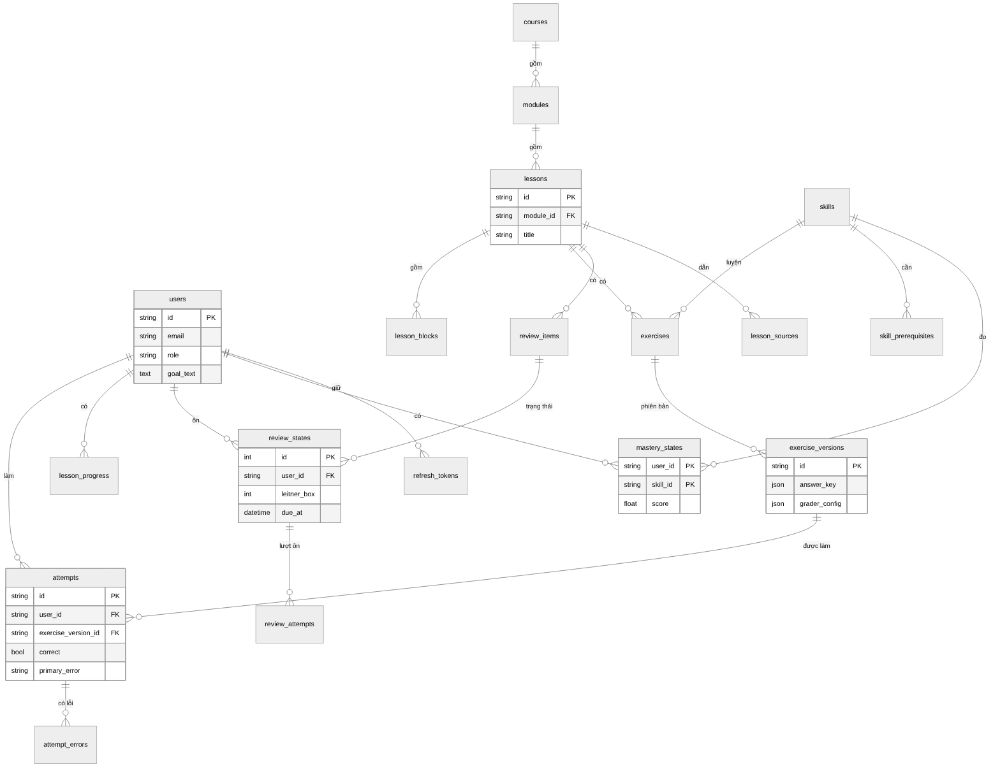

***Hình 1. Sơ đồ quan hệ thực thể: nhóm học tập***

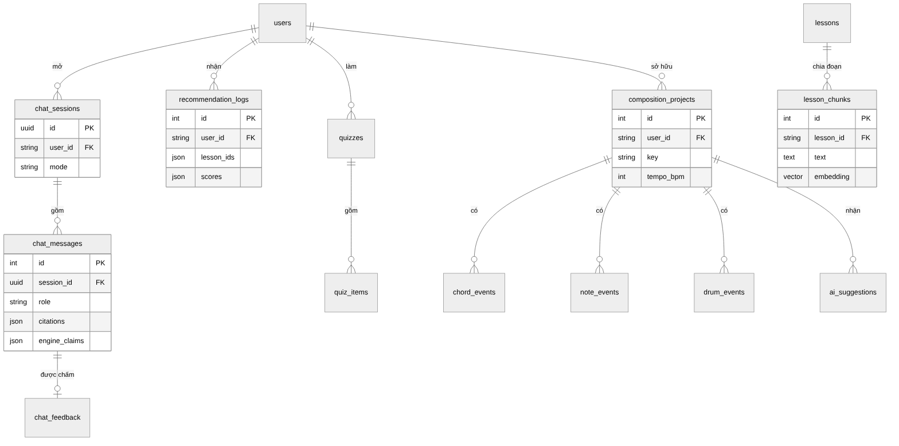

***Hình 2. Sơ đồ quan hệ thực thể: nhóm AI Tutor, gợi ý và Harmony Lab***

## 2.2 Bảng nhóm học tập

***Bảng 2. Bảng users (người dùng)***

| **Cột**              | **Kiểu**             | **Ý nghĩa**                                                    |
|----------------------|----------------------|----------------------------------------------------------------|
| id                   | varchar(64), PK      | Mã người dùng                                                  |
| email                | varchar(320), unique | Email đăng nhập                                                |
| hashed_password      | varchar              | Mật khẩu đã băm bằng bcrypt                                    |
| display_name         | varchar(120)         | Tên hiển thị                                                   |
| role                 | varchar(16)          | learner hoặc admin                                             |
| preferred_instrument | varchar(16)          | piano, guitar hoặc drums                                       |
| goal_text            | text                 | Mục tiêu học tập viết tự do                                    |
| goal_embedding       | vector(384)          | Vector của mục tiêu, dùng cho hệ gợi ý                         |
| is_synthetic         | boolean              | Người học mô phỏng, không đăng nhập, không hiện trong thống kê |
| is_active            | boolean              | Tài khoản còn hoạt động                                        |
| created_at           | timestamp            | Thời điểm tạo                                                  |

***Bảng 3. Bảng refresh_tokens (token làm mới)***

| **Cột**    | **Kiểu**        | **Ý nghĩa**                                        |
|------------|-----------------|----------------------------------------------------|
| id         | uuid, PK        | Mã token                                           |
| user_id    | FK → users      | Chủ token                                          |
| token_hash | varchar, unique | Giá trị băm SHA-256 của token, không lưu token gốc |
| expires_at | timestamp       | Hết hạn sau 7 ngày                                 |
| revoked_at | timestamp, null | Thời điểm bị thu hồi                               |

***Bảng 4. Bảng nội dung học***

| **Bảng**                     | **Cột chính**                                                                                                                                                                                            |
|------------------------------|----------------------------------------------------------------------------------------------------------------------------------------------------------------------------------------------------------|
| courses                      | id (PK), title, description, is_published                                                                                                                                                                |
| modules                      | id (PK), course_id (FK), branch (foundation, functional, pop, jazz, integrated), title, order_index                                                                                                      |
| lessons                      | id (PK, ví dụ L05), module_id (FK), order_index (unique), title, objectives (JSON), status, deleted_at                                                                                                   |
| lesson_blocks                | id (PK), lesson_id (FK), position, block_type (THEORY, NOTATION, PIANO, CHECKPOINT…), payload (JSON). Unique (lesson_id, position)                                                                       |
| skills                       | id (PK, ví dụ chord.seventh_build), name, group_code (14 nhóm kỹ năng), description, embedding vector(384), ready_threshold (đủ để học tiếp, mặc định 0,6), mastery_threshold (thành thạo, mặc định 0,8) |
| skill_prerequisites          | id (PK), skill_id (FK), prerequisite_skill_id (FK). Unique cặp hai cột. Không cho phép tạo chu trình                                                                                                     |
| source_works, lesson_sources | Nguồn tham chiếu (tên, tác giả, đường dẫn) và vị trí chương, mục của từng bài                                                                                                                            |

***Bảng 5. Bảng bài tập và lượt làm***

| **Bảng**          | **Cột chính**                                                                                                                                                                                                                           |
|-------------------|-----------------------------------------------------------------------------------------------------------------------------------------------------------------------------------------------------------------------------------------|
| exercises         | id (PK), lesson_id (FK), skill_id (FK), kind (loại câu), prompt, options (JSON), position, difficulty, deleted_at                                                                                                                       |
| exercise_versions | id (PK, ví dụ L02-Q06-v1), exercise_id (FK), version, answer_key (JSON), grader_config (JSON: chế độ chấm, cho phép thể đảo), explanation, provenance (JSON). Khi sửa câu hỏi, hệ thống tạo phiên bản mới để lượt làm cũ giữ đúng nghĩa |
| attempts          | id (PK), user_id (FK), exercise_version_id (FK), answer (JSON), input_method (text, choice, piano), correct, score, primary_error, feedback, is_test, created_at                                                                        |
| attempt_errors    | id (PK), attempt_id (FK), code, detail (JSON). Một lượt làm có thể có nhiều lỗi                                                                                                                                                         |
| lesson_progress   | id (PK), user_id (FK), lesson_id (FK), status, current_step, started_at, completed_at. Unique (user_id, lesson_id)                                                                                                                      |

***Bảng 6. Bảng ôn tập và mức thành thạo***

| **Bảng**        | **Cột chính**                                                                                                                                                 |
|-----------------|---------------------------------------------------------------------------------------------------------------------------------------------------------------|
| review_items    | id (PK), lesson_id (FK), skill_id (FK), mode (đáp án cố định hoặc tự đánh giá), front, back, answer_key, provenance                                           |
| review_states   | id (PK), user_id (FK), review_item_id (FK), leitner_box (1–5), due_at, last_reviewed_at, failure_count. Unique (user_id, review_item_id). Chỉ mục trên due_at |
| review_attempts | id (PK), review_state_id (FK), answer, correct, response_time_ms, created_at                                                                                  |
| mastery_states  | PK (user_id, skill_id), score (0–1), attempts_count, last_error_code, updated_at                                                                              |

## 2.3 Bảng nhóm AI Tutor, gợi ý và Harmony Lab

***Bảng 7. Bảng của AI Tutor***

| **Bảng**            | **Cột chính**                                                                                                                                                                                                                |
|---------------------|------------------------------------------------------------------------------------------------------------------------------------------------------------------------------------------------------------------------------|
| chat_sessions       | id (UUID, PK), user_id (FK), mode (companion hoặc harmony_assistant), summary, created_at, updated_at                                                                                                                        |
| chat_messages       | id (PK), session_id (FK), role (user, assistant, tool), content, intent, citations (JSON), engine_claims (JSON), tool_calls (JSON), hint_level, status (ok, failed, fallback), latency_ms, tokens_in, tokens_out, created_at |
| chat_feedback       | id (PK), message_id (FK, unique), user_id (FK), stars (1–5), comment                                                                                                                                                         |
| companion_nudges    | id (PK), user_id (FK), session_id (FK), kind (review_due, next_lesson, mastery_up), status (shown, clicked, dismissed), shown_at. Dùng ở Giai đoạn 2                                                                         |
| lesson_chunks       | id (PK), lesson_id (FK), block_id, chunk_index, text, source_work_id, embedding vector(384). Chỉ mục HNSW để tìm nhanh                                                                                                       |
| quizzes, quiz_items | quizzes: id, user_id, skill_id, source. quiz_items: id, quiz_id, question, correct_answer (do Music Engine sinh), distractors (JSON), explanation, validated                                                                 |

***Bảng 8. Bảng của hệ gợi ý và Harmony Lab***

| **Bảng**                               | **Cột chính**                                                                                                             |
|----------------------------------------|---------------------------------------------------------------------------------------------------------------------------|
| recommendation_logs                    | id (PK), user_id (FK), lesson_ids (JSON), scores (JSON theo từng tầng), explanation, clicked_lesson_id, created_at        |
| composition_projects                   | id (PK), user_id (FK), name, key, tempo_bpm, time_signature (4/4), bars (4–8), is_test, deleted_at. Giai đoạn 2           |
| chord_events, note_events, drum_events | Sự kiện hợp âm, nốt giai điệu và trống của dự án. Thời gian tính theo phách (start_beat, duration_beats), không theo giây |
| ai_suggestions                         | id (PK), project_id (FK), rule, payload (JSON), explanation, status (pending, accepted, rejected)                         |

## 2.4 Ràng buộc chung

> • Mọi bảng dữ liệu cá nhân có user_id. Mọi truy vấn lọc theo user_id lấy từ token.
>
> • Bài học, bài tập và dự án được xóa mềm bằng cột deleted_at. Lượt làm cũ vẫn trỏ đúng tới câu hỏi.
>
> • Lượt làm của Quản trị viên có is_test = true, không tính vào mức thành thạo và thống kê.
>
> • Người học mô phỏng có is_synthetic = true. Họ chỉ dùng để huấn luyện và đánh giá hệ gợi ý.

## 2.5 Khóa Redis

***Bảng 9. Khóa lưu trong Redis***

| **Khóa**                   | **Hết hạn** | **Nội dung**                                                                                                                   |
|----------------------------|-------------|--------------------------------------------------------------------------------------------------------------------------------|
| chat:{session_id}          | 24 giờ      | Danh sách 6 tin nhắn gần nhất của phiên                                                                                        |
| chat:nudge:{session_id}    | 24 giờ      | Số lời nhắc đã hiện trong phiên (tối đa 3)                                                                                     |
| rl:ai:{user_id}:{yyyymmdd} | 24 giờ      | Số câu hỏi AI trong ngày (tối đa 30)                                                                                           |
| rl:login:{email}:{ip}      | 15 phút     | Số lần đăng nhập sai của một email từ một địa chỉ IP (tối đa 5). Đếm theo cặp này để người dùng chung wifi không khóa lẫn nhau |

# 3. THIẾT KẾ API

## 3.1 Quy ước chung

> • Tiền tố /api/v1. Dữ liệu gửi và nhận ở dạng JSON.
>
> • Token truy cập gửi trong header Authorization: Bearer. Token làm mới nằm trong cookie hm_refresh (httpOnly, 7 ngày).
>
> • Khi nhận mã 401, giao diện gọi /auth/refresh một lần rồi thử lại yêu cầu.
>
> • Mỗi phản hồi có header X-Response-Time để đo hiệu năng.

## 3.2 Danh sách endpoint

***Bảng 10. Danh sách endpoint***

| **Method** | **Endpoint**                                                         | **Quyền**                | **Mô tả**                                             |
|------------|----------------------------------------------------------------------|--------------------------|-------------------------------------------------------|
| GET        | /health                                                              | Công khai                | Trạng thái cơ sở dữ liệu, Redis, phiên bản            |
| POST       | /auth/register                                                       | Công khai                | Tạo tài khoản, trả token truy cập, đặt cookie làm mới |
| POST       | /auth/login                                                          | Công khai                | Đăng nhập, khóa tạm sau 5 lần sai                     |
| POST       | /auth/refresh                                                        | Cookie                   | Đổi token làm mới, cấp token truy cập mới             |
| POST       | /auth/logout                                                         | Cookie                   | Thu hồi token làm mới                                 |
| GET, PATCH | /me                                                                  | Người học                | Xem, sửa tên hiển thị và nhạc cụ ưa thích             |
| PUT        | /me/goal                                                             | Người học                | Lưu mục tiêu học tập, tính vector mục tiêu            |
| GET        | /courses, /courses/{id}                                              | Công khai                | Khóa học, module và bài theo module                   |
| GET        | /lessons, /lessons/{id}                                              | Người học                | Danh sách bài, chi tiết bài (không kèm đáp án)        |
| POST       | /lessons/{id}/start                                                  | Người học                | Ghi nhận bắt đầu bài                                  |
| POST       | /lessons/{id}/complete                                               | Người học                | Hoàn thành bài, kích hoạt thẻ ôn                      |
| POST       | /attempts                                                            | Người học                | Nộp đáp án, nhận kết quả chấm                         |
| GET        | /exercises/{id}/hint                                                 | Người học                | Lấy gợi ý cho câu bài tập                             |
| GET        | /review/due                                                          | Người học                | Thẻ ôn đến hạn (tối đa 20)                            |
| POST       | /review/{item_id}/answer                                             | Người học                | Ghi kết quả ôn, xếp lịch kế tiếp                      |
| GET        | /progress                                                            | Người học                | Mức thành thạo theo kỹ năng, kỹ năng yếu, hộp Leitner |
| GET        | /recommend?k=5                                                       | Người học                | 3–5 bài gợi ý kèm lý do                               |
| POST       | /placement/start, /placement/submit                                  | Người học                | Bài kiểm tra đầu vào                                  |
| POST       | /chat/sessions                                                       | Người học                | Tạo phiên chat mới                                    |
| POST       | /chat/message                                                        | Người học                | Gửi tin nhắn, nhận câu trả lời của AI Tutor           |
| POST       | /chat/explain-attempt                                                | Người học (chủ lượt làm) | Giải thích một lượt làm sai theo mức gợi mở           |
| GET        | /chat/sessions, /chat/history/{session_id}                           | Người học (chủ phiên)    | Danh sách phiên, lịch sử một phiên                    |
| POST       | /chat/messages/{id}/rating                                           | Người học                | Chấm 1–5 sao cho câu trả lời                          |
| POST       | /quiz/generate                                                       | Người học                | Sinh quiz 3 hoặc 10 câu theo kỹ năng                  |
| GET        | /music/chords/inspect                                                | Công khai                | Phân tích cấu tạo một hợp âm                          |
| CRUD       | /projects, /projects/{id}                                            | Người học (chủ dự án)    | Dự án Harmony Lab (Giai đoạn 2)                       |
| POST       | /projects/{id}/suggestions                                           | Người học (chủ dự án)    | Gợi ý hợp âm (hướng phát triển)                       |
| POST       | /suggestions/{id}/accept, /reject                                    | Người học (chủ dự án)    | Chấp nhận hoặc từ chối gợi ý (hướng phát triển)       |
| CRUD       | /admin/courses, /modules, /lessons, /skills, /exercises, /flashcards | Quản trị viên            | Quản lý nội dung                                      |
| POST       | /admin/content/import                                                | Quản trị viên            | Nhập nội dung từ file                                 |
| GET, PATCH | /admin/users, /admin/ai-config                                       | Quản trị viên            | Quản lý người dùng và cấu hình AI                     |

## 3.3 Ví dụ yêu cầu và phản hồi

### Đăng nhập

<table>
<colgroup>
<col style="width: 100%" />
</colgroup>
<thead>
<tr class="header">
<th>POST /api/v1/auth/login 
{ "email": "hocvien@example.com", "password": "********" } 
 
200 OK 
{ "access_token": "&lt;JWT 30 phút&gt;", "token_type": "bearer", "expires_in": 1800, 
"user": { "id": "u_1a2b", "display_name": "Minh", "role": "learner", 
"preferred_instrument": "piano", "goal_text": null } } 
Set-Cookie: hm_refresh=&lt;token&gt;; HttpOnly; SameSite=Lax; Path=/api/v1/auth</th>
</tr>
</thead>
<tbody>
</tbody>
</table>

### Nộp đáp án sai

<table>
<colgroup>
<col style="width: 100%" />
</colgroup>
<thead>
<tr class="header">
<th>POST /api/v1/attempts 
{ "exercise_version_id": "L02-Q06-v1", "answer": "G B D F#", "input_method": "text" } 
 
200 OK 
{ "attempt_id": "9b1e0c4a-...", "correct": false, "score": 0.0, 
"primary_error": "SEVENTH_QUALITY", 
"feedback": "Bạn đang dùng quãng 7 trưởng thay vì quãng 7 thứ (F# → F).", 
"errors": [ { "code": "SEVENTH_QUALITY", 
"detail": { "answered": "F#", "expected_note": "F" } } ], 
"explanation": null, "wrong_attempts": 1 }</th>
</tr>
</thead>
<tbody>
</tbody>
</table>

### Nhận gợi ý bài học

<table>
<colgroup>
<col style="width: 100%" />
</colgroup>
<thead>
<tr class="header">
<th>GET /api/v1/recommend?k=3 
 
200 OK 
{ "items": [ 
{ "lesson_id": "L10", "title": "Nhịp, phách và tiết tấu cơ bản", "score": 0.548, 
"reason": "Khớp mục tiêu đệm hát pop; người học giống bạn thường học bài này tiếp theo." }, 
{ "lesson_id": "L03", "title": "Chức năng hòa âm T – PD – D", "score": 0.447, 
"reason": "Bạn đã vững hợp âm ba, đây là bước tiếp theo trên lộ trình." }, 
{ "lesson_id": "L09", "title": "Âm giai thứ và giọng thứ", "score": 0.419, 
"reason": "Kỹ năng nền tảng bạn chưa học." } ] }</th>
</tr>
</thead>
<tbody>
</tbody>
</table>

### Hỏi AI Tutor

<table>
<colgroup>
<col style="width: 100%" />
</colgroup>
<thead>
<tr class="header">
<th>POST /api/v1/chat/message 
{ "session_id": "c7a8b9e1-2f34-4d56-9a01-abcdef123456", 
"message": "V7/vi trong giọng Đô trưởng là gì?", 
"context": { "page": "learn", "lesson_id": "L05", "block_id": "L05-B02" } } 
 
200 OK 
{ "message_id": 1842, 
"reply": "V7/vi là hợp âm át của Am. Trong giọng Đô trưởng đó là E7 = E G# B D, thường đi về Am.", 
"citations": [ { "lesson_id": "L05", "block_id": "L05-B02", "title": "Hợp âm át phụ" } ], 
"engine_claims": [ { "tool": "secondary_dominant", 
"args": { "key": "C", "target": "vi" }, "verified": true } ], 
"intent": "concept", "quota_remaining_today": 27 }</th>
</tr>
</thead>
<tbody>
</tbody>
</table>

## 3.4 Định dạng lỗi

Mọi lỗi trả về cùng một dạng để giao diện xử lý thống nhất:

<table>
<colgroup>
<col style="width: 100%" />
</colgroup>
<thead>
<tr class="header">
<th>{ "error": { "code": "AI_UNAVAILABLE", 
"message": "Trợ lý đang bận. Tin nhắn của bạn đã được lưu, hãy thử lại.", 
"retryable": true } }</th>
</tr>
</thead>
<tbody>
</tbody>
</table>

***Bảng 11. Mã trạng thái HTTP***

| **Mã** | **Ý nghĩa**                                                                                                                                                                                             |
|--------|---------------------------------------------------------------------------------------------------------------------------------------------------------------------------------------------------------|
| 400    | Dữ liệu gửi lên không hợp lệ                                                                                                                                                                            |
| 401    | Chưa đăng nhập hoặc token hết hạn                                                                                                                                                                       |
| 403    | Không đủ quyền, ví dụ Người học gọi API quản trị                                                                                                                                                        |
| 404    | Không tồn tại, hoặc thuộc người dùng khác                                                                                                                                                               |
| 409    | Xung đột trạng thái, ví dụ hoàn thành bài khi chưa đúng hết các câu. Mã lỗi LESSON_NOT_MASTERED được giữ từ bản trước, nghĩa là "chưa làm đúng hết các câu", không liên quan tới ngưỡng thành thạo 0,80 |
| 429    | Vượt giới hạn: đăng nhập sai quá nhiều (LOGIN_LOCKED) hoặc hết lượt hỏi AI                                                                                                                              |
| 503    | Dịch vụ AI lỗi. Dữ liệu của người dùng vẫn được lưu                                                                                                                                                     |

## 3.5 Kiểm tra dữ liệu đầu vào

***Bảng 12. Quy tắc kiểm tra dữ liệu đầu vào***

| **Trường**         | **Quy tắc**                                                    | **Lỗi trả về**           |
|--------------------|----------------------------------------------------------------|--------------------------|
| email              | Đúng định dạng email, tối đa 320 ký tự, chưa có trong hệ thống | 400 hoặc 409 EMAIL_TAKEN |
| password           | Từ 8 ký tự, có ít nhất một chữ cái và một chữ số               | 400 WEAK_PASSWORD        |
| display_name       | Từ 1 đến 120 ký tự                                             | 400                      |
| goal_text          | Tối đa 500 ký tự. Rỗng thì hệ gợi ý dùng lộ trình mặc định     | 400                      |
| answer             | Chuỗi hoặc danh sách, tối đa 200 ký tự                         | 400                      |
| input_method       | Một trong text, choice, piano                                  | 400                      |
| message (chat)     | Từ 1 đến 1.000 ký tự                                           | 400                      |
| context.attempt_id | Phải là lượt làm của chính người dùng                          | 404                      |
| stars              | Số nguyên từ 1 đến 5                                           | 400                      |

## 3.6 Định dạng câu trả lời của AI Tutor

Gemini phải trả về JSON theo các trường dưới đây. Câu trả lời sai định dạng được yêu cầu soạn lại một lần, sau đó dùng câu trả lời dự phòng.

***Bảng 13. Các trường trong câu trả lời của AI Tutor***

| **Trường**        | **Kiểu**            | **Ý nghĩa**                                                                              |
|-------------------|---------------------|------------------------------------------------------------------------------------------|
| reply             | chuỗi               | Câu trả lời hiển thị cho người học                                                       |
| citations         | danh sách           | Các bài và khối bài học được trích dẫn (lesson_id, block_id, title)                      |
| engine_claims     | danh sách           | Các khẳng định nhạc lý AI đưa ra, kèm công cụ đã gọi. AI không được điền trường verified |
| hint_level        | số 0–3              | 0 là trả lời thường. 1–3 là mức gợi mở khi giải thích lỗi                                |
| suggested_actions | danh sách           | Gợi ý thao tác tiếp theo, ví dụ mở bài L05 hoặc làm quiz                                 |
| quiz              | đối tượng hoặc null | Các câu quiz khi người học xin luyện tập                                                 |
| intent            | chuỗi               | concept, explain_error, quiz, study_advice, composition hoặc out_of_scope                |

Sau khi nhận JSON, máy chủ tự làm hai việc. Một là gọi lại Music Engine cho từng mục trong engine_claims và ghi verified. Hai là quét toàn bộ reply để tìm mọi ký hiệu hợp âm và dãy tên nốt, kể cả những gì AI không khai trong engine_claims, rồi đối chiếu với Music Engine. Chỉ khi mọi mục đều đúng, câu trả lời mới được gắn nhãn "Đã kiểm bằng Music Engine".

***Bảng 14. Công cụ AI Tutor được phép gọi***

| **Công cụ**          | **Đầu vào → đầu ra**                                                                         | **Ví dụ**                        | **Module cung cấp**        |
|----------------------|----------------------------------------------------------------------------------------------|----------------------------------|----------------------------|
| get_chord_tones      | ký hiệu hợp âm → các nốt, công thức                                                          | Ebm7b5 → Eb Gb Bbb Db            | Music Engine               |
| get_scale            | nốt chủ, loại âm giai → các nốt                                                              | G major → G A B C D E F#         | Music Engine               |
| identify_interval    | hai nốt → tên quãng, số nửa cung                                                             | F, A → M3, 4                     | Music Engine               |
| roman_numeral        | giọng, hợp âm → bậc, chức năng                                                               | C, Dm7 → ii7, PD                 | Music Engine               |
| secondary_dominant   | giọng, bậc đích → hợp âm, các nốt                                                            | C, vi → E7 = E G# B D            | Music Engine               |
| analyze_progression  | giọng, vòng hợp âm → bậc, chức năng, cờ                                                      | C, \[C E7 Am F\] → I V7/vi vi IV | Music Engine (Giai đoạn 2) |
| get_lesson           | mã bài, mã khối → nội dung, nguồn                                                            | L05, L05-B02                     | Nội dung                   |
| get_attempt_feedback | mã lượt làm → mã lỗi, đáp án đúng, đáp án đã nộp                                             | Chỉ lượt làm của người hỏi       | Bài tập                    |
| get_learner_snapshot | không có → tên kỹ năng yếu, số thẻ đến hạn, mục tiêu. Không trả email, tên hay mã người dùng | Chỉ đọc                          | Học tập                    |

# 4. THIẾT KẾ THÀNH PHẦN

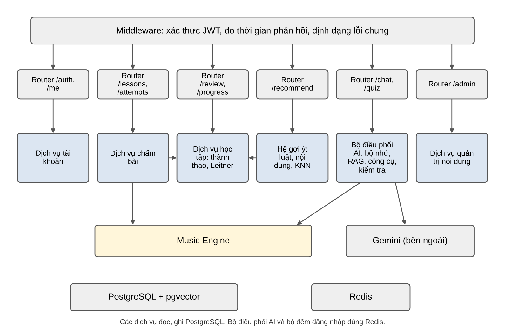

***Hình 3. Thành phần bên trong máy chủ API***

***Bảng 15. Hàm công khai giữa các module***

| **Module**   | **Hàm công khai**                                                                                                                                                | **Ai gọi**                       |
|--------------|------------------------------------------------------------------------------------------------------------------------------------------------------------------|----------------------------------|
| Music Engine | chord_tones(symbol), interval_between(a, b), build_scale(tonic, type), roman_numeral(key, chord), harmonic_function(key, chord), secondary_dominant(key, target) | Bài tập, AI Tutor, Sáng tác      |
| Bài tập      | grade(exercise_version, answer, input_method) → kết quả chấm                                                                                                     | API /attempts                    |
| Học tập      | on_attempt(user, skill, result), due_reviews(user, limit), answer_review(user, item, correct), recommend(user, k)                                                | Bài tập, API, AI Tutor (chỉ đọc) |
| Nội dung     | get_lesson(id), search_chunks(vector, k)                                                                                                                         | Học tập, AI Tutor                |
| AI Tutor     | handle_message(user, session, text, context), explain_attempt(user, attempt, level)                                                                              | API /chat                        |

# 5. SƠ ĐỒ TUẦN TỰ

## 5.1 Nộp đáp án bài tập

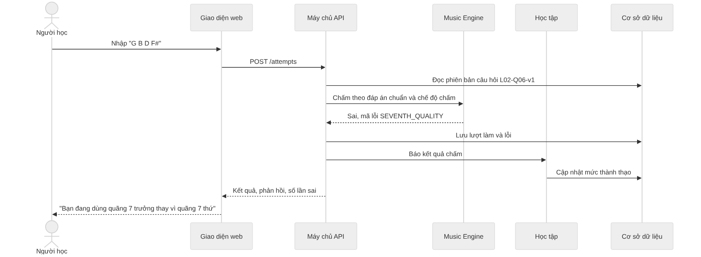

***Hình 4. Sơ đồ tuần tự: nộp đáp án bài tập***

## 5.2 Ôn tập flashcard

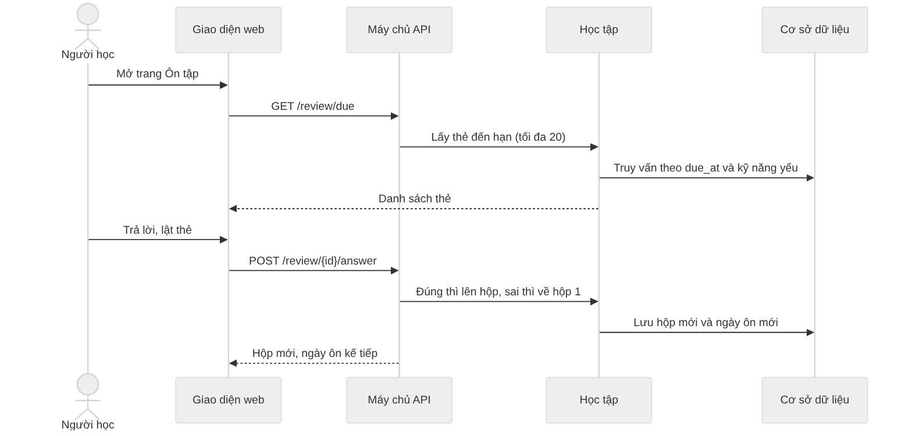

***Hình 5. Sơ đồ tuần tự: ôn tập flashcard***

## 5.3 Nhận gợi ý bài học

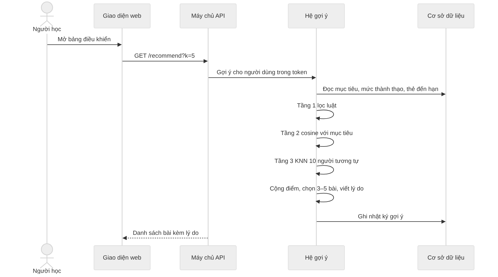

***Hình 6. Sơ đồ tuần tự: nhận gợi ý bài học***

## 5.4 Hỏi AI Tutor

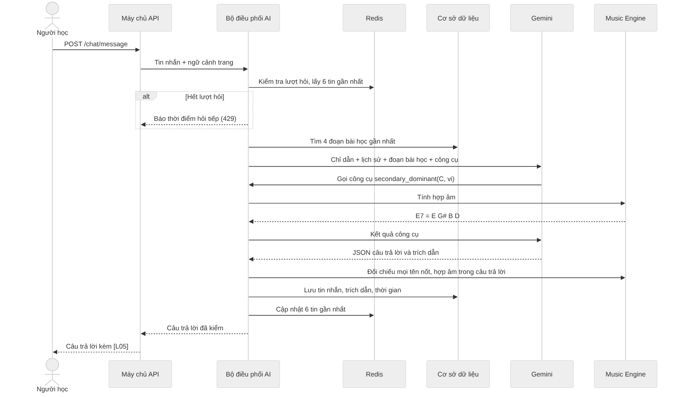

***Hình 7. Sơ đồ tuần tự: hỏi AI Tutor***

## 5.5 Giải thích câu trả lời sai

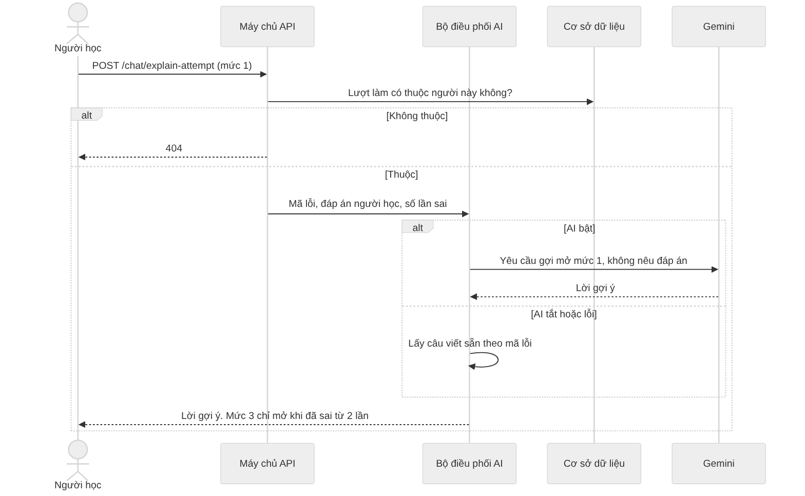

***Hình 8. Sơ đồ tuần tự: giải thích câu trả lời sai***

# 6. THUẬT TOÁN

## 6.1 Biểu diễn nốt và viết tên hợp âm

Mỗi nốt là bộ ba (chữ cái, dấu hóa, quãng tám). Ví dụ Ab4 là ("A", −1, 4). Số MIDI chỉ dùng để phát âm thanh: midi = 12 × (quãng tám + 1) + số nửa cung của chữ cái + dấu hóa, với số nửa cung C = 0, D = 2, E = 4, F = 5, G = 7, A = 9, B = 11. Ví dụ Ab4 = 12 × 5 + 9 − 1 = 68.

Các nốt của hợp âm được viết tên theo quãng tính từ nốt gốc: quãng 3 cách 2 chữ cái, quãng 5 cách 4 chữ cái, quãng 7 cách 6 chữ cái. Vì vậy Ebm7b5 luôn là Eb Gb Bbb Db, không bao giờ là Eb F# A C#.

***Bảng 16. Các loại hợp âm Music Engine hỗ trợ***

| **Ký hiệu** | **Công thức quãng** | **Ví dụ trên nốt C** |
|-------------|---------------------|----------------------|
| (trưởng)    | 1 3 5               | C E G                |
| m           | 1 b3 5              | C Eb G               |
| dim         | 1 b3 b5             | C Eb Gb              |
| aug         | 1 3 \#5             | C E G#               |
| 7           | 1 3 5 b7            | C E G Bb             |
| maj7        | 1 3 5 7             | C E G B              |
| m7          | 1 b3 5 b7           | C Eb G Bb            |
| m7b5        | 1 b3 b5 b7          | C Eb Gb Bb           |
| dim7        | 1 b3 b5 bb7         | C Eb Gb Bbb          |
| sus2, sus4  | 1 2 5; 1 4 5        | C D G; C F G         |

## 6.2 Chấm bài tập

**Đầu vào:** phiên bản câu hỏi (đáp án chuẩn, chế độ chấm), đáp án của người học, cách nhập.

**Các bước:**

> 1\. Chuẩn hóa đáp án: bỏ khoảng trắng thừa, dấu phẩy và gạch nối, đổi ký hiệu ♯ ♭ thành \# b, chấp nhận tên Đồ Rê Mi.
>
> 2\. Nếu nhập bằng phím đàn, chuyển sang chế độ chỉ so phím (pitch_class_only), vì phím đàn không cho biết tên nốt.
>
> 3\. Gọi hàm chấm của Music Engine theo loại câu.
>
> 4\. Nếu sai, so từng nốt với đáp án chuẩn để tìm mã lỗi chính.
>
> 5\. Đếm số lần sai của người học ở câu này. Từ lần sai thứ 2 thì trả kèm lời giải thích đầy đủ.

**Đầu ra:** đúng hay sai, điểm, mã lỗi chính, danh sách lỗi, phản hồi ngắn, lời giải thích (nếu có).

***Bảng 17. Loại câu bài tập và quy tắc chấm***

| **Loại câu**      | **Ví dụ**                     | **Quy tắc chấm**                                          |
|-------------------|-------------------------------|-----------------------------------------------------------|
| build_chord       | Dựng G7                       | So tập nốt. Chấp nhận thể đảo trừ khi câu yêu cầu thế gốc |
| build_scale       | Viết âm giai Rê trưởng        | So đúng thứ tự 7 nốt và tên nốt                           |
| build_interval    | Viết quãng 3 trưởng trên C4   | So đúng cao độ và tên nốt                                 |
| identify_interval | Quãng từ F lên A là gì?       | So đúng tên quãng. Quãng 4 tăng khác quãng 5 giảm         |
| identify_chord    | C E G Bb là hợp âm gì?        | Chấp nhận ký hiệu tương đương, ví dụ Cm7 = C-7            |
| roman_numeral     | Dm7 trong giọng C là bậc mấy? | So chữ hoa, chữ thường và số                              |
| sequence          | Viết vòng ii – V – I trong C  | So đúng thứ tự các phần tử                                |
| tap_rhythm        | Gõ theo mẫu nhịp              | Mỗi lần gõ lệch không quá 80 ms                           |
| multiple_choice   | Câu trắc nghiệm               | So đúng mã phương án                                      |

***Bảng 18. Mã lỗi***

| **Mã lỗi**                           | **Khi nào xảy ra**                            | **Ví dụ**                |
|--------------------------------------|-----------------------------------------------|--------------------------|
| SEVENTH_QUALITY                      | Đúng gốc, quãng 3, quãng 5, sai quãng 7       | G7 → G B D F#            |
| THIRD_QUALITY                        | Sai quãng 3 (trưởng thành thứ hoặc ngược lại) | Am → A C# E              |
| FIFTH_QUALITY                        | Sai quãng 5                                   | Bdim → B D F#            |
| MISSING_TONE                         | Thiếu một nốt bắt buộc                        | G7 → G B F               |
| EXTRA_TONE                           | Thừa một nốt                                  | C → C E G A              |
| WRONG_ROOT                           | Đúng cấu trúc, sai nốt gốc                    | Dm7 dựng trên E          |
| ENHARMONIC_SPELLING                  | Đúng phím, sai tên nốt                        | Ab → G# C D#             |
| NOT_IN_KEY                           | Nốt không thuộc giọng                         | F# trong giọng Đô trưởng |
| WRONG_INTERVAL_SIZE                  | Sai số của quãng                              | Quãng 3 trên C → F       |
| EARLY_ONSET, LATE_ONSET, MISSED_BEAT | Gõ sớm, muộn quá 80 ms hoặc bỏ phách          | Bài gõ nhịp              |

Mỗi mã lỗi có sẵn một câu giải thích tiếng Việt. Nhờ vậy, hệ thống vẫn giải thích được khi AI tắt.

## 6.3 Cập nhật mức thành thạo

<table>
<colgroup>
<col style="width: 100%" />
</colgroup>
<thead>
<tr class="header">
<th>mastery_mới = mastery_cũ + 0,3 × (kết_quả − mastery_cũ) 
kết_quả = 1 nếu đúng ngay lần đầu; 0,5 nếu đúng sau gợi ý hoặc sau khi làm lại; 0 nếu sai</th>
</tr>
</thead>
<tbody>
</tbody>
</table>

Ví dụ: một kỹ năng đang ở 0,50. Người học làm đúng ngay, điểm lên 0,50 + 0,3 × 0,50 = 0,65. Lần sau làm sai, điểm còn 0,65 − 0,3 × 0,65 = 0,455.

***Bảng 19. Ba ngưỡng của mức thành thạo***

| **Ngưỡng**     | **Giá trị**                  | **Dùng để**                                                     |
|----------------|------------------------------|-----------------------------------------------------------------|
| Yếu            | dưới 0,60 sau ít nhất 5 lượt | Đưa thẻ của kỹ năng lên đầu phiên ôn, hiện trên bảng điều khiển |
| Đủ để học tiếp | từ 0,60                      | Tầng 1 của hệ gợi ý mở các bài cần kỹ năng này                  |
| Thành thạo     | từ 0,80                      | Không gợi ý lại kỹ năng, chúc mừng người học                    |

Bắt đầu từ 0 và làm đúng ngay liên tiếp, điểm đi 0,30 → 0,51 → 0,66 → 0,76 → 0,83. Ba câu đúng đủ để học tiếp, năm câu đúng liên tiếp mới thành thạo. Vì vậy mỗi kỹ năng cần ít nhất 3 câu bài tập trong bài dạy nó. Bài kiểm tra đầu vào đặt 0,65 cho kỹ năng làm đúng.

## 6.4 Xếp lịch ôn Leitner

***Bảng 20. Năm hộp Leitner***

| **Hộp** | **Ôn lại sau khi trả lời đúng** |
|---------|---------------------------------|
| 1       | 1 ngày                          |
| 2       | 2 ngày                          |
| 3       | 4 ngày                          |
| 4       | 8 ngày                          |
| 5       | 16 ngày                         |

Quy tắc chuyển hộp:

> • Thẻ mới vào hộp 1 và đến hạn ngay khi bài được hoàn thành, nên người học ôn được trong cùng buổi.
>
> • Trả lời đúng: thẻ lên một hộp và hẹn theo bảng trên. Đúng ở hộp 5 thì giữ hộp 5.
>
> • Trả lời sai: thẻ về hộp 1, hẹn sau 1 ngày.
>
> • Thẻ của kỹ năng yếu được đưa vào phiên ôn dù chưa đến hạn. Nếu trả lời đúng khi chưa đến hạn, thẻ giữ hộp và giữ ngày hẹn cũ. Nếu sai, thẻ về hộp 1 như bình thường.

Thứ tự lấy thẻ trong một phiên: thẻ quá hạn lâu nhất trước, rồi thẻ của kỹ năng yếu, rồi thẻ ở hộp thấp. Mỗi phiên tối đa 20 thẻ.

## 6.5 Gợi ý bài học

**Đầu vào:** mục tiêu của người học (vector 384 chiều), mức thành thạo theo kỹ năng, thẻ ôn đến hạn, ma trận mức thành thạo của người học khác.

**Kỹ năng của một bài** lấy từ cột skill_id của các câu bài tập trong bài. **Kỹ năng tiên quyết của một bài** là mọi kỹ năng tiên quyết của các kỹ năng đó, trừ những kỹ năng bài tự dạy.

**Các bước:**

> 1\. **Lọc theo luật.** Giữ bài có ít nhất một kỹ năng chưa thành thạo (dưới 0,80), và mọi kỹ năng tiên quyết của bài đã đủ để học tiếp (từ 0,60).
>
> 2\. **Điểm nội dung.** content = cosine(vector mục tiêu, vector mô tả kỹ năng).
>
> 3\. **Điểm cộng tác.** Mỗi người học là một vector 14 chiều. Mỗi chiều là mức thành thạo trung bình của một nhóm kỹ năng (cột group_code, 14 nhóm). Tìm 10 người gần nhất theo khoảng cách cosine. cf = tỷ lệ những người này học tốt kỹ năng đó ở bước tiếp theo.
>
> 4\. **Điểm đến hạn.** due = 1 nếu kỹ năng có thẻ ôn đến hạn, ngược lại bằng 0.
>
> 5\. **Tổng điểm của kỹ năng.** score = 0,35 × content + 0,25 × (1 − mastery) + 0,20 × due + 0,20 × cf.
>
> 6\. **Điểm của bài** = trung bình score của các kỹ năng chưa thành thạo mà bài dạy. Các cột content, mastery, due, cf của bài cũng là trung bình tương ứng.
>
> 7\. Lấy 3–5 bài điểm cao nhất. Lý do được viết theo mẫu từ tầng đóng góp nhiều điểm nhất.

Người học mới chưa có lịch sử thì bỏ bước 3 và cộng 0,20 của tầng cộng tác vào tầng nội dung: score = 0,55 × content + 0,25 × (1 − mastery) + 0,20 × due.

***Bảng 21. Ví dụ minh họa với mục tiêu "đệm hát nhạc pop"***

| **Bài** | **content** | **mastery** | **due** | **cf** | **score**                         |
|---------|-------------|-------------|---------|--------|-----------------------------------|
| L10     | 0,58        | 0,10        | 0       | 0,60   | 0,203 + 0,225 + 0 + 0,120 = 0,548 |
| L03     | 0,42        | 0,20        | 0       | 0,50   | 0,147 + 0,200 + 0 + 0,100 = 0,447 |
| L09     | 0,31        | 0,00        | 0       | 0,30   | 0,109 + 0,250 + 0 + 0,060 = 0,419 |

Số liệu trong bảng chỉ để minh họa cách tính. Mỗi cột là trung bình trên các kỹ năng chưa thành thạo của bài. Kết quả thật được đo bằng HitRate@5 và Precision@5 trên 2.000 người học mô phỏng: giữ lại 20% lịch sử cuối của mỗi người, gợi ý từ 80% đầu và so với bài họ thực sự học tiếp.

**Cách sinh dữ liệu mô phỏng.** Bộ sinh phải độc lập với thuật toán gợi ý, nếu không phép đánh giá chỉ đo việc thuật toán học lại luật của chính nhóm.

> • Mỗi người mô phỏng thuộc một trong 4 chân dung. Mỗi chân dung có sở thích riêng về nhánh học, ví dụ chân dung đệm hát pop chọn bài nhánh Pop với xác suất 0,6.
>
> • Xác suất làm đúng một câu phụ thuộc mức thành thạo hiện tại, cộng nhiễu ngẫu nhiên.
>
> • Khoảng 20% người mô phỏng không đi theo thứ tự tiên quyết, để phương án "chỉ luật" không tự nhiên đạt điểm tuyệt đối.
>
> • Hạt giống ngẫu nhiên được cố định để kết quả lặp lại được.

Kết quả trên dữ liệu mô phỏng chỉ chứng minh thuật toán chạy đúng thiết kế, chưa chứng minh chất lượng với người học thật. Báo cáo cuối kỳ ghi rõ giới hạn này.

## 6.6 Trả lời câu hỏi có căn cứ (RAG)

**Chuẩn bị:** mỗi bài học được chia theo tiêu đề thành đoạn khoảng 80–100 từ. Mô hình embedding chỉ đọc 128 token đầu của mỗi đoạn, nên đoạn dài hơn sẽ bị cắt mất phần sau khi tính vector. Mỗi đoạn được tính vector và lưu cùng mã bài, mã khối và nguồn tham chiếu.

**Khi có câu hỏi:**

> 1\. Tính vector câu hỏi, lấy 4 đoạn gần nhất trong các bài đã xuất bản.
>
> 2\. Nếu đoạn tốt nhất có độ tương đồng dưới ngưỡng (ban đầu 0,35, hiệu chỉnh trên bộ 30 câu hỏi chuẩn), trợ lý trả lời rằng mình không chắc và gợi ý bài nên đọc.
>
> 3\. Gửi cho Gemini: chỉ dẫn hệ thống, 6 tin nhắn gần nhất, 4 đoạn bài học và danh sách công cụ được phép gọi.
>
> 4\. Gemini trả JSON gồm câu trả lời, trích dẫn và các khẳng định nhạc lý.
>
> 5\. Máy chủ gọi lại Music Engine cho từng khẳng định và quét câu trả lời để tìm tên nốt, hợp âm chưa khai. Có chỗ sai thì yêu cầu soạn lại một lần, vẫn sai thì dùng câu trả lời dự phòng.

## 6.7 Sinh quiz

> 1\. Music Engine sinh câu hỏi và đáp án đúng từ mẫu bài tập của kỹ năng.
>
> 2\. Gemini viết 3 phương án nhiễu và một lời giải thích cho mỗi câu.
>
> 3\. Music Engine kiểm tra từng phương án nhiễu: phải sai và đúng định dạng. Phương án không hợp lệ được thay bằng phương án sinh theo luật.
>
> 4\. Nếu AI không dùng được, quiz vẫn được trả về với phương án nhiễu sinh theo luật.

## 6.8 Dữ liệu dự án Harmony Lab (Giai đoạn 2)

Giai đoạn 2 làm bản rút gọn: hợp âm và trống nền. Phần notes (giai điệu) đã có chỗ trong cấu trúc dữ liệu nhưng thuộc hướng phát triển.

Dự án được lưu dưới dạng ký hiệu, không lưu file âm thanh. Thời gian tính theo phách, nên khi đổi tốc độ, các phần không bị lệch khỏi nhau. Số giây chỉ được tính lúc phát: giây = phách × 60 / BPM.

<table>
<colgroup>
<col style="width: 100%" />
</colgroup>
<thead>
<tr class="header">
<th>{ "key": "C major", "bpm": 90, "time_sig": "4/4", "bars": 4, 
"chords": [ { "bar": 1, "beat": 1, "symbol": "Cmaj7", "dur_beats": 4 } ], 
"notes": [ { "pitch": "E4", "start_beat": 0, "dur_beats": 1, "velocity": 90 } ], 
"drums": [ { "drum": "kick", "start_beat": 0, "velocity": 110 } ] }</th>
</tr>
</thead>
<tbody>
</tbody>
</table>

Hướng phát triển: khi người học xin gợi ý hợp âm, Composition Engine sinh 3–6 ứng viên theo luật có tên, ví dụ hợp âm át phụ hay hợp âm mượn. AI chỉ được xếp hạng và giải thích các ứng viên này. Dự án chỉ thay đổi khi người học bấm Chấp nhận.

## 6.9 Lời nhắc chủ động (Giai đoạn 2)

Khi nào nhắc do luật cố định quyết định. AI chỉ viết câu nhắc cho tự nhiên.

***Bảng 22. Điều kiện hiện lời nhắc***

| **Loại**  | **Điều kiện**                                                | **Ví dụ câu nhắc**                  |
|-----------|--------------------------------------------------------------|-------------------------------------|
| Nhắc ôn   | Có ít nhất 1 thẻ đến hạn và người học vừa hoàn thành một bài | "Bạn có 3 thẻ cần ôn hôm nay."      |
| Gợi ý bài | Mở bảng điều khiển lần đầu trong ngày và hệ gợi ý có bài mới | "Bài L03 hợp với mục tiêu của bạn." |
| Chúc mừng | Một kỹ năng vừa vượt mức thành thạo 0,80                     | "Bạn đã vững hợp âm bảy át."        |

Mỗi phiên hiện tối đa 3 lời nhắc. Không nhắc khi người học đang làm bài kiểm tra. Người học có thể tắt nhắc trong hồ sơ, lựa chọn này có hiệu lực ngay.

## 6.10 Biến đổi và kiểm tra vòng hợp âm (hướng phát triển)

Mỗi biến đổi trả về một dự án mới và danh sách thay đổi để giao diện tô sáng. Dự án gốc không bị sửa.

***Bảng 23. Các phép biến đổi của Composition Engine***

| **Biến đổi**        | **Quy tắc**                                         | **Ví dụ trong giọng Đô trưởng**            |
|---------------------|-----------------------------------------------------|--------------------------------------------|
| Dịch giọng          | Dịch mọi hợp âm và nốt, viết tên nốt theo giọng mới | C – Am – F – G lên 1 cung → D – Bm – G – A |
| Chèn hợp âm át phụ  | Chèn V7 của hợp âm ở ô nhịp sau                     | C – Am → C – E7 – Am                       |
| Thay thế tritone    | Thay hợp âm át bằng hợp âm át cách 3 cung           | G7 → Db7                                   |
| Mượn hợp âm         | Lấy hợp âm từ giọng thứ cùng tên                    | F → Fm                                     |
| Thay cùng chức năng | Thay bằng hợp âm có cùng chức năng                  | C → Am                                     |

***Bảng 24. Cảnh báo khi kiểm tra vòng hợp âm***

| **Cảnh báo**        | **Ý nghĩa**                                                                    |
|---------------------|--------------------------------------------------------------------------------|
| NOT_IN_KEY          | Hợp âm ngoài giọng và không giải thích được bằng hợp âm át phụ hay hợp âm mượn |
| UNRESOLVED_DOMINANT | Hợp âm át phụ không đi tới hợp âm đích                                         |
| MELODY_CLASH        | Nốt giai điệu ở phách mạnh cách nốt hợp âm nửa cung                            |
| GRID_OVERFLOW       | Tổng độ dài hợp âm trong ô nhịp vượt 4 phách                                   |

Cảnh báo chỉ để người học tham khảo, không chặn lựa chọn sáng tạo.

# 7. THIẾT KẾ GIAO DIỆN

Các hình dưới đây chụp từ bản chạy thử của hệ thống.

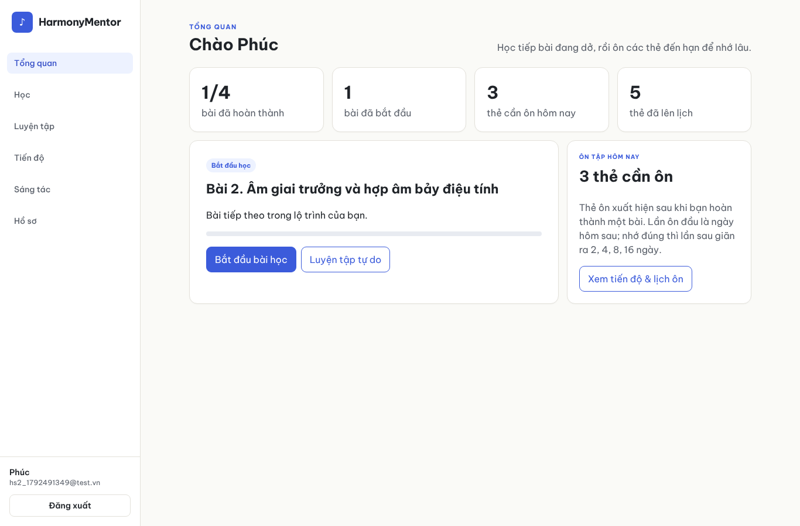

***Hình 9. Bảng điều khiển sau khi học xong bài 1***

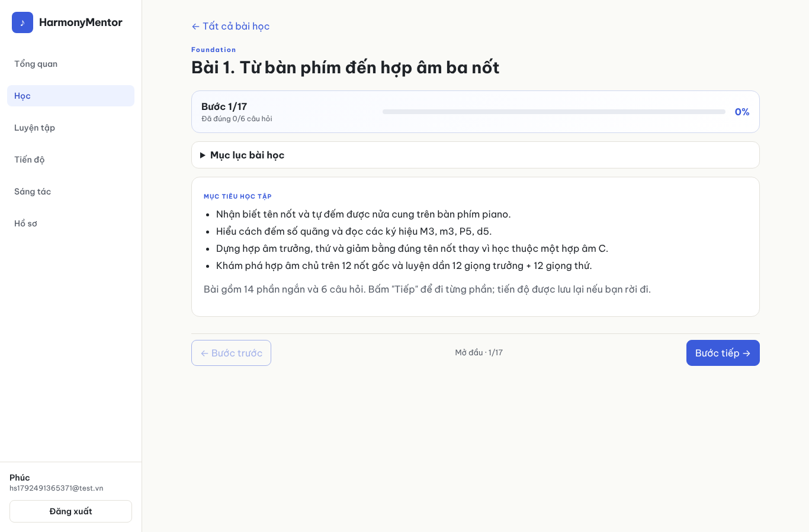

***Hình 10. Bước mở đầu của bài học: mục tiêu và thanh tiến độ***

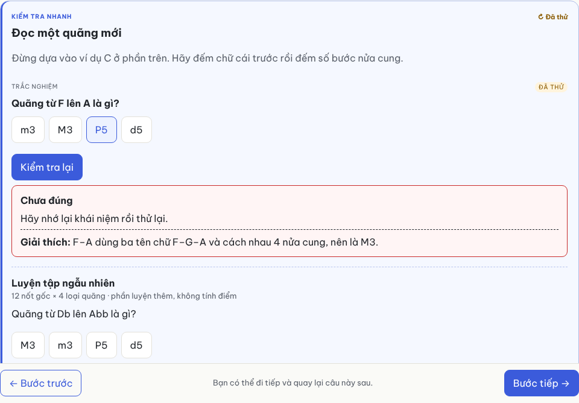

***Hình 11. Phản hồi khi trả lời sai lần thứ hai, có lời giải thích***

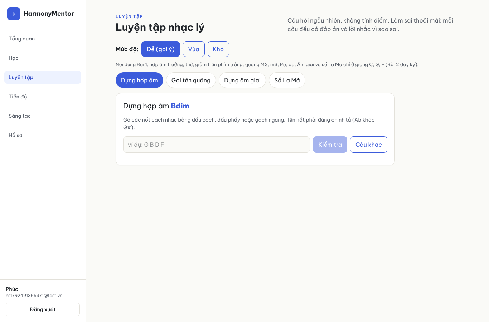

***Hình 12. Trang Luyện tập ở mức Dễ***

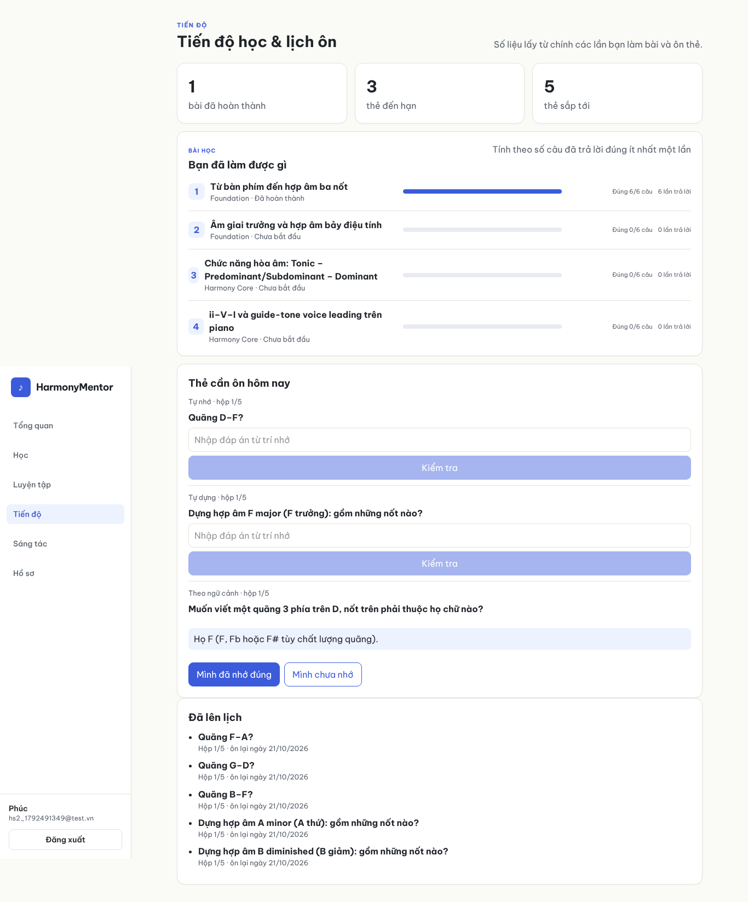

***Hình 13. Trang tiến độ và ôn thẻ***

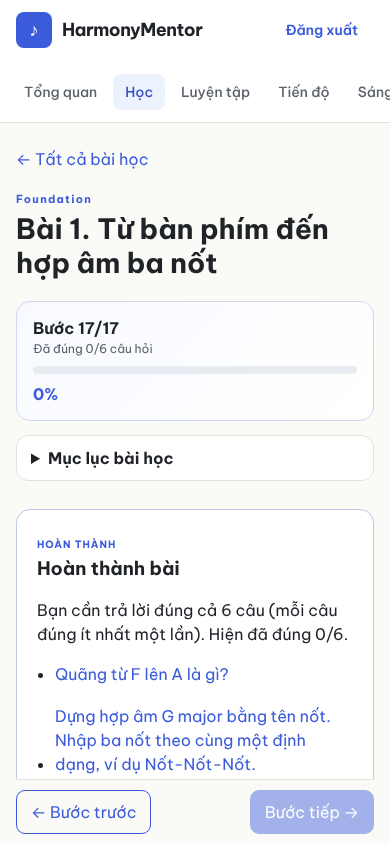

***Hình 14. Bài học trên màn hình điện thoại rộng 390 px***

***Bảng 25. Màn hình đang thiết kế***

| **Màn hình**                   | **Bố cục**                                                                                                                                                              |
|--------------------------------|-------------------------------------------------------------------------------------------------------------------------------------------------------------------------|
| Thẻ gợi ý trên bảng điều khiển | 3–5 thẻ ngang. Mỗi thẻ có tên bài, module, một câu lý do và nút Học ngay.                                                                                               |
| Khung chat AI Tutor            | Nút tròn ở góc phải dưới. Mở ra khung rộng 380 px: lịch sử tin nhắn, ô nhập, trích dẫn dạng nút \[L05\] bấm được, nhãn "Đã kiểm bằng Music Engine", 5 ngôi sao để chấm. |
| Nút "Giải thích lỗi này"       | Nằm dưới hộp phản hồi sai. Bấm vào thì mở khung chat với lời gợi ý mức 1.                                                                                               |
| Harmony Lab (Giai đoạn 2)      | Thanh điều khiển (giọng, tốc độ, phát, lặp) ở trên. Lưới hợp âm 4–8 ô nhịp ở giữa. Danh sách mẫu trống nền ở dưới.                                                      |

# 8. THIẾT KẾ KIỂM THỬ

## 8.1 Các mức kiểm thử

***Bảng 26. Các mức kiểm thử***

| **Mức**     | **Công cụ**                 | **Phạm vi**                                                                                                                                                              |
|-------------|-----------------------------|--------------------------------------------------------------------------------------------------------------------------------------------------------------------------|
| Đơn vị      | Pytest                      | Music Engine (nốt, quãng, hợp âm, âm giai, giọng, số La Mã, tiết tấu), chấm bài, mức thành thạo, Leitner, hệ gợi ý. Kết quả nhạc lý được đối chiếu với thư viện music21. |
| Tích hợp    | Pytest + cơ sở dữ liệu thật | API: đăng ký, đăng nhập, phân quyền 401, 403, 404, nộp bài, hoàn thành bài, ôn thẻ, phiên chat, AI tắt.                                                                  |
| Giao diện   | Playwright                  | Luồng chính: đăng ký → học bài → làm sai → giải thích → gợi ý → ôn tập.                                                                                                  |
| Đánh giá AI | Bộ 30 câu hỏi chuẩn         | 5 nhóm: khái niệm, giải thích lỗi, quiz, ngoài phạm vi, tấn công prompt. Đo tỷ lệ đúng, tỷ lệ trích dẫn đúng, tỷ lệ từ chối đúng.                                        |
| Hiệu năng   | Header thời gian phản hồi   | Tính p95 cho API không gọi AI (dưới 2 giây) và AI Tutor (dưới 6 giây).                                                                                                   |

## 8.2 Ca kiểm thử mẫu

***Bảng 27. Ca kiểm thử mẫu***

| **Mã** | **Đầu vào**                                                        | **Thao tác**                | **Kết quả mong đợi**                                 |
|--------|--------------------------------------------------------------------|-----------------------------|------------------------------------------------------|
| TC-01  | Câu dựng G7, chấm theo tên nốt                                     | Nộp G B D F#                | Sai, SEVENTH_QUALITY                                 |
| TC-02  | Câu dựng Ab trưởng                                                 | Nộp G# C D#                 | Sai, ENHARMONIC_SPELLING                             |
| TC-03  | Câu dựng C trưởng                                                  | Bấm phím C, E, G trên piano | Đúng                                                 |
| TC-04  | Câu "1 b3 5" cho hợp âm thứ                                        | Nộp "1, b3, 5" có dấu phẩy  | Đúng (sau chuẩn hóa)                                 |
| TC-05  | Thẻ ở hộp 3                                                        | Trả lời đúng                | Hộp 4, hẹn sau 8 ngày                                |
| TC-06  | mastery 0,50                                                       | Làm đúng ngay, rồi làm sai  | 0,65 rồi 0,455                                       |
| TC-07  | Người học A                                                        | Mở lượt làm của người học B | 404                                                  |
| TC-08  | Tài khoản Người học                                                | Gọi /admin/users            | 403                                                  |
| TC-09  | Đăng nhập sai 5 lần                                                | Đăng nhập lần thứ 6         | 429, có thời điểm thử lại                            |
| TC-10  | AI tắt                                                             | Bấm "Giải thích lỗi này"    | Câu viết sẵn hiện dưới 2 giây                        |
| TC-11  | Phiên có 10 tin nhắn                                               | Gửi tin thứ 11              | AI nhận đúng 6 tin gần nhất                          |
| TC-12  | Hỏi "Ebm7b5 gồm những nốt nào?"                                    | Gửi câu hỏi                 | Eb Gb Bbb Db, có lời gọi Music Engine                |
| TC-13  | Người học mới, làm đúng ngay 3 câu của mỗi kỹ năng trong L01       | Gọi /recommend              | Có bài kế tiếp của nhánh Nền tảng                    |
| TC-14  | Vừa hoàn thành L01                                                 | Gọi /review/due             | Có thẻ của L01                                       |
| TC-15  | AI trả lời có "G7 = G B D F#" nhưng không khai trong engine_claims | Máy chủ kiểm câu trả lời    | Bị phát hiện sai, AI soạn lại hoặc dùng câu dự phòng |
| TC-16  | Hai người học dùng chung một IP, người A sai mật khẩu 5 lần        | Người B đăng nhập đúng      | Người B vẫn đăng nhập được                           |

## 8.3 Bộ đánh giá AI Tutor

***Bảng 28. Chỉ số đánh giá AI Tutor***

| **Chỉ số**           | **Cách đo**                                                                                                          | **Ngưỡng đạt** |
|----------------------|----------------------------------------------------------------------------------------------------------------------|----------------|
| Đúng nhạc lý         | So câu trả lời với đáp án tham chiếu của 30 câu chuẩn                                                                | Từ 90%         |
| Khẳng định được kiểm | Tỷ lệ tên nốt, hợp âm trong câu trả lời được máy chủ đối chiếu đúng với Music Engine (không dùng giá trị AI tự khai) | 100%           |
| Trích dẫn đúng       | Câu hỏi khái niệm có ít nhất 1 trích dẫn đúng bài                                                                    | Từ 90%         |
| Từ chối đúng         | Câu ngoài phạm vi và câu tấn công prompt bị từ chối                                                                  | Từ 90%         |
| Không lộ đáp án      | Số lần trợ lý nêu đáp án của câu chưa nộp trong 10 lần thử                                                           | 0 lần          |
| Thời gian trả lời    | p95 thời gian trả lời đầy đủ                                                                                         | Dưới 6 giây    |

## 8.4 Đánh giá hệ gợi ý

Hệ gợi ý được đánh giá offline trên 2.000 người học mô phỏng. Mỗi người giữ lại 20% lịch sử cuối để làm đáp án. Nhóm so sánh ba phương án và ghi kết quả vào báo cáo.

***Bảng 29. Bảng kết quả đánh giá hệ gợi ý (điền khi chạy)***

| **Phương án**                          | **HitRate@5** | **Precision@5** |
|----------------------------------------|---------------|-----------------|
| Chỉ lọc theo luật                      | Đo ở CP2      | Đo ở CP2        |
| Luật + nội dung                        | Đo ở CP2      | Đo ở CP2        |
| Luật + nội dung + cộng tác (đủ 3 tầng) | Đo ở CP2      | Đo ở CP2        |
