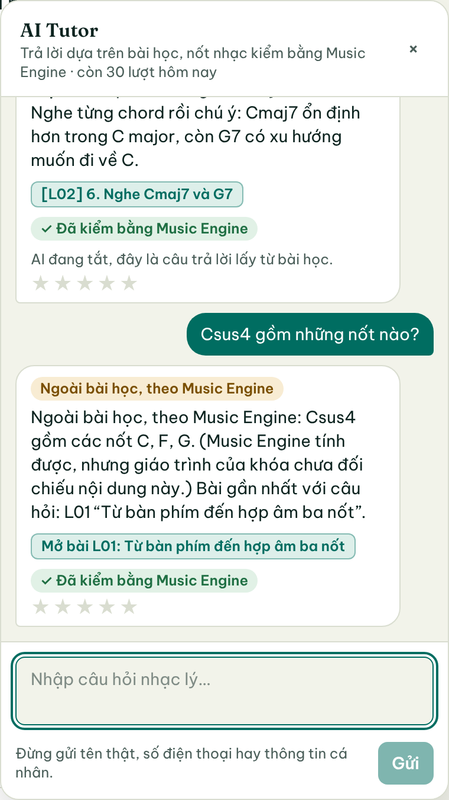
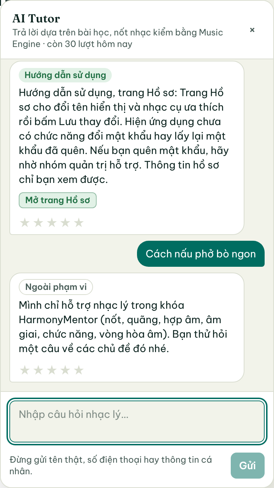

# GĐ1 góp ý thầy: AI Tutor định tuyến 4 luồng

Ngày 06/11/2026 · nhánh `ai-gop-y/gd1-dinh-tuyen` (xếp chồng trên `ai-gop-y/gd0-kiem-ke`, PR #27) · quyết định ở [ADR-017](../../decisions/ADR-017-dinh-tuyen-4-luong-ai-tutor.md).

## 1. Kết quả chính

- **Câu nằm ngoài bài học không còn được đưa cho LLM.** Có bốn luồng (B, C, D, G) trả lời bằng khuôn viết sẵn và không gọi LLM. Test API kiểm `fake.calls == []` cho từng luồng.
  - Luồng B gồm hai trường hợp. Music Engine tính được thì trả dữ kiện, nhãn "Ngoài bài học, theo Music Engine". Không tính được thì nói "không biết" kèm nút mở bài gợi ý.
  - Luồng C là câu ngoài phạm vi, trả lời bằng lời từ chối.
  - Luồng D là câu hỏi cách dùng app, trả lời bằng kho hướng dẫn kèm nút mở trang.
  - Luồng G là chào hỏi.
- **Câu trong bài học (luồng A)** vẫn đi qua RAG có trích dẫn và guardrail như GĐ3.
  - Nếu LLM không trích được đoạn nào, câu trả lời mang nhãn "Chưa có trích dẫn bài học", không mang nhãn "Từ bài học".
- **Nhúng e5-small chạy cục bộ là mặc định**, kể cả khi AI tắt. Ở GĐ0, cách này đạt R@1 85,7%, còn BM25 chỉ đạt 51,4%.
- **Số đo trên các câu không dùng để chỉnh ngưỡng** (cả bộ câu do Claude soạn, chi tiết ở mục 4):

  | Chỉ số | Mục tiêu | BM25 | e5 |
  |---|---|---|---|
  | Câu B/C bị trả lời như bài học | ≤ 2% | 3,5% | 3,5% |
  | Câu A bị từ chối sai | ≤ 5% | 5,4% | 10,8% |

  **Cả hai mục tiêu đều chưa đạt.** Lý do và hướng sửa ở mục 5.
- **Số chính thức phải đo trên tập test khóa** do người viết: Đạt 40 câu, Thắng 30 câu. Hạn nộp 10 câu mỗi người là 08/11.

Ảnh chụp giao diện thật (AI tắt, e5 cục bộ), Playwright ngày 06/11:

| Chào hỏi · A từ bài học · B theo Music Engine | B bài sau · D hướng dẫn · C ngoài phạm vi |
|---|---|
|  |  |

## 2. Đã làm gì (theo góp ý thầy và đề GĐ1)

| Việc | File | Ghi chú |
|---|---|---|
| Bộ định tuyến 2 tầng, 4 luồng + chào hỏi | `backend/app/ai/tutor/router.py` | `gather()` lấy tín hiệu một lần, `route()` thuần so ngưỡng; `Decision.log()` lưu vào `tool_calls.router` |
| Tầng 1: 4 nhãn, ≥ 60 câu/nhãn | `route_classifier.py`, `route_data.json` | TF-IDF ký tự + LogisticRegression; 303 câu train, 60 dev; Claude soạn, **nháp** |
| Tìm dữ kiện Engine trong câu hỏi | `engine_query.py` | 4 công cụ (hợp âm kể cả sus/add9, quãng, âm giai có tên Việt, số La Mã). Ký hiệu Engine không hiểu (C9) → "không biết", không đoán |
| Luật phủ kiến thức, bài sau, thuật ngữ lạ | `router.py` | Lấy từ dữ liệu kho, không lập danh sách tay; luật "bài sau" tự tắt khi L05–L08 vào kho |
| Kho hướng dẫn sử dụng 18 mục | `backend/app/content/help/help_entries.json` | Viết từ giao diện thật; mỗi mục có trang và cách hỏi mẫu (`hoi`, chỉ dùng để tìm); **nháp, chờ Phúc duyệt** (10A) |
| Nhúng e5-small cục bộ | `backend/app/ai/local_embedder.py` | onnxruntime, bản cố định + SHA-256, `TUTOR_EMBEDDER=local\|gemini\|bm25` |
| Ngưỡng do script chọn | `scripts/ai/gop_y/hieu_chinh_nguong.py` → `router_thresholds.json` | Dò lưới trên tập dev 105 câu (`scripts/ai/data/router_dev.json`, nháp) |
| Đo + ma trận nhầm lẫn | `scripts/ai/gop_y/danh_gia_dinh_tuyen.py` → `gd1_danh_gia_dinh_tuyen.{json,md}` | `--set` để chạy tập test khóa |
| Kiểm trùng giữa các tập | `scripts/ai/gop_y/kiem_trung_du_lieu.py` | Đã bắt 18 cặp trùng giữa train và dev, đã thay; test CI chặn trùng |
| System prompt viết lại | `prompt.py` | Vai trò → phạm vi → luật → chế độ → JSON → 5 ví dụ; test so ví dụ với kho và Engine |
| Sửa chặn nhầm injection | `injection.py` | "đổi/quên mật khẩu", "đóng vai trò", "C# hay là Db" không còn bị chặn; bắt thêm 2 câu tấn công lọt ở GĐ0 |
| API + giao diện | `contracts/ai.py`, `ai_tutor_service.py`, `FloatingTutorDrawer.tsx`, `api.ts` | Trường mới `flow`, `source_label`, `suggested_lesson`, `help_page` (tùy chọn) |
| Docker, CI | `backend/Dockerfile`, `.dockerignore`, `requirements.txt`, `.github/workflows/ci.yml` | Tải mô hình ở lớp riêng; CI cache mô hình; `--min-passed 966` |

## 3. Luồng xử lý một câu hỏi

```
câu hỏi ─► lọc injection ──có──► C (từ chối)
            │
            ▼
   gather: nhãn tầng 1 · dữ kiện Engine · điểm kho bài · điểm kho hướng dẫn · bài sau · thuật ngữ lạ
            │
   route:   chào hỏi (≤ 8 từ)                                   ─► G
            nhãn hướng dẫn + có mục đủ điểm (bài không thắng)   ─► D
            nhãn ngoài phạm vi, không có dữ kiện Engine          ─► C
            không giống nhạc lý                                  ─► C
            khái niệm bài L05–L08 chưa vào kho                   ─► B "Bạn sẽ học sau"
            loại hợp âm/âm giai kho chưa nhắc, ký hiệu lạ        ─► B (Engine hoặc không biết)
            thuật ngữ ngoại kho không có ("pentatonic")          ─► B
            điểm kho bài ≥ ngưỡng nhận                           ─► A (LLM nếu có, không thì câu viết sẵn)
            có dữ kiện Engine + đoạn ở vùng xám                  ─► A kèm Engine
            còn lại                                              ─► B (Engine hoặc "không biết")
```

## 4. Số đo

Lệnh (chạy thật 06/11, máy cloud, CPU):

```bash
cd backend
python ../scripts/ai/gop_y/kiem_trung_du_lieu.py      # Không có câu trùng giữa các tập.
python ../scripts/ai/gop_y/hieu_chinh_nguong.py       # ~4 phút, ghi router_thresholds.json
python ../scripts/ai/gop_y/danh_gia_dinh_tuyen.py --out ../docs/giai-doan/ai-gop-y/gd1_danh_gia_dinh_tuyen.json
```

### Ngưỡng chọn được

| Cách tìm | ngưỡng xám | ngưỡng nhận | ngưỡng hướng dẫn |
|---|---|---|---|
| BM25 | 1,8 | 3,9 | 0,0 (nhãn tầng 1 đủ quyết) |
| e5-small | 0,832 | 0,832 | 0,687 |

### Trên tập dev (dùng để chỉnh, nên số lạc quan)

| Cách tìm | Đúng luồng | B/C trả lời như bài học | A từ chối sai |
|---|---|---|---|
| BM25 | 94,3% | 8,9% (4/45) | 0% |
| e5-small | 93,3% | 8,9% (4/45) | 2,9% (1/35) |

Bốn câu B lọt vào A đều là chủ đề tiếng Việt mà kho chưa dạy nhưng chữ lại giống bài: nhịp 6/8, nốt móc, vòng tròn quãng năm, quãng năm song song.

### Trên bộ đo không dùng để chỉnh: 74 câu

Bộ này gồm 30 câu A của bộ chuẩn GĐ4, 10 câu ngoài phạm vi, 10 câu tấn công và 24 câu dò GĐ0. Tất cả do Claude soạn.

Ba câu dò GĐ0 được đổi nhãn từ B sang A, có ghi lý do trong script: quãng E–Bb, âm giai Rê trưởng, Am là bậc mấy. Đây là trường hợp cụ thể của khái niệm L01/L02 đã dạy, nên theo quyết định 7A phải là A.

Ma trận nhầm lẫn của e5-small (đường mặc định). BM25 ở file `gd1_danh_gia_dinh_tuyen.md`.

| thật \ đoán | A | B | C | D | G | recall |
|---|---|---|---|---|---|---|
| **A** | 33 | 2 | 0 | 2 | 0 | 89% |
| **B** | 1 | 4 | 0 | 0 | 0 | 80% |
| **C** | 0 | 1 | 23 | 0 | 0 | 96% |
| **D** | 0 | 0 | 0 | 6 | 0 | 100% |
| **G** | 0 | 0 | 0 | 0 | 2 | 100% |
| precision | 97% | 57% | 100% | 75% | 100% | |

Các câu sai luồng:

- A→D, hai câu. Tầng 1 đoán là câu hỏi cách dùng:
  - "Phím đen trên đàn piano được gọi tên ra sao?"
  - "Tập vòng ii-V-I nhanh hơn thì nên làm thế nào?"
- A→B, hai câu. Điểm e5 thấp hơn ngưỡng:
  - "Quãng tăng và quãng giảm nghĩa là gì?"
  - "What is a half-diminished chord?"
- B→A, một câu: "Bài hát buồn thường dùng hợp âm gì?". Câu này không có từ lạ, không có dữ kiện Engine, nhưng điểm cao.
- C→B, một câu: "what is the capital of France". Hệ thống trả lời "không biết", không trả lời sai.

So với GĐ0 (đường đang chạy trên `phuc-music`): 6/8 câu B và 2/4 câu C được đưa cho LLM kèm đoạn không liên quan. Câu hỏi cách dùng web cũng bị đưa cho LLM, còn câu "đổi mật khẩu" bị chặn như tấn công.

### Test

- `pytest -q -m "not postgres and not live"`: **966 passed, 0 skip**. Trước GĐ1 là 928, thêm 38 test ở `tests/test_ai_gd1_router.py`. Test e5 chạy thật vì máy có mô hình, CI sẽ tự tải.
- `npm test`: **263 passed**. Trước là 259, thêm `tests/tutorFlowLabel.test.tsx`.
- `npm run build`: đạt.
- `docker compose up --build`: **chưa chạy**, vì máy cloud không có Docker. Lớp tải mô hình trong Dockerfile chưa được build thử.

## 5. Rủi ro và việc tiếp

1. **Chưa đạt mục tiêu ≤ 2% / ≤ 5% trên bộ đo Claude soạn.** Điểm cosine của e5-small bị nén: câu A và câu B cùng nằm quanh 0,83–0,86, nên một ngưỡng không tách được hai loại. Hướng sửa, cần nhóm chọn:
   - Thêm reranker cross-encoder nhỏ, chạy cục bộ. Cách này có thể làm trong GĐ2b.
   - Hoặc fine-tune tầng 1 trên dữ liệu GĐ2.
   - Trong lúc chờ, router nghiêng về "không biết" (quyết định GĐ1).
2. **Số chính thức chờ tập test khóa** của Đạt (40 câu) và Thắng (30 câu), hạn 10 câu mỗi người ngày 08/11. Khi có:
   - Chạy `kiem_trung_du_lieu.py --test <file>`, sau đó `danh_gia_dinh_tuyen.py --set <file>`.
   - Khi có tập dev 30 câu của Phúc, chạy `hieu_chinh_nguong.py --dev <file>`.
3. **Dữ liệu train, dev và kho hướng dẫn đều là bản nháp Claude soạn.** Kho hướng dẫn cần Phúc duyệt (quyết định 10A) trước khi gộp.
4. **BM25 lại đo nhỉnh hơn e5 ở phần chọn luồng** trên 74 câu này. Tuy vậy e5 vẫn là mặc định vì chọn đúng đoạn để trích tốt hơn nhiều (R@1 85,7% so với 51,4%).
   - Ảnh chụp cho thấy e5 vẫn trích L02-B07 "Nghe Cmaj7 và G7" cho câu C7/Cmaj7. Đoạn đó đúng bài nhưng chưa phải đoạn tốt nhất (L02-B05).
5. **Ảnh Docker nặng thêm khoảng 470 MB.** Máy Phúc cần tắt "HTTPS scanning" của Avast khi build lần đầu. Không tải được mô hình thì app vẫn chạy bằng BM25.
6. Câu "Làm sao đổi mật khẩu tài khoản?" (câu dò GĐ0) đã được dùng để thêm cách hỏi mẫu cho mục H03, nên câu đó không còn là phép đo sạch cho luồng D.
