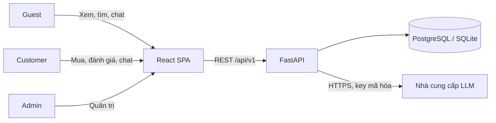
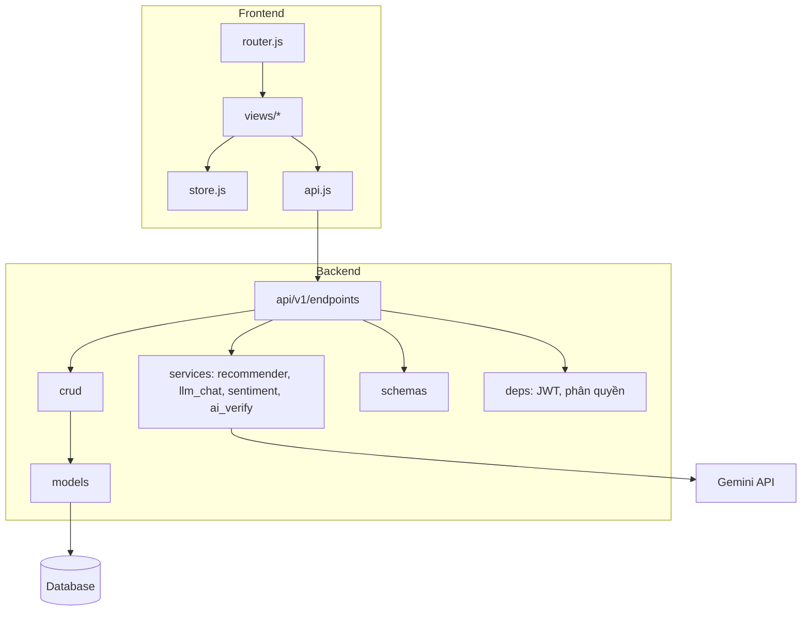
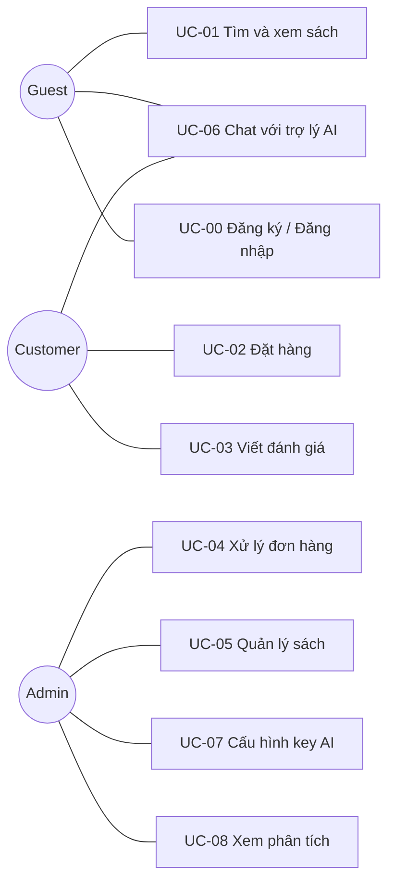
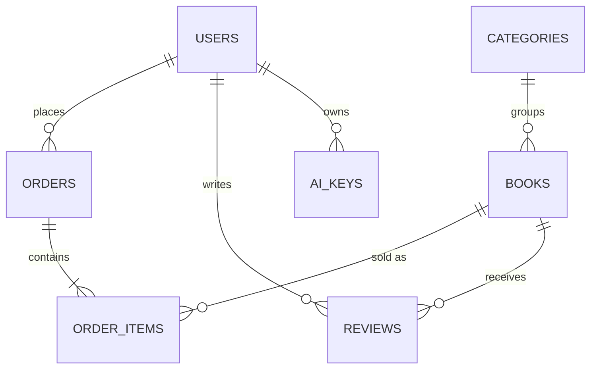

# Tài liệu Đặc tả Yêu cầu Nghiệp vụ (BRD/SRS) — BookStore Pro

## 0. Thông tin tài liệu

| Mục | Nội dung |
| --- | --- |
| Dự án | BookStore Pro — Cửa hàng sách công nghệ trực tuyến tích hợp AI |
| Loại tài liệu | Business Requirements & Software Requirements Specification |
| Phiên bản | 2.0 (viết lại toàn bộ, bổ sung phân hệ AI) |
| Ngày | 13/11/2026 |
| Trạng thái | Bản nháp chờ duyệt |
| Phạm vi mã nguồn tham chiếu | Commit `92c681f` |

### Lịch sử thay đổi

| Phiên bản | Ngày | Nội dung |
| --- | --- | --- |
| 1.0 | — | Sách học và thuyết trình (`Sach_hoc_va_thuyet_trinh_BookStore_Pro.docx`), mô tả kỹ thuật phục vụ bảo vệ đồ án |
| 2.0 | 13/11/2026 | Viết lại theo chuẩn BA: hiện trạng (as-is) đối chiếu mã nguồn, yêu cầu có mã định danh, use case, quy tắc nghiệp vụ, dữ liệu, phi chức năng, lộ trình AI |

### Bộ tài liệu

| Tài liệu | Nội dung |
| --- | --- |
| Tài liệu này | Nghiệp vụ tổng thể, yêu cầu chức năng hiện có và mục tiêu |
| [ba-ai-chatbot-rag-requirements.md](ba-ai-chatbot-rag-requirements.md) | Đặc tả chi tiết phân hệ AI: chatbot LLM + RAG, mô hình tự xây dựng |
| [code-review-report.md](code-review-report.md) | Kết quả review mã nguồn, rủi ro và kế hoạch khắc phục |

---

## 1. Giới thiệu

### 1.1 Mục đích

Tài liệu mô tả đầy đủ nghiệp vụ của BookStore Pro: hệ thống đang làm được gì, quy tắc nào chi phối dữ liệu, và hệ thống cần đạt tới đâu ở phiên bản tiếp theo. Tài liệu là căn cứ chung cho giảng viên/khách hàng, nhóm phát triển, kiểm thử và người vận hành.

### 1.2 Đối tượng đọc

| Đối tượng | Phần nên đọc |
| --- | --- |
| Product owner, giảng viên hướng dẫn | 2, 3, 4, 12, 13 |
| Lập trình viên backend/frontend | 5–10 |
| Kiểm thử (QA) | 6, 7, 8, 11, Phụ lục A |
| Vận hành (DevOps) | 5, 11 |

### 1.3 Thuật ngữ

| Thuật ngữ | Giải thích |
| --- | --- |
| Guest | Khách chưa đăng nhập |
| Customer | Khách hàng đã có tài khoản, vai trò `customer` |
| Admin | Quản trị viên, vai trò `admin` |
| Catalog | Danh mục sách đang bán (300 đầu sách seed sẵn, 3 bộ sưu tập: Programming, AI, Computer Science) |
| Category | Thể loại sách, khóa là `code` dạng slug (ví dụ `deep-learning`) |
| JWT | JSON Web Token, dùng để xác thực request |
| LLM | Large Language Model — mô hình ngôn ngữ lớn (ví dụ Gemini) |
| RAG | Retrieval-Augmented Generation — truy xuất dữ liệu liên quan rồi đưa vào LLM để sinh câu trả lời có căn cứ |
| Sentiment | Nhãn cảm xúc của đánh giá: `positive`, `neutral`, `negative` |
| Provider key | API key của nhà cung cấp AI do admin cấu hình |

---

## 2. Bối cảnh và mục tiêu kinh doanh

### 2.1 Bối cảnh

Người học lập trình và AI thường khó chọn sách phù hợp trình độ, ngân sách và mục tiêu. Các sàn thương mại điện tử chung không tư vấn sâu theo chủ đề kỹ thuật. BookStore Pro là cửa hàng chuyên sách công nghệ, khác biệt bằng **trợ lý AI hiểu catalog** và **phân tích ý kiến độc giả**.

### 2.2 Mục tiêu kinh doanh

| ID | Mục tiêu | Chỉ số đo (KPI) | Mục tiêu đề xuất |
| --- | --- | --- | --- |
| BO-01 | Tăng tỷ lệ chuyển đổi nhờ tư vấn | Tỷ lệ phiên chat có thêm sách vào giỏ | ≥ 15% |
| BO-02 | Giảm thời gian tìm sách | Số bước từ trang chủ tới trang chi tiết sách phù hợp | ≤ 3 bước |
| BO-03 | Tăng giá trị đơn hàng | Giá trị đơn trung bình (AOV) | +10% so với trước khi có gợi ý |
| BO-04 | Hỗ trợ quyết định nhập hàng | Số đầu sách hết hàng có nhu cầu cao | Giảm 30% |
| BO-05 | Lắng nghe độc giả | Tỷ lệ review được phân loại cảm xúc đúng | ≥ 85% (F1) |

### 2.3 Phạm vi

**Trong phạm vi:** bán sách giấy trực tuyến; quản lý catalog, đơn hàng, khách hàng; đánh giá sách; phân tích kinh doanh; trợ lý AI tư vấn và gợi ý; công cụ AI cho quản trị.

**Ngoài phạm vi phiên bản hiện tại:** cổng thanh toán thật, vận chuyển và tính phí ship, mã giảm giá, sách điện tử, ứng dụng di động, đa cửa hàng/đa kho.

---

## 3. Các bên liên quan và persona

### 3.1 Stakeholders

| Vai trò | Quan tâm chính | Ảnh hưởng |
| --- | --- | --- |
| Chủ cửa hàng / Product owner | Doanh thu, chi phí AI, uy tín | Duyệt phạm vi và ưu tiên |
| Quản trị viên vận hành | Quản lý sách, đơn, kho, review | Người dùng chính phân hệ admin |
| Khách hàng | Tìm đúng sách, mua nhanh, được tư vấn | Người dùng cuối |
| Nhóm phát triển | Kiến trúc rõ, dễ mở rộng | Thực hiện |
| Nhà cung cấp AI (Gemini, …) | — | Phụ thuộc bên ngoài: chi phí, giới hạn quota |
| Giảng viên (bối cảnh đồ án) | Đủ chức năng, có chiều sâu kỹ thuật, trình bày được | Nghiệm thu |

### 3.2 Persona

| Persona | Mô tả | Nhu cầu | Nỗi đau |
| --- | --- | --- | --- |
| **Minh — sinh viên năm 2** | Mới học Python, ngân sách dưới 30 USD | "Sách nào cho người mới, rẻ, dễ hiểu?" | Không biết bắt đầu từ đâu, ngại đọc tiếng Anh dài |
| **Lan — kỹ sư backend 4 năm** | Muốn chuyển sang AI/LLM | "Lộ trình sách từ ML nền tảng tới LLM" | Danh sách quá nhiều, không biết thứ tự đọc |
| **Hùng — quản trị viên cửa hàng** | Quản lý kho, đơn hàng hằng ngày | Biết sách nào sắp hết, khách phàn nàn gì | Phải xem nhiều màn hình, không có tóm tắt |

---

## 4. Hiện trạng và định hướng

### 4.1 Tóm tắt hiện trạng (as-is)

| Lớp | Công nghệ |
| --- | --- |
| Frontend | React 19 + Vite, JSX, hash router tự viết, state lưu `localStorage` (token, giỏ hàng) |
| Backend | FastAPI, SQLAlchemy 2 (sync và async), Pydantic 2, PyJWT, Argon2 |
| Cơ sở dữ liệu | PostgreSQL 16 (Docker) hoặc SQLite (`--sqlite`) |
| AI | Chatbot luật/từ khóa cục bộ + Gemini (OpenAI-compatible), gợi ý heuristic, sentiment từ điển |
| Triển khai | `run.py`, `start.bat`, Docker Compose, manifest Kubernetes |

### 4.2 Định hướng (to-be)

1. Củng cố nền tảng: bảo mật, migration, kiểm thử (xem [code-review-report.md](code-review-report.md)).
2. Nâng cấp trợ lý AI thành **chatbot RAG** hiểu tiếng Việt, có trích dẫn, có công cụ tra đơn/thêm giỏ.
3. Bổ sung **mô hình tự xây dựng**: gợi ý cá nhân hóa, phân tích cảm xúc tiếng Việt, dự báo nhu cầu.
4. Trợ lý AI cho admin: tóm tắt review, hỏi đáp số liệu, sinh mô tả sách.

### 4.3 Sơ đồ ngữ cảnh

---

## 5. Kiến trúc tổng quan

| Module backend | Trách nhiệm |
| --- | --- |
| `auth` | Đăng ký, đăng nhập, hồ sơ |
| `books`, `books_async` | Catalog, thể loại, thống kê; CRUD sách cho admin (bản sync và async) |
| `orders` | Đặt hàng, xem đơn của mình |
| `reviews` | Xem và viết đánh giá |
| `admin` | Người dùng, vai trò, đơn hàng, dashboard review |
| `analytics` | Tổng quan kinh doanh |
| `ai` | Trạng thái AI, gợi ý, chat |
| `ai_keys` | Quản lý API key nhà cung cấp AI |

---

## 6. Yêu cầu chức năng hiện có

Trạng thái: **Đã có** = đã triển khai và đối chiếu mã nguồn; **Một phần** = có nhưng thiếu theo mô tả; **Đề xuất** = chưa có.

### 6.1 Xác thực và tài khoản

| ID | Yêu cầu | Tác nhân | Trạng thái | API / Màn hình |
| --- | --- | --- | --- | --- |
| FR-AUTH-01 | Đăng ký bằng họ tên, email, mật khẩu 8–128 ký tự; email không trùng (không phân biệt hoa thường) | Guest | Đã có | `POST /auth/register`, `#/register` |
| FR-AUTH-02 | Đăng ký luôn tạo vai trò `customer`, không cho tự gán `admin` | Hệ thống | Đã có | — |
| FR-AUTH-03 | Đăng nhập bằng email/mật khẩu, nhận JWT hết hạn sau 30 phút (cấu hình được) | Guest | Đã có | `POST /auth/login`, `#/login` |
| FR-AUTH-04 | Xem thông tin tài khoản hiện tại | Customer, Admin | Đã có | `GET /auth/me` |
| FR-AUTH-05 | Tài khoản bị vô hiệu hóa (`is_active=false`) không đăng nhập được | Hệ thống | Đã có | — |
| FR-AUTH-06 | Đổi mật khẩu, quên mật khẩu, cập nhật hồ sơ | Customer | Đề xuất | — |

### 6.2 Catalog và tìm kiếm

| ID | Yêu cầu | Tác nhân | Trạng thái | API / Màn hình |
| --- | --- | --- | --- | --- |
| FR-CAT-01 | Danh sách sách phân trang (1–50/trang, mặc định 12) | Mọi người | Đã có | `GET /books`, `#/catalog` |
| FR-CAT-02 | Tìm theo từ khóa trên tiêu đề hoặc tác giả (không phân biệt hoa thường) | Mọi người | Đã có | tham số `keyword` |
| FR-CAT-03 | Lọc theo thể loại (mã hoặc tên), giá tối đa, còn hàng/hết hàng | Mọi người | Đã có | `category`, `max_price`, `is_available` |
| FR-CAT-04 | Sắp xếp theo id, tiêu đề, giá, tồn kho; tăng/giảm | Mọi người | Đã có | `sort_by`, `order` |
| FR-CAT-05 | Danh sách thể loại kèm số đầu sách | Mọi người | Đã có | `GET /books/categories` |
| FR-CAT-06 | Thống kê catalog: tổng sách, còn/hết hàng, tổng tồn, giá trị kho, giá trung bình | Mọi người | Đã có | `GET /books/stats` |
| FR-CAT-07 | Trang chi tiết sách: bìa, mô tả, giá, tồn kho, đánh giá | Mọi người | Đã có | `GET /books/{id}`, `#/book/{id}` |
| FR-CAT-08 | Tìm kiếm ngữ nghĩa (hiểu ý, tiếng Việt, đồng nghĩa) | Mọi người | Đề xuất | Xem AI-02 |

### 6.3 Giỏ hàng và đơn hàng

| ID | Yêu cầu | Tác nhân | Trạng thái | API / Màn hình |
| --- | --- | --- | --- | --- |
| FR-ORD-01 | Thêm/sửa/xóa sách trong giỏ; giỏ lưu ở trình duyệt | Guest, Customer | Đã có | Cart drawer (`shell.jsx`) |
| FR-ORD-02 | Đặt hàng yêu cầu đăng nhập; 1–50 dòng, mỗi dòng 1–20 cuốn; gộp dòng trùng sách | Customer | Đã có | `POST /orders` |
| FR-ORD-03 | Kiểm tra tồn kho, trừ kho và tạo đơn trong cùng một giao dịch | Hệ thống | Đã có | — |
| FR-ORD-04 | Xem danh sách đơn của mình | Customer | Đã có | `GET /orders`, `#/orders` |
| FR-ORD-05 | Xem chi tiết một đơn (chủ đơn hoặc admin) | Customer, Admin | Đã có | `GET /orders/{id}` |
| FR-ORD-06 | Khách tự hủy đơn đang `pending` | Customer | Đề xuất | — |
| FR-ORD-07 | Thanh toán trực tuyến | Customer | Ngoài phạm vi | — |

### 6.4 Đánh giá sách

| ID | Yêu cầu | Tác nhân | Trạng thái | API / Màn hình |
| --- | --- | --- | --- | --- |
| FR-REV-01 | Xem đánh giá của sách kèm tóm tắt: tổng, số tích cực/trung tính/tiêu cực, điểm trung bình | Mọi người | Đã có | `GET /books/{id}/reviews` |
| FR-REV-02 | Viết đánh giá 1–5 sao, nội dung 3–2000 ký tự | Customer | Đã có | `POST /books/{id}/reviews` |
| FR-REV-03 | Tự gán nhãn cảm xúc và trích tối đa 6 từ khóa | Hệ thống | Một phần (chỉ tiếng Anh) | `services/sentiment.py` |
| FR-REV-04 | Chỉ người đã mua mới được đánh giá; mỗi người một đánh giá mỗi sách | Hệ thống | Đề xuất | — |
| FR-REV-05 | Admin ẩn/xóa đánh giá vi phạm | Admin | Đề xuất | — |

### 6.5 Quản trị

| ID | Yêu cầu | Tác nhân | Trạng thái | API / Màn hình |
| --- | --- | --- | --- | --- |
| FR-ADM-01 | Tổng quan: KPI và đơn gần đây | Admin | Đã có | `#/admin` |
| FR-ADM-02 | Thêm/sửa/xóa sách; thể loại phải tồn tại | Admin | Đã có | `POST/PATCH/DELETE /books`, `#/admin/books` |
| FR-ADM-03 | Xem đơn hàng toàn hệ thống, lọc theo trạng thái, phân trang (≤ 100) | Admin | Đã có | `GET /admin/orders`, `#/admin/orders` |
| FR-ADM-04 | Chuyển trạng thái đơn theo máy trạng thái (BR-ORD-01) | Admin | Đã có | `PATCH /admin/orders/{id}/status` |
| FR-ADM-05 | Xem danh sách người dùng, đổi vai trò | Admin | Đã có | `GET /admin/users`, `PATCH /admin/users/{id}/role`, `#/admin/customers` |
| FR-ADM-06 | Dashboard review: tóm tắt cảm xúc, top từ khóa tích cực/tiêu cực, review gần đây | Admin | Đã có | `GET /admin/reviews`, `#/admin/reviews` |
| FR-ADM-07 | Phân tích kinh doanh: doanh thu, số đơn, số cuốn bán, AOV, khách hàng, khách quay lại, sách sắp hết (≤ 10), giá trị kho, tăng trưởng tháng; doanh thu 8 tháng, theo thể loại, top 6 sách, phân bố trạng thái, top 6 khách, khách mới theo tháng | Admin | Đã có | `GET /analytics/overview`, `#/admin/analytics` |

### 6.6 AI (hiện có)

| ID | Yêu cầu | Tác nhân | Trạng thái | API / Màn hình |
| --- | --- | --- | --- | --- |
| FR-AI-01 | Gợi ý 1–8 sách: theo thể loại khách mua nhiều nhất, loại sách đã mua, ưu tiên độ phổ biến; khách vãng lai nhận sách bán chạy | Mọi người | Đã có | `GET /ai/recommendations` |
| FR-AI-02 | Chat tư vấn: hiểu chủ đề, trình độ, ngân sách; trả lời kèm tối đa 3 sách và gợi ý câu hỏi tiếp | Mọi người | Đã có (tiếng Anh) | `POST /ai/chat`, `#/ai` |
| FR-AI-03 | Khi có key đang kích hoạt, chat dùng LLM với ≤ 16 sách ứng viên, lịch sử ≤ 10 lượt; LLM chỉ được chọn sách trong danh sách ứng viên | Hệ thống | Đã có | `services/llm_chat.py` |
| FR-AI-04 | LLM lỗi thì trả kết quả cục bộ kèm thông báo | Hệ thống | Đã có | trường `notice`, `source` |
| FR-AI-05 | Hiển thị nhà cung cấp AI đang hoạt động | Mọi người | Đã có | `GET /ai/status` |
| FR-AI-06 | Admin thêm key (mã hóa khi lưu), kích hoạt (chỉ một key hoạt động), kiểm tra định dạng, xóa | Admin | Đã có | `/admin/ai-keys/*`, `#/admin/ai-keys` |

Yêu cầu AI mới (AI-01 … AI-13) được đặc tả trong [ba-ai-chatbot-rag-requirements.md](ba-ai-chatbot-rag-requirements.md).

---

## 7. Use case chính

### 7.1 Sơ đồ use case

### 7.2 UC-02 Đặt hàng

| Mục | Nội dung |
| --- | --- |
| Tác nhân | Customer |
| Tiền điều kiện | Giỏ có ít nhất 1 sách |
| Hậu điều kiện thành công | Đơn `pending` được tạo; tồn kho giảm đúng số lượng; giỏ được làm trống |
| Luồng chính | 1. Khách mở giỏ, bấm Checkout. 2. Hệ thống kiểm tra đăng nhập. 3. Gửi danh sách `book_id`, `quantity`. 4. Hệ thống gộp dòng trùng, khóa các dòng sách, kiểm tra tồn. 5. Tạo đơn và dòng đơn với giá tại thời điểm mua, trừ kho, tính tổng. 6. Trả về đơn, giao diện thông báo thành công. |
| Luồng thay thế 2a | Chưa đăng nhập → nút hiển thị "Sign in & checkout", chuyển tới trang đăng nhập, giữ giỏ hàng |
| Ngoại lệ 4a | Có `book_id` không tồn tại → 404 "Unknown book ids" |
| Ngoại lệ 4b | Không đủ tồn → 409 "Not enough stock for '<tên sách>'", không thay đổi dữ liệu |
| Quy tắc | BR-ORD-02, BR-ORD-03 |

### 7.3 UC-04 Xử lý đơn hàng

| Mục | Nội dung |
| --- | --- |
| Tác nhân | Admin |
| Luồng chính | 1. Admin mở `#/admin/orders`, lọc theo trạng thái. 2. Chọn trạng thái mới cho đơn. 3. Hệ thống kiểm tra chuyển đổi hợp lệ. 4. Nếu chuyển sang `cancelled` thì cộng lại tồn kho. 5. Lưu và trả về đơn cập nhật. |
| Ngoại lệ | Chuyển đổi không hợp lệ → 409 "Cannot change order from 'X' to 'Y'"; đơn không tồn tại → 404 |
| Quy tắc | BR-ORD-01 |

### 7.4 UC-03 Viết đánh giá

| Mục | Nội dung |
| --- | --- |
| Tác nhân | Customer |
| Luồng chính | 1. Khách mở trang sách, chọn số sao, nhập nội dung. 2. Hệ thống chuẩn hóa nội dung, phân tích cảm xúc và từ khóa. 3. Lưu đánh giá với tên người viết. 4. Tóm tắt đánh giá của sách được cập nhật. |
| Ngoại lệ | Sách không tồn tại → 404; nội dung < 3 ký tự sau khi bỏ khoảng trắng → 422; chưa đăng nhập → 401 |

### 7.5 UC-06 Chat với trợ lý AI (hiện trạng)

| Mục | Nội dung |
| --- | --- |
| Tác nhân | Guest, Customer |
| Luồng chính | 1. Người dùng nhập câu hỏi (≤ 500 ký tự) hoặc bấm gợi ý. 2. Frontend gửi tin nhắn kèm tối đa 12 lượt lịch sử. 3. Hệ thống tính câu trả lời cục bộ. 4. Nếu có key đang hoạt động: gom ứng viên từ câu hỏi, lịch sử và gợi ý cá nhân (≤ 16 sách), gọi LLM. 5. Lọc `book_ids` theo danh sách ứng viên. 6. Trả về câu trả lời, ≤ 3 sách, ≤ 4 gợi ý, nguồn (`local`/`gemini`). |
| Luồng thay thế 4a | Không có key → trả kết quả cục bộ |
| Ngoại lệ 4b | Key không giải mã được, bị từ chối, hết quota, quá thời gian 25 giây → kết quả cục bộ kèm `notice` |
| Phiên bản mới | Xem UC-AI-01 trong tài liệu AI |

### 7.6 UC-07 Cấu hình key AI

| Mục | Nội dung |
| --- | --- |
| Tác nhân | Admin |
| Luồng chính | 1. Admin nhập tên gợi nhớ và API key. 2. Hệ thống kiểm tra định dạng (≥ 20 ký tự, không phải chuỗi mẫu). 3. Mã hóa và lưu, chỉ giữ `key_hint`. 4. Kích hoạt key mới, vô hiệu các key khác. |
| Luồng phụ | Kích hoạt lại key cũ; kiểm tra key; xóa key |
| Ngoại lệ | Định dạng sai → 422; key không giải mã được (đổi `SECRET_KEY`) → trạng thái `invalid_format` |

---

## 8. Quy tắc nghiệp vụ

| ID | Quy tắc | Nơi thực thi |
| --- | --- | --- |
| BR-ORD-01 | Chuyển trạng thái đơn hợp lệ: `pending → paid / cancelled`; `paid → shipped / cancelled`; `shipped → completed`; `completed` và `cancelled` là trạng thái cuối | `crud/order.py` |
| BR-ORD-02 | Tồn kho không âm; đặt hàng thất bại nếu thiếu bất kỳ sách nào (tất cả hoặc không gì cả) | `crud/order.py`, CHECK `stock >= 0` |
| BR-ORD-03 | Giá dòng đơn là giá sách tại thời điểm đặt; tổng đơn = Σ(đơn giá × số lượng) | `crud/order.py` |
| BR-ORD-04 | Hủy đơn hoàn lại tồn kho của tất cả dòng | `crud/order.py` |
| BR-USR-01 | Email duy nhất, lưu chữ thường | `crud/user.py`, UNIQUE |
| BR-USR-02 | Admin không tự hạ quyền mình; không hạ quyền admin cuối cùng | `endpoints/admin.py` |
| BR-BOOK-01 | Giá > 0 khi tạo/sửa; tồn ≥ 0; thể loại phải tồn tại | `schemas/book.py`, `endpoints/books.py` |
| BR-REV-01 | Điểm 1–5; cảm xúc thuộc {positive, neutral, negative}; số sao ≥ 4 cộng 1 điểm cảm xúc, ≤ 2 trừ 1 | `services/sentiment.py`, CHECK |
| BR-AI-01 | Tại một thời điểm chỉ một key AI của admin được kích hoạt | `crud/ai_key.py` |
| BR-AI-02 | Trợ lý chỉ được giới thiệu sách có trong catalog và còn hàng; không bịa tên, giá, tồn kho | `services/llm_chat.py` (prompt và lọc id) |
| BR-AI-03 | Câu trả lời tối đa 1500 ký tự, tối đa 3 sách, tối đa 4 gợi ý (mỗi gợi ý ≤ 60 ký tự) | `services/llm_chat.py` |
| BR-ANL-01 | Doanh thu tính các đơn không bị hủy | `crud/analytics.py` (xem CR-10) |
| BR-ANL-02 | Sách "sắp hết hàng" khi tồn ≤ 10 | `crud/analytics.py` |

---

## 9. Mô hình dữ liệu

### 9.1 Sơ đồ thực thể

### 9.2 Từ điển dữ liệu

**users**

| Cột | Kiểu | Ràng buộc | Ý nghĩa |
| --- | --- | --- | --- |
| id | int | PK | |
| name | varchar(100) | NOT NULL | Họ tên |
| email | varchar(320) | UNIQUE, NOT NULL | Email đăng nhập (chữ thường) |
| hashed_password | varchar(255) | NOT NULL | Hash Argon2 |
| role | varchar(20) | `customer` \| `admin` | Vai trò |
| is_active | bool | mặc định true | Cho phép đăng nhập |
| created_at | timestamptz | mặc định now() | |

**categories**: `code` varchar(50) PK (slug), `name` varchar(100) UNIQUE.

**books**

| Cột | Kiểu | Ràng buộc | Ý nghĩa |
| --- | --- | --- | --- |
| id | int | PK | |
| title | varchar(255) | NOT NULL, index | |
| author | varchar(150) | NOT NULL, index | |
| category_code | varchar(50) | FK categories, RESTRICT | |
| description | text | | Mô tả |
| price | numeric(10,2) | ≥ 0 | Giá (USD) |
| stock | int | ≥ 0 | Tồn kho |
| cover | varchar(255) | | Đường dẫn ảnh bìa |

**orders**: `id`, `user_id` (FK users, CASCADE), `status` (5 giá trị, index), `total` numeric(12,2) ≥ 0, `created_at`.

**order_items**: `id`, `order_id` (FK, CASCADE), `book_id` (FK books, RESTRICT), `title` (snapshot), `quantity` > 0, `unit_price` (snapshot).

**reviews**: `id`, `book_id` (FK, CASCADE), `user_id` (FK, SET NULL), `author_name`, `rating` 1–5, `text`, `sentiment`, `keywords` (JSON), `created_at`.

**ai_keys**: `id`, `user_id` (FK, CASCADE), `provider` (`gemini`), `label` varchar(80), `key_hint` varchar(32), `encrypted_key` text (Fernet), `is_active` bool, `created_at`.

Bảng mới cho phân hệ AI (`kb_documents`, `kb_chunks`, `book_embeddings`, `chat_sessions`, `chat_messages`, `ai_feedback`, `ai_usage`, …) được đặc tả trong tài liệu AI, mục 7.3.

### 9.3 Dữ liệu khởi tạo

| Dữ liệu | Số lượng | Nguồn |
| --- | --- | --- |
| Sách | 300 | `backend/app/db/books_catalog.json` (sinh từ `Cover_Remake/`) |
| Admin | 1 | Biến môi trường `ADMIN_*` khi `SEED_ADMIN=true` |
| Khách demo | 5 | `init_db.py`, mật khẩu chung `reader-password-1` |
| Đơn demo | 34 | Sinh ngẫu nhiên có seed cố định |
| Review demo | 18 | `init_db.py` (cần viết lại theo chủ đề sách kỹ thuật — CR-07) |

---

## 10. Danh mục API (v1)

Tiền tố: `/api/v1`. Xác thực: `Authorization: Bearer <JWT>`.

| Nhóm | Phương thức & đường dẫn | Quyền |
| --- | --- | --- |
| Health | `GET /health` (không có tiền tố) | Công khai |
| Auth | `POST /auth/register`, `POST /auth/login`, `GET /auth/me` | Công khai / Đăng nhập |
| Books | `GET /books`, `GET /books/categories`, `GET /books/stats`, `GET /books/{id}` | Công khai |
| Books | `POST /books`, `PATCH /books/{id}`, `DELETE /books/{id}` | Admin |
| Books async | Như trên, tiền tố `/books-async` | Như trên |
| Orders | `POST /orders`, `GET /orders`, `GET /orders/{id}` | Đăng nhập |
| Reviews | `GET /books/{id}/reviews` | Công khai |
| Reviews | `POST /books/{id}/reviews` | Đăng nhập |
| Admin | `GET /admin/users`, `PATCH /admin/users/{id}/role`, `GET /admin/orders`, `PATCH /admin/orders/{id}/status`, `GET /admin/reviews` | Admin |
| Analytics | `GET /analytics/overview` | Admin |
| AI | `GET /ai/providers`, `GET /ai/status`, `GET /ai/recommendations`, `POST /ai/chat` | Công khai (token tùy chọn) |
| AI keys | `GET/POST /admin/ai-keys`, `DELETE /admin/ai-keys/{id}`, `POST /admin/ai-keys/{id}/activate`, `POST /admin/ai-keys/{id}/verify` | Admin |

Tài liệu tương tác: `http://127.0.0.1:8000/docs` (Swagger UI).

---

## 11. Yêu cầu phi chức năng

| ID | Nhóm | Yêu cầu | Hiện trạng |
| --- | --- | --- | --- |
| NFR-SEC-01 | Bảo mật | Mật khẩu băm Argon2; không trả hash ra API | Đạt |
| NFR-SEC-02 | Bảo mật | Bí mật (SECRET_KEY, API key) không nằm trong mã nguồn hay Git | **Chưa đạt** (CR-01) |
| NFR-SEC-03 | Bảo mật | API key AI mã hóa khi lưu, khóa mã hóa tách khỏi DB | Một phần (CR-13) |
| NFR-SEC-04 | Bảo mật | Endpoint tốn chi phí (chat AI) có rate limit và hạn mức | **Chưa đạt** (CR-02) |
| NFR-SEC-05 | Bảo mật | Phân quyền kiểm tra ở backend cho mọi endpoint admin | Đạt |
| NFR-PERF-01 | Hiệu năng | API catalog p95 < 300 ms với 10.000 sách | Chưa đo |
| NFR-PERF-02 | Hiệu năng | Chat AI: token đầu tiên < 2 s (streaming), trọn câu trả lời p95 < 8 s | Chưa đạt (không streaming, timeout 25 s) |
| NFR-REL-01 | Tin cậy | Đặt hàng là giao dịch nguyên tử; không bán vượt tồn kho | Đạt trên PostgreSQL |
| NFR-REL-02 | Tin cậy | AI lỗi không làm hỏng trải nghiệm chat (có dự phòng) | Đạt |
| NFR-USE-01 | Khả dụng | Giao diện responsive, hoạt động trên màn hình từ 360 px | Cần kiểm thử |
| NFR-I18N-01 | Ngôn ngữ | Chatbot và phân tích review hiểu tiếng Việt và tiếng Anh | **Chưa đạt** |
| NFR-MNT-01 | Bảo trì | Thay đổi schema qua migration có phiên bản | **Chưa đạt** (CR-14) |
| NFR-MNT-02 | Bảo trì | Độ phủ test ≥ 70% cho `crud` và `services` | Chưa đạt (CR-19) |
| NFR-OBS-01 | Quan sát | Log có cấu trúc; ghi nhận số lượt và chi phí AI | Chưa có |
| NFR-PRV-01 | Riêng tư | Không gửi email, mật khẩu, địa chỉ khách hàng tới nhà cung cấp LLM | Đạt (chỉ gửi dữ liệu sách và tin nhắn) |

---

## 12. Phân tích khoảng trống (gap analysis)

| Lĩnh vực | Hiện trạng | Mong muốn | Ưu tiên |
| --- | --- | --- | --- |
| Bảo mật vận hành | Bí mật trong Git, chat không giới hạn | Bí mật ngoài Git, rate limit, hạn mức chi phí | Must |
| Trợ lý AI | Từ khóa tiếng Anh + LLM với ứng viên lọc bằng từ khóa | RAG đa ngôn ngữ, trích dẫn, streaming, công cụ tra đơn | Must |
| Tìm kiếm | `ILIKE` trên tiêu đề/tác giả | Hybrid search (từ khóa + vector) trên cả mô tả | Should |
| Gợi ý | Heuristic thể loại + độ phổ biến | Mô hình lai content-based + collaborative; "sách tương tự", "thường mua cùng" | Should |
| Review | Từ điển tiếng Anh, không kiểm duyệt | Mô hình cảm xúc đa ngôn ngữ, tóm tắt, kiểm duyệt spam/độc hại | Should |
| Quản trị | Dashboard số liệu tĩnh | Trợ lý hỏi đáp số liệu, dự báo nhập hàng, sinh mô tả sách | Could |
| Đơn hàng | Không hủy được phía khách, không hết hạn giữ hàng | Khách tự hủy, tự động hủy đơn quá hạn | Should |
| Nền tảng | Không migration, ít test | Alembic, test nghiệp vụ, CI | Must |

---

## 13. Lộ trình tổng thể

| Giai đoạn | Thời lượng gợi ý | Nội dung | Kết quả nghiệm thu |
| --- | --- | --- | --- |
| P0 — Ổn định | 1 sprint (2 tuần) | Khắc phục CR-01 → CR-05, Alembic, test đơn hàng | Không còn bí mật trong Git; test xanh; chat có rate limit |
| P1 — RAG Chatbot MVP | 2 sprint | AI-01, AI-02, AI-11, AI-12, AI-13 | Bộ đánh giá ≥ 80% câu trả lời đúng, 100% sách gợi ý có thật |
| P2 — AI giao dịch & nội dung | 2 sprint | AI-03, AI-04, AI-05, AI-08 | Tra đơn, thêm giỏ qua chat; tóm tắt review trên trang sách |
| P3 — Mô hình tự xây dựng | 2–3 sprint | AI-06, AI-09, AI-10, sentiment tiếng Việt | Đạt chỉ số offline mục tiêu; A/B test gợi ý |
| P4 — Copilot quản trị | 1–2 sprint | AI-07 | Admin hỏi số liệu bằng ngôn ngữ tự nhiên, kết quả khớp dashboard |

Chi tiết phạm vi, tiêu chí chấp nhận và kiến trúc của từng tính năng AI: [ba-ai-chatbot-rag-requirements.md](ba-ai-chatbot-rag-requirements.md).

---

## 14. Giả định, ràng buộc, rủi ro

| Loại | Nội dung |
| --- | --- |
| Giả định | Catalog chủ yếu là sách tiếng Anh; người dùng hỏi bằng tiếng Việt hoặc tiếng Anh |
| Giả định | Admin có thể cung cấp ít nhất một API key LLM có hạn mức đủ cho demo |
| Ràng buộc | Môi trường demo có thể không có Internet → mọi tính năng AI phải có chế độ dự phòng cục bộ |
| Ràng buộc | Ngân sách AI giới hạn (đề xuất trần chi phí/ngày cấu hình được) |
| Rủi ro | Dữ liệu đơn hàng ít (34 đơn demo) → mô hình gợi ý cộng tác thiếu dữ liệu; giảm thiểu bằng content-based và dữ liệu mô phỏng có ghi chú rõ |
| Rủi ro | Phụ thuộc một nhà cung cấp LLM → lớp trừu tượng nhiều provider, có dự phòng |

---

## Phụ lục A. Ma trận truy vết

| Mục tiêu | Yêu cầu | Use case | Kiểm thử gợi ý |
| --- | --- | --- | --- |
| BO-01 | FR-AI-02, AI-01, AI-03 | UC-06, UC-AI-01 | Tỷ lệ chat → thêm giỏ; golden set chatbot |
| BO-02 | FR-CAT-01…08, AI-02 | UC-01 | Thời gian/bước tìm sách |
| BO-03 | FR-AI-01, AI-06 | UC-02 | AOV trước/sau |
| BO-04 | FR-ADM-07, AI-10 | UC-08 | Sai số dự báo (MAPE) |
| BO-05 | FR-REV-03, AI-05 | UC-03 | F1 sentiment trên tập gán nhãn |

## Phụ lục B. Câu hỏi mở cần chủ dự án quyết định

1. Giữ giá USD hay chuyển sang VND (ảnh hưởng dữ liệu, giao diện, prompt AI)?
2. Có tích hợp thanh toán (VNPay/MoMo) trong phạm vi tiếp theo không?
3. Chọn hướng AI chính: chỉ LLM API + RAG, hay bắt buộc có thành phần mô hình tự huấn luyện để đáp ứng yêu cầu học thuật?
4. Ngân sách chi phí LLM mỗi tháng và nhà cung cấp ưu tiên?
5. Có lưu lịch sử hội thoại của khách phía server không, và giữ trong bao lâu?
